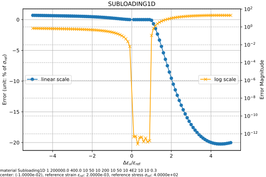

# Subloading1D

The Modified Extended Subloading Surface (Hashiguchi) Model

The subloading surface framework provides a very versatile approach to model cyclic behaviour.
It is highly recommended to try it out.

## References

The implementation is based on the following paper.

1. [10.1007/s00707-025-04339-0](https://doi.org/10.1007/s00707-025-04339-0)

Additional material on the same topic can be found in the following literature.

2. [10.1016/0020-7683(89)90038-3](https://doi.org/10.1016/0020-7683(89)90038-3)
3. [10.1007/978-3-030-93138-4](https://doi.org/10.1007/978-3-030-93138-4)
4. [10.1007/s11831-023-10022-1](https://doi.org/10.1007/s11831-023-10022-1)
5. [10.1007/s11831-022-09880-y](https://doi.org/10.1007/s11831-022-09880-y)

Prof. Koichi Hashiguchi has published a large number of papers on this topic.
To find more references, please refer to the monograph and the references therein.

Alternatively, refer to the corresponding section in [Constitutive Modelling Cookbook](https://github.com/TLCFEM/constitutive-modelling-cookbook/releases/download/latest/COOKBOOK.pdf) for implementation details.

## Theory

### Subloading Surface

The subloading surface is defined as

$$
f_s=|\eta|-z\sigma^y
$$

where $$\eta=\sigma-a^y\alpha+\left(z-1\right)\sigma^yd$$ is the shifted stress, shifted from the centre defined by $$a^y\alpha+\left(1-z\right)\sigma^yd$$.
The scalar $$0\leqslant{}z\leqslant{}1$$ is the normal yield ratio that provides a smooth transition from the interior to the normal yield surface.
The scalar $$\sigma^y$$ is the yield stress that is affected by isotropic hardening.

### Isotropic Hardening

The isotropic hardening combines linear hardening and exponential saturation.

$$
\sigma^y=\sigma^i+k_\text{iso}q+\sigma^s_\text{iso}\left(1-e^{-m^s_\text{iso}q}\right)
$$

where $$\sigma^i$$ is the initial yield stress, $$k_\text{iso}$$ is the linear hardening modulus, $$\sigma^s_\text{iso}$$ is the saturation stress and $$m^s_\text{iso}$$ is the hardening rate.

The history variable $$q$$ is the accumulated plastic strain; conventionally, it is

$$
\dot{q}=\gamma
$$

where $$\gamma$$ is the plasticity multiplier.

### Kinematic Hardening

A modified Armstrong--Frederick rule is adopted for the normalised back stress $$\alpha$$.

$$
\dot{\alpha}=b\gamma\left(n-\alpha\right)
$$

with

$$
a^y=a^i+k_\text{kin}q+a^s_\text{kin}\left(1-e^{-m^s_\text{kin}q}\right)
$$

where $$b$$ is the hardening rate.
Compared to the conventional AF rule, the saturation bound is not a constant in this model.
Instead, it is associated to plasticity.
The backbone $$a^y$$ mimics $$\sigma^y$$.
The parameters $$a^i$$, $$k_\text{kin}$$, $$a^s_\text{kin}$$ and $$m^s_\text{kin}$$ share similar implications compared to their counterparts.

### Evolution of $$z$$

The following rule is used.
Noting that the original formulation uses a cotangent function.
Here, the logarithmic function is used instead.
Also, the original formulation sets a minimum value for $$z$$ ($$R$$ in the references).
We do not adopt such a limit.

$$
\dot{z}=-u\ln\left(z\right)\gamma.
$$

Here, $$u$$ is a constant that controls the rate of transition.

!!! info "deviation from theory"
    Hashiguchi's original subloading surface model uses a cotangent function of the normal yield ratio.
    The logarithmic form above is a deliberate replacement used throughout this implementation.
    The original lower bound on the normal yield ratio is not imposed in the model.

!!! note "developer note"
    The logarithm is floored numerically in the code.

### Evolution of $$d$$

The evolution of $$d$$ resembles that of $$\alpha$$.

$$
\dot{d}=c_e\gamma\left(z_en-d\right)
$$

in which $$c_e$$ and $$z_e<1$$ are two constants.

### Numerical Solution

The implicit update solves for the plastic multiplier $$\gamma$$, the normal yield ratio $$z$$ and the viscous ratio $$z_v$$ simultaneously.
With the elastic predictor $$\sigma^\text{tr}=\sigma_n+E\Delta\varepsilon$$, the residual system is

$$
\begin{aligned}
R_1&=\left|\sigma^\text{tr}-En\gamma-a^y\sum_i\alpha_i+(z-1)\sigma^y\sum_jd_j\right|-z_v\sigma^y,\\
R_2&=z-z_\text{start}+u\ln(z)\gamma,\\
R_3&=z_v-\left[1+\dfrac{\mu}{\Delta t}\left(c_vz-z_v\right)\gamma\right]^{n_v}z.
\end{aligned}
$$

Here $$n=\operatorname{sign}(\cdot)$$ is the direction of the shifted stress evaluated at the trial state, $$r_i$$ and $$\bar\alpha_i$$ are the rate and bound of the $$i$$-th back-stress saturation, and $$s_j$$ and $$\bar d_j$$ are the rate and bound of the $$j$$-th elastic-core saturation.
These saturation bounds are distinct from the kinematic hardening rate $$b$$ and the elastic-core ratio $$z_e$$.
The plastic strain components are updated by backward Euler,

$$
\alpha_i=\dfrac{\alpha_i^n+r_i\bar\alpha_i n\gamma}{1+r_i\gamma},\qquad d_j=\dfrac{d_j^n+s_j\bar d_j n\gamma}{1+s_j\gamma}.
$$

In the rate-independent case $$z_v=z$$ and only the first two equations remain.
The accumulated plastic strain increments as $$q=q_n+\gamma$$ in one dimension, whereas the three-dimensional model uses $$\sqrt{2/3}\gamma$$.

!!! info "deviation from theory"
    The one-dimensional multiplier equals the increment of accumulated plastic strain because $$|\mathrm{d}\varepsilon^p|=\mathrm{d}\gamma$$ in uniaxial flow.
    The three-dimensional implementation uses the von Mises norm and therefore scales the multiplier by $$\sqrt{2/3}$$.
    Identical parameter sets do not give identical hardening rates in the two implementations unless this factor is accounted for.

The consistent tangent is obtained by statically condensing the $$z$$--$$z_v$$ block out of the Newton Jacobian, giving

$$
E^{ep}=E+\dfrac{E^2}{\det J}\det J_{zz}.
$$

A special check at the first iteration detects elastic unloading, in which case $$z$$ is reduced directly and no plastic flow is generated.
The logarithm in $$R_2$$ is replaced by a constant rate below $$z=10^{-15}$$ to avoid a singularity at zero.

!!! warning "implementation limitation"
    The initial saturation bounds are unity for the back stress and the supplied elastic-core ratio for the core when this token is used.

!!! note "developer note"
    The elastic-unloading detection at the first iteration uses a heuristic load factor computed from the committed stress and the trial stress.
    It is not a general consistency check and is specific to the one-dimensional update.

## Syntax

```text title="Subloading1D"
material Subloading1D (1) (2) (3) (4) (5) (6) (7) (8) (9) (10) (11) (12) (13) (14) [15]
# (1) int, unique material tag
# (2) double, elastic modulus
# (3) double, initial isotropic stress, \sigma^i>=0
# (4) double, linear isotropic hardening modulus, k_{iso}>=0
# (5) double, isotropic saturation stress, \sigma^s>=0
# (6) double, isotropic saturation rate, m^s_{iso}>=0
# (7) double, initial kinematic stress, a^i>=0
# (8) double, linear kinematic hardening modulus, k_{kin}>=0
# (9) double, kinematic saturation stress, a^s>=0
# (10) double, kinematic saturation rate, m^s_{kin}>=0
# (11) double, yield ratio evolution rate, u>=0
# (12) double, kinematic hardening rate, b>=0
# (13) double, elastic core evolution rate, c_e>=0
# (14) double, limit elastic core ratio, 1>z_e>=0
# [15] double, density, default: 0.0
```

## Remarks

All fourteen numerical inputs are optional in the parser and default to $$E=2\times10^5$$, $$\sigma^i=200$$, $$k_\text{iso}=0$$, $$\sigma^s=200$$, $$m^s=10$$, $$a^i=200$$, $$k_\text{kin}=0$$, $$a^s=200$$, $$m^s_\text{kin}=10$$, $$u=10$$, $$b=10$$, $$c_e=10$$ and $$z_e=0.7$$.
The isotropic and kinematic saturation rates must be non-negative, otherwise the parser rejects the definition.
The elastic-core bound is capped just below unity, so the elastic core never fully vanishes.
The normal yield ratio starts at unity and is clamped to $$[0,1]$$ during iteration.
A single back-stress saturation with unit bound and a single elastic-core saturation are installed by this token.
The implementation is rate independent unless viscosity parameters are supplied through the [`SubloadingViscous1D`](SubloadingViscous1D.md) token.
The history layout below assumes one back-stress and one elastic-core component; each additional saturation term in [`MultiSubloading1D`](MultiSubloading1D.md) appends one more slot.
The three-dimensional counterpart [`Subloading`](../../Material3D/vonMises/Subloading.md) uses the same framework with a von Mises norm and $$\sqrt{2/3}\gamma$$ as the plastic strain increment.

## Variants

`MultiSubloading1D` uses the same subloading backbone but replaces the single back-stress and elastic-core saturation terms with sums of user-defined exponential saturation terms.
It takes the first ten parameters above (through `u`), then a compulsory density, then any number of `-back (rate) (bound)` and `-core (rate) (bound)` groups; each pair adds one saturation term.
This gives finer control over cyclic hardening and softening.

`SubloadingViscous1D` adds rate dependence through a viscous normal yield ratio $$z_v$$ that is confined to $$z\leqslant z_v\leqslant c_v z$$.
After `u` it takes the viscous limit $$c_v$$, the viscosity $$\mu$$, the exponent $$n_v$$, then the back-saturation rate, the core-saturation rate and the core bound, plus an optional density.
Viscosity is active only when both $$\mu>0$$ and $$n_v>0$$; otherwise the response reduces to the rate-independent `Subloading1D`, and $$c_v$$ must be at least unity.

See [`MultiSubloading1D`](MultiSubloading1D.md) and [`SubloadingViscous1D`](SubloadingViscous1D.md) for full syntax.

## History Layout

| location             | parameter                         |
| -------------------- | --------------------------------- |
| `initial_history(0)` | iteration counter                 |
| `initial_history(1)` | accumulated plastic strain $$q$$  |
| `initial_history(2)` | normal yield ratio $$z$$          |
| `initial_history(3)` | normalised back stress $$\alpha$$ |
| `initial_history(4)` | normalised elastic core $$d$$     |

## Example

See [this](../../../../Example/Structural/Statics/calibration-subloading.md) example.

## Accuracy

```py
from plugins import ErrorLine
# note: the dependency `ErrorLine` can be found in the following link
# https://github.com/TLCFEM/suanPan-manual/blob/dev/plugins/scripts/ErrorLine.py

young_modulus = 2e5
yield_stress = 4e2
hardening_ratio = 0.01

with ErrorLine(
    f"""material Subloading1D 1 {young_modulus} \
{yield_stress} 10 50 10 \
200 10 50 10 \
4E2 10 10 0.3""",
    ref_strain=yield_stress / young_modulus,
    ref_stress=yield_stress,
) as error_map:
    error_map.contour("subloading", center=-5, size=5, type={"abs"})
```


