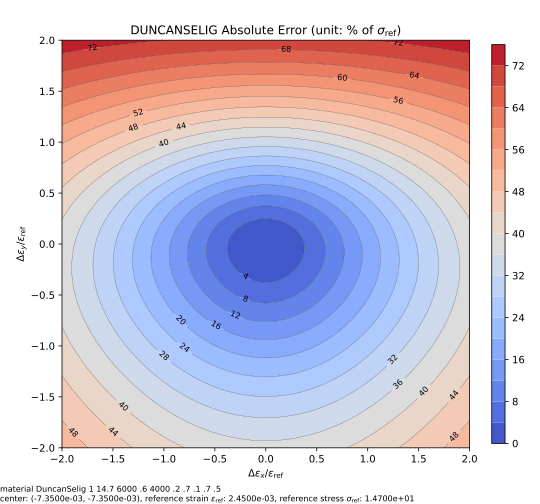
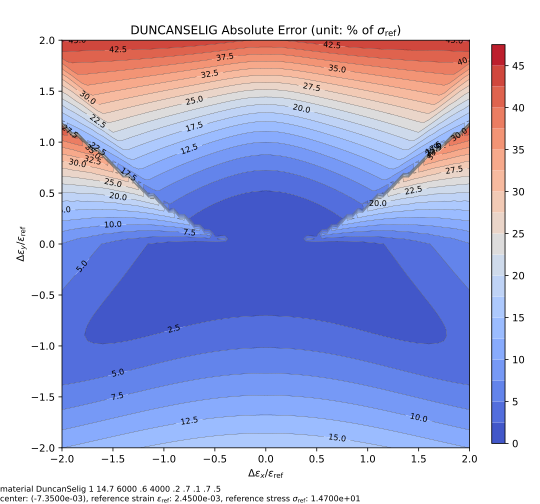
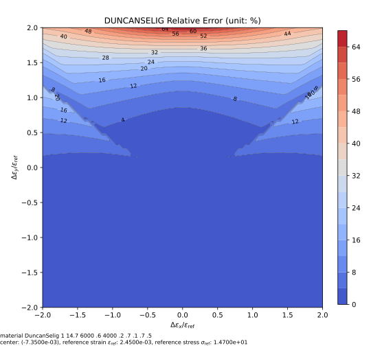

# DuncanSelig

Plane Strain Duncan-Selig Soil Model

## Background

The Duncan--Selig model is a nonlinear elastic, stress-dependent model assembled from the hyperbolic Young's modulus of Duncan and Chang and the stress-dependent bulk modulus of Selig.
It was developed for plane-strain earth structures and is intended for monotonic, quasi-static loading of soils.
It contains a Mohr--Coulomb-type strength limit but no plastic flow rule, so unloading and reloading are always elastic.
A drained triaxial compression curve is approximated by the hyperbola $\varepsilon_1=q/[E_i(1-q/q_u)]$, whose tangent modulus is $E_t=E_i(1-R_f S)^2$.
Here $S=q/q_f$ is the stress level, $q_f$ is the Mohr--Coulomb failure deviator stress and $R_f=q_f/q_u<1$ is the failure ratio.
The initial tangent modulus and the bulk modulus increase with the minor principal (confining) stress according to power laws, and the friction angle decreases linearly with $\log_{10}(\sigma_3/p_a)$.
The largest deviatoric stress ever reached is stored as a single history variable, and the initial (undegraded) modulus is used whenever the current deviatoric stress is below that value.
The stiffness is written in terms of $E$ and $B$ rather than $E$ and $\nu$, with $\nu=(3B-E)/(6B)$ and $G=3BE/(9B-E)$, which is why the bulk modulus must satisfy $B\geq E/3$.

!!! warning "implementation limitation"
    The model is incrementally nonlinear elastic and accumulates no plastic strain.
    The Mohr--Coulomb expression only caps the tangent modulus and does not define an associated yield surface or a flow rule.

## References

1. [10.3141/2511-07](https://doi.org/10.3141/2511-07)
2. [10.1061/JSFEAQ.0001458](https://doi.org/10.1061/JSFEAQ.0001458)
3. Strength, Stress-Strain and Bulk Modulus Parameters for Finite Element Analysis of Stresses and Movements in Soil Masses

## Syntax

```text title="DuncanSelig"
material DuncanSelig (1) (2) (3) (4) (5) (6) (7) (8) (9) (10) [11]
# (1) int, unique material tag
# (2) double, reference atmospheric pressure, positive, p_a
# (3) double, reference elastic modulus, E_r
# (4) double, elastic modulus exponent, n
# (5) double, reference bulk modulus, B_r
# (6) double, bulk modulus exponent, m
# (7) double, initial friction angle, \phi_i
# (8) double, friction angle slope, \Delta\phi
# (9) double, ratio of actual failure to ultimate failure, r_f
# (10) double, cohesion, c
# [11] double, density, default: 0.0
```

## Theory

The constitutive relationship can be expressed as

$$
\dot\sigma=\dfrac{3B}{9B-E}\begin{bmatrix}
3B+E&3B-E&0\\
3B-E&3B+E&0\\
0&0&E
\end{bmatrix}\dot\varepsilon.
$$

Note it is an incremental form of the constitutive relationship.
Symbols $$B$$ and $$E$$ denote bulk and elastic modulus, respectively.

The elastic modulus $$E$$ is a function of stress.

$$
E=E_i\left(1-\dfrac{\sigma_d}{\sigma_{d,max}}\right)^2,
$$

with

$$
E_i=E_r\left(\dfrac{\sigma_3}{p_a}\right)^n,\quad
\sigma_{d,max}=\dfrac{2}{r_f}\dfrac{c\cos\phi+\sigma_3\sin\phi}{1-\sin\phi}.
$$

The friction angle $$\phi$$ decreases with increasing $$\sigma_3$$.

$$
\phi=\phi_i-\Delta\psi\log_{10}\left(\dfrac{\sigma_3}{p_a}\right).
$$

The deviatoric stress $$\sigma_d$$ is the difference between the major and minor principal stresses.

$$
\sigma_d=\sigma_1-\sigma_3.
$$

The bulk modulus $$B$$ is a function of $$\sigma_3$$.

$$
B=B_r\left(\dfrac{\sigma_3}{p_a}\right)^m.
$$

### Sign convention and stress measures

Although suanPan uses tension-positive global stresses, this model works with compressive principal stress magnitudes.
The source forms the centre $-\tfrac12(\sigma_{11}+\sigma_{22})$ and the radius $\tfrac12\sqrt{(\sigma_{11}-\sigma_{22})^2+4\tau_{12}^2}$ of the in-plane Mohr circle, then takes $\sigma_1$ as the larger and $\sigma_3$ as the smaller magnitude.
The deviatoric stress used by the degradation law is $\sigma_d=\sigma_1-\sigma_3$, which is the diameter of that circle.

!!! info "deviation from theory"
    All moduli are evaluated from compressive principal stress magnitudes even though the global stress vector is tension-positive.
    A tensile stress state gives a negative $\sigma_3$, which is clamped to the low-confinement plateau instead of triggering a tensile failure check.

### Stress integration

The strain increment is first applied with the moduli evaluated at the current stress, and a local Newton iteration with backtracking solves the implicit relation between the stress increment and the strain increment.
If the resulting deviatoric stress exceeds the recorded maximum, the local iteration is repeated with the degraded loading moduli.
The consistent tangent is obtained from the same Jacobian, so it is the derivative of the converged stress with respect to the strain increment rather than a simple elastic stiffness.
In the source the degradation factor is floored at $0.1$, so the tangent modulus never drops below $10\%$ of the initial modulus, and the power laws are frozen at $\sigma_3/p_a\leq0.1$.

!!! info "deviation from theory"
    The constant plateau is entered when $\sigma_3/p_a\leq0.1$, which is stricter than the $\sigma_3<p_a$ statement in the regularization section below.
    The parabolic degradation factor is additionally truncated at $0.1$, so the tangent modulus retains at least $10\%$ of its initial value even beyond the Mohr--Coulomb limit.

## Remarks

* `(2)` $p_a$ is a reference pressure that only normalises stresses, while `(3)` $E_r$ and `(4)` $n$ set the initial stiffness and `(5)` $B_r$ and `(6)` $m$ set the volumetric stiffness.
* `(7)` $\phi_i$ and `(8)` $\Delta\phi$ are entered in radians, not degrees, so $40^\circ$ is entered as 0.698 and a ten-fold reduction of $6^\circ$ as 0.105.
* A typical failure ratio `(9)` $r_f$ is between 0.7 and 0.95, and values close to one make the hyperbolic asymptote approach the Mohr--Coulomb strength.
* The cohesion `(10)` $c$ and all moduli and $p_a$ must be supplied in the same stress units.
* The bulk modulus is raised to $E/3$ whenever $3B<E$ in the source, which keeps the implied Poisson ratio non-negative and the constitutive matrix invertible.
* The model has `PlaneType::E`, so use [CPE4](../../Element/Membrane/Plane/CP4.md) or [CPE8](../../Element/Membrane/Plane/CP8.md) type elements and not plane-stress elements.
* `HIST` contains one entry, the maximum deviatoric stress reached, and `YF` becomes one as soon as that entry is non-zero, so `YF` is not a true yield indicator for this model.
* Because no plastic strain is accumulated, the model cannot reproduce cyclic hysteresis, pore pressure generation or dilation; use [ExpCC](../Material3D/Clay/CamClay/ExpCC.md) with a [`PlaneStrain`](../Wrapper/PlaneStrain.md) wrapper for critical-state elastoplasticity.

!!! info "deviation from theory"
    The bulk modulus is overwritten by $E/3$ whenever $3B<E$, so $B_r$ and $m$ do not control the volumetric stiffness in that regime.
    The friction angle and its ten-fold decrement are interpreted in radians rather than degrees.

## Numerical Regularization

The model is intended for compressive stress states.
Two modifications keep the local iteration well-conditioned over a wide strain range.

1. The confining-stress dependent moduli use the constant plateau for all $$\sigma_3<p_a$$.
   There is no separate branch at $$\sigma_3=-p_a$$, which would otherwise introduce a large jump in the moduli.
2. The degradation factor is capped at a small positive residual value once $$\sigma_d\ge\sigma_{d,\max}$$.
   Without this cap, the parabolic factor increases again beyond failure, which can make the local Newton iteration oscillate between two modulus branches.

These modifications are required for the local iteration to converge over the full $$\pm2$$ reference-strain range used in the iso-error maps below.

## Iso-error Map

The following example iso-error maps are obtained via the script below.
The maps are centred at the undeformed state and cover $$\pm2$$ reference strains in both in-plane normal components, with zero shear strain.
The relative error is undefined at the origin because the reference stress vanishes there.

```py
from plugins import ErrorMap
# note: the dependency `ErrorMap` can be found in the following link
# https://github.com/TLCFEM/suanPan-manual/blob/dev/plugins/scripts/ErrorMap.py

young_modulus = 6000
ref_stress = 14.7

with ErrorMap(
    f"material DuncanSelig 1 {ref_stress} {young_modulus} .6 4000 .2 .7 .1 .7 .5",
    ref_strain=ref_stress / young_modulus,
    ref_stress=ref_stress,
    contour_samples=40,
    dimension=3,
) as error_map:
    error_map.contour(
        "duncan.selig.uniaxial.shear",
        center=(-3, 0),
        components=(0, 2),
        size=2,
        type=("abs", "rel"),
    )
    error_map.contour(
        "duncan.selig.uniaxial",
        center=(-3, 0),
        components=(0, 1),
        size=2,
        type=("abs", "rel"),
    )
    error_map.contour(
        "duncan.selig.biaxial",
        center=(-3, -3),
        components=(0, 2),
        size=2,
        type=("abs", "rel"),
    )
```







