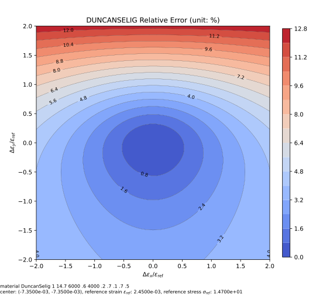
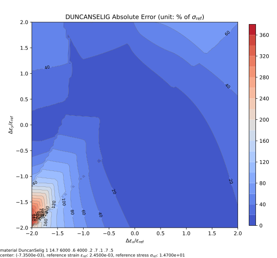
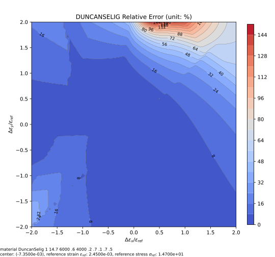

# DuncanSelig

Plane Strain Duncan-Selig Soil Model

## References

1. [10.3141/2511-07](https://doi.org/10.3141/2511-07)

## Syntax

```text title="DuncanSelig"
material DuncanSelig (1) (2) (3) (4) (5) (6) (7) (8) (9) (10) [11]
# (1) int, unique material tag
# (2) double, reference atmospheric pressure, positive, p_a
# (3) double, reference elastic modulus, E_r
# (4) double, elastic modulus exponent, n
# (5) double, reference bulk modulus, B_r
# (6) double, bulk modulus exponent, m
# (7) double, initial friction angle, \phi_i
# (8) double, friction angle slope, \Delta\phi
# (9) double, ratio of actual failure to ultimate failure, r_f
# (10) double, cohesion, c
# [11] double, density, default: 0.0
```

## Theory

The constitutive relationship can be expressed as

$$
\dot\sigma=\dfrac{3B}{9B-E}\begin{bmatrix}
3B+E&3B-E&0\\
3B-E&3B+E&0\\
0&0&E
\end{bmatrix}\dot\varepsilon.
$$

Note it is an incremental form of the constitutive relationship.
Symbols $$B$$ and $$E$$ denote bulk and elastic modulus, respectively.

The elastic modulus $$E$$ is a function of stress.

$$
E=E_i\left(1-\dfrac{\sigma_d}{\sigma_{d,max}}\right)^2,
$$

with

$$
E_i=E_r\left(\dfrac{\sigma_3}{p_a}\right)^n,\quad
\sigma_{d,max}=\dfrac{2}{r_f}\dfrac{c\cos\phi+\sigma_3\sin\phi}{1-\sin\phi}.
$$

The friction angle $$\phi$$ decreases with increasing $$\sigma_3$$.

$$
\phi=\phi_i-\Delta\psi\log_{10}\left(\dfrac{\sigma_3}{p_a}\right).
$$

The deviatoric stress $$\sigma_d$$ is the difference between the major and minor principal stresses.

$$
\sigma_d=\sigma_1-\sigma_3.
$$

The bulk modulus $$B$$ is a function of $$\sigma_3$$.

$$
B=B_r\left(\dfrac{\sigma_3}{p_a}\right)^m.
$$

## Numerical Regularization

The model is intended for compressive stress states. Two modifications keep the
local iteration well-conditioned over a wide strain range.

1. The confining-stress dependent moduli use the constant plateau for all
   $$\sigma_3<p_a$$. There is no separate branch at $$\sigma_3=-p_a$$, which
   would otherwise introduce a large jump in the moduli.
2. The degradation factor is capped at a small positive residual value once
   $$\sigma_d\ge\sigma_{d,\max}$$. Without this cap, the parabolic factor
   increases again beyond failure, which can make the local Newton iteration
   oscillate between two modulus branches.

These modifications are required for the local iteration to converge over the
full $$\pm2$$ reference-strain range used in the iso-error maps below.

## Iso-error Map

The following example iso-error maps are obtained via the following script.
The maps are centred at the undeformed state and cover $$\pm2$$ reference
strains in both in-plane normal components, with zero shear strain. The
relative error is undefined at the origin because the reference stress
vanishes there.

```py
from plugins import ErrorMap
# note: the dependency `ErrorMap` can be found in the following link
# https://github.com/TLCFEM/suanPan-manual/blob/dev/plugins/scripts/ErrorMap.py

young_modulus = 6000
ref_stress = 14.7

with ErrorMap(
    f"material DuncanSelig 1 {ref_stress} {young_modulus} .6 4000 .2 .7 .1 .7 .5",
    ref_strain=ref_stress / young_modulus,
    ref_stress=ref_stress,
    contour_samples=40,
    dimension=3,
) as error_map:
    error_map.contour(
        "duncan.selig.uniaxial.shear",
        center=(-3, 0),
        components=(0, 2),
        size=2,
        type=("abs", "rel"),
    )
    error_map.contour(
        "duncan.selig.uniaxial",
        center=(-3, 0),
        components=(0, 1),
        size=2,
        type=("abs", "rel"),
    )
    error_map.contour(
        "duncan.selig.biaxial",
        center=(-3, -3),
        components=(0, 2),
        size=2,
        type=("abs", "rel"),
    )
```









