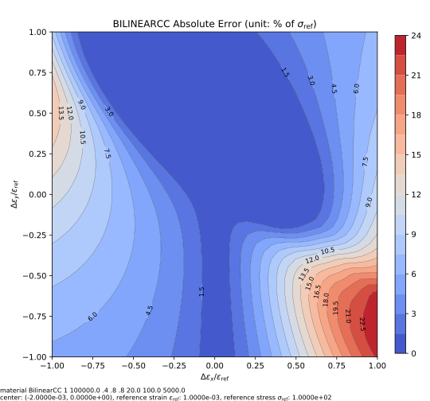
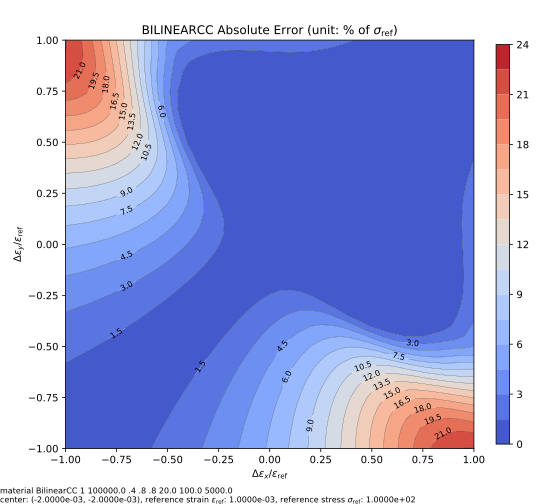

# BilinearCC

Bilinear Hardening Modified Cam-Clay Model

## Background

`BilinearCC` is a variant of [`NonlinearCamClay`](NonlinearCamClay.md) and shares its yield surface, associative flow rule and return-mapping algorithm.
Only the hardening law is replaced, so all of the critical-state concepts of the canonical page apply here.
The hardening parameter $a$ controls the size of the yield ellipse and equals half the compressive preconsolidation pressure when $p_t=0$ and $\beta=1$.

## Theory

This model defines a bilinear hardening rule for $$a(\alpha)$$, which is a non-negative function.

$$
a(\alpha)=a_0+H\alpha\ge0,
$$

in which $$H$$ is the hardening modulus; note that $$\alpha=\varepsilon_p=\varepsilon_1+\varepsilon_2+\varepsilon_3$$ is the volumetric plastic strain.

The hardening modulus could be either positive or negative.

**This hardening rule does not imply any physical soil behavior.**

### Implementation of the hardening law

The source evaluates $a(\alpha)=\max(0,a_0+H\alpha)$, so the yield surface can never become negative even when softening is requested.
For $H>0$ the linear branch is truncated at $\alpha=-a_0/H$, and for $H<0$ it is truncated at $\alpha=a_0/|H|$, beyond which both $a$ and $\mathrm da/\mathrm d\alpha$ are zero.
Both the function and its derivative are passed to the local Newton iteration, so the truncation point is a kink at which differentiability is lost.

!!! info "deviation from theory"
    Physical soil hardens in compression, but $\alpha$ is negative in compression, so a positive $H$ makes the yield surface shrink.
    To obtain compression hardening the user must supply a negative slope, which is the opposite of the usual soil-mechanics convention.

## Syntax

```text title="BilinearCC"
material BilinearCC (1) (2) (3) (4) (5) (6) (7) (8) [9]
# (1) int, unique material tag
# (2) double, elastic modulus
# (3) double, Poisson's ratio
# (4) double, beta, controls compression side shape
# (5) double, m, slope of CSL
# (6) double, p_t, initial tension strength
# (7) double, a_0, initial a_0
# (8) double, H, slope of hardening function
# [9] double, density, default: 0.0
```

## Remarks

* The first six arguments are the elastic modulus, Poisson's ratio, $\beta$, $M$, $p_t$ and $a_0$ as defined on the [`NonlinearCamClay`](NonlinearCamClay.md) page.
* Because suanPan's volumetric plastic strain is negative in compression, a positive $H$ makes the yield surface shrink during compression, whereas a negative $H$ makes it grow.
* The slope $H$ has units of stress per unit volumetric strain, and $a_0$ has units of stress.
* Setting $\beta=1$ gives a single ellipse, while $\beta<1$ reduces the radius of the compressive half of the yield surface.
* Use `set symm_mat 0` because the consistent tangent is not generally symmetric, as in the shipped Cam-Clay examples.
* This hardening law is a convenient numerical test case but does not reproduce the logarithmic compression of real soil, for which [`ExpCC`](ExpCC.md) is appropriate.

## References

1. On the Generalised Stress-Strain Behaviour of 'Wet' Clay
2. [ISBN 978-0-641-94048-4](https://search.worldcat.org/search?q=bn:9780641940484)
3. [ISBN 978-1-932159-75-2](https://search.worldcat.org/search?q=bn:9781932159752)

## Iso-error Map

The following example iso-error maps are obtained via the following script.

```py
from plugins import ErrorMap
# note: the dependency `ErrorMap` can be found in the following link
# https://github.com/TLCFEM/suanPan-manual/blob/dev/plugins/scripts/ErrorMap.py

young_modulus = 1e5
yield_stress = 100.0
hardening_ratio = 0.05

with ErrorMap(
    f"material BilinearCC 1 {young_modulus} .4 .8 .8 {0.2 * yield_stress} {yield_stress} {hardening_ratio * young_modulus}",
    ref_strain=yield_stress / young_modulus,
    ref_stress=yield_stress,
    contour_samples=20,
) as error_map:
    error_map.contour("cam.clay.uniaxial", center=(-2, 0), size=1)
    error_map.contour("cam.clay.biaxial", center=(-2, -2), size=1)
```



