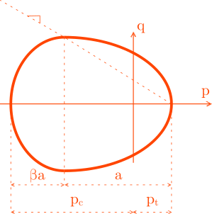

# NonlinearCamClay

Modified Cam-Clay Model

The `NonlinearCamClay` class defines a basic framework using modified Cam-Clay yield surface and associative flow rule.
Theories can be seen in Chapter 10 in [Computational Methods for Plasticity: Theory and Application](https://doi.org/10.1002/9780470694626), in which there are some minor errors in the derivation of consistent stiffness.

## Background

Modified Cam-Clay is an elastoplastic critical-state model for saturated clays formulated in effective stresses.
The critical state is the asymptotic state reached under continued shear, where the soil deforms at constant effective mean stress $$p'$$, constant deviatoric stress $$q$$ and constant specific volume $$v$$.
The locus of such states is the critical state line, given by $$q=M p'$$ and $$v=\Gamma-\lambda\ln p'$$, and its slope $$M$$ is related to the triaxial compression friction angle by $$M=6\sin\phi'/(3-\sin\phi')$$.
The virgin consolidation line and the unloading-reloading line in the $$v$$--$$\ln p'$$ plane have slopes $$-\lambda$$ and $$-\kappa$$, respectively, with $$\lambda>\kappa>0$$.
The overconsolidation ratio $$OCR=p'_c/p'$$ measures how far the current mean stress lies from the preconsolidation pressure $$p'_c$$.
A normally consolidated soil has $$OCR=1$$ and starts on the wet side of critical, while an overconsolidated soil starts on the dry side and may soften during shearing.
Hardening is driven solely by plastic volumetric strain, so compression grows the yield surface and dilation shrinks it.
The original Cam-Clay of Schofield and Wroth uses a logarithmic spiral yield locus, whereas the modified Cam-Clay of Roscoe and Burland replaces it by an ellipse that is far more convenient for numerical integration.

!!! warning "implementation limitation"
    Classical Cam-Clay uses stress-dependent porous elasticity with logarithmic volumetric compression, but this class uses constant isotropic elasticity from an elastic modulus and a Poisson's ratio.
    The swelling and virgin compression lines of the $$v$$--$$\ln p'$$ plot are therefore not reproduced by the elastic part of the model.
    No pore pressure or effective-stress calculation is performed, so the stresses must already be interpreted as effective stresses.

This model resembles the one in ABAQUS but the third stress invariant does not enter yield surface.
As a result, the yield surface on the $$\pi$$-plane is a circle.

Interested readers can also refer to the corresponding section in [Constitutive Modelling Cookbook](https://github.com/TLCFEM/constitutive-modelling-cookbook/releases/download/latest/COOKBOOK.pdf) for more details.

The following function is chosen as the yield surface.

$$
F(\sigma,a)=\dfrac{(p-p_t+a)^2}{b^2}+\dfrac{q^2}{M^2}-a^2
$$

where $$p(\sigma)=\dfrac{1}{3}(\sigma_1+\sigma_2+\sigma_3)$$ is the hydrostatic pressure, $$q^2(\sigma)=\dfrac{3}{2}s:s$$ with $$s$$ denoting the deviatoric stress, $$a(\alpha)$$ is a hardening function in terms of internal hardening variable $$\alpha$$ that is defined as volumetric plastic strain, that is $$\alpha=\varepsilon_v^p$$.
$$b=1$$ when $$p-p_t+a\ge0$$ and $$b=\beta$$ when $$p-p_t+a<0$$.
This $$\beta$$ parameter changes the radius of the second half of this ellipse on the compressive side of the hydrostatic axis.
The constant $$M$$ modifies the radius of the ellipse along the $$q$$ axis.

The same function is used for plasticity potential so that $$G=F$$ and

$$
\dot{\varepsilon_p}=\dot{\gamma}\dfrac{\partial{}G}{\partial\sigma}=\dot{\gamma}(\dfrac{3}{M^2}s+\dfrac{2(p-p_t+a)
}{3b^2}I)
$$

where $$I=[1~1~1~0~0~0]^\mathrm{T}$$ is the second order unit tensor.

The `NonlinearCamClay` class allows $$a(\alpha)$$ to be user defined, where $$\alpha$$ is the volumetric plastic strain.

$$
\alpha=\int\dot{\varepsilon}_v^p\mathrm{d}t.
$$

Please note in practical applications, this value is negative as soil is often in compression.

### Return mapping and consistent tangent

The elastic predictor is $$\mathbf\sigma^{\mathrm{tr}}=\mathbf\sigma_n+\mathbf D^e\Delta\mathbf\varepsilon$$, where $$\mathbf D^e$$ is the constant isotropic stiffness built from the elastic modulus and Poisson's ratio.
The two local unknowns of the backward-Euler update are the plastic multiplier $$\gamma$$ and the change of the volumetric plastic strain, $$\alpha-\alpha_n$$.
The first residual enforces the yield condition at the end of the step and the second one enforces the flow rule for the volumetric component, $$\alpha-\alpha_n=2\gamma(p-p_t+a)/b^2$$.
Since suanPan uses tension-positive stresses, a compressive mean stress is negative and the resulting increment of $$\alpha$$ is negative, consistent with soil compaction.

!!! info "deviation from theory"
    Soil mechanics normally takes compression as positive and defines the hardening variable from the compressive volumetric plastic strain.
    This implementation records the tension-positive logarithmic volumetric plastic strain, so $$\alpha$$ is negative for the compaction that grows the yield surface.
The two residual equations are solved by Newton iteration with equilibration, and the stress is pulled back by $$\mathbf\sigma=\mathbf\sigma^{\mathrm{tr}}-\gamma\,\partial G/\partial\mathbf\sigma$$ at convergence.
The returned `trial_stiffness` is the consistent tangent obtained by linearising the converged local equations, not the elastic or the continuum elastoplastic stiffness.
The state at critical has $$p-p_t+a=0$$ and $$q=Ma$$, where the associative flow rule gives zero plastic volumetric strain.
The parameter $$\beta$$ gives a different ellipse radius on the compressive side of the critical state line, with $$b=1$$ when $$p-p_t+a\geq0$$ and $$b=\beta$$ otherwise, producing the two-arc surface used in the Abaqus critical-state model.
The third stress invariant does not enter the yield function, so the yield surface is a surface of revolution about the hydrostatic axis and its $$\pi$$-plane section is a circle.

!!! info "deviation from theory"
    The third stress invariant is absent, so the model has no Lode-angle dependence and predicts the same critical stress ratio in triaxial compression and extension.
    The Abaqus critical-state model instead includes a shape parameter that can make the $$\pi$$-plane section non-circular.

## Remarks

* The input elastic modulus and Poisson's ratio define constant isotropic elasticity, not the logarithmic porous elasticity of classical Cam-Clay, so the bulk modulus does not increase with compression.
* suanPan reports $$p$$ as tension-positive, so the soil-mechanics effective mean stress is $$p'=-p$$ and the compressive preconsolidation pressure magnitude is $$p_c=a(1+b)-p_t$$, which reduces to $$2a-p_t$$ when $$b=1$$.
* A tensile intercept $$p_t>0$$ gives the ellipse a finite extent in hydrostatic tension, but soils cannot sustain such tension, so $$p_t=0$$ is the usual choice.
* The slope $$M$$ of the critical state line sets the ultimate stress ratio, and $$M=1$$ corresponds to a friction angle of about $$25^\circ$$ in triaxial compression.
* The hardening variable is the volumetric plastic strain $$\alpha$$, stored in `initial_history(0)`, and it is negative for the compression that dominates soil response.
* The source derives `compute_a` and `compute_da` from each subclass, so the hardening curve must be smooth enough for the local Newton iteration and must remain non-negative.
* Because the consistent tangent is generally non-symmetric for this formulation, the shipped examples use `set symm_mat 0` to avoid enforcing symmetry in the global solver.
* Use three-dimensional solid elements such as [C3D8](../../../../Element/Cube/C3D8.md), or embed the model in a plane analysis with the [`PlaneStrain`](../../../Wrapper/PlaneStrain.md) wrapper.
* Large strain increments can make the local Newton iteration, which is limited to 20 iterations, fail, so use small steps or automatic substepping.
* See [`BilinearCC`](BilinearCC.md), [`ParabolicCC`](ParabolicCC.md), [`ExpCC`](ExpCC.md) and [`CustomCC`](CustomCC.md) for the available hardening laws.

!!! warning "implementation limitation"
    Abaqus repositions the initial yield surface so that a prescribed initial stress lies on it, but this class performs no such adjustment.
    The initial stress and the initial value of $$a$$ must be chosen consistently by the user before the first load step.

## References

1. On the Generalised Stress-Strain Behaviour of 'Wet' Clay
2. [ISBN 978-0-641-94048-4](https://search.worldcat.org/search?q=bn:9780641940484)
3. [ISBN 978-0-521-33782-3](https://search.worldcat.org/search?q=bn:9780521337823)
4. [ISBN 978-1-932159-75-2](https://search.worldcat.org/search?q=bn:9781932159752)

## History Layout

| location             | parameter                  |
|----------------------|----------------------------|
| `initial_history(0)` | accumulated plastic strain |

!!! info "deviation from theory"
    The stored variable is the volumetric plastic strain only, not a scalar measure of accumulated deviatoric plastic strain.
    Its magnitude grows with compression and can decrease when the soil dilates on the dry side of critical.

## Variants

The `CustomCC` token subclasses `NonlinearCamClay` and supplies the hardening function $$a(\alpha)$$ and its derivative from a user-defined scalar [Expression](../../../../../Collection/Define/expression.md).
It takes the elastic modulus, Poisson's ratio, $$\beta$$, $$M$$ and $$p_t$$ as above, then an expression tag and an optional density.
The expression must be univariate (one input, one output) and must be able to compute derivatives; its input is the volumetric plastic strain $$\alpha$$.
See [`CustomCC`](CustomCC.md) for the exact syntax.
