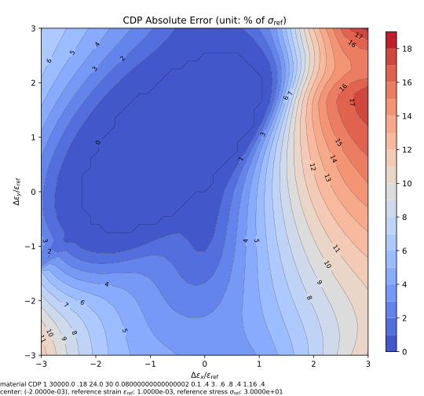
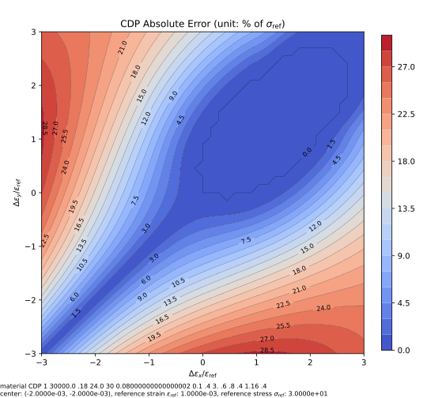

# CDP

Concrete Damage Plasticity Model

## References

1. [10.1061/(ASCE)0733-9399(1998)124:8(892)](https://doi.org/10.1061/(ASCE)0733-9399(1998)124:8(892))
2. [10.1002/(SICI)1096-9845(199809)27:9<937::AID-EQE764>3.0.CO;2-5](https://doi.org/10.1002/(SICI)1096-9845(199809)27:9%3C937::AID-EQE764%3E3.0.CO;2-5)
3. [10.1002/1097-0207(20010120)50:2<487::AID-NME44>3.0.CO;2-N](https://doi.org/10.1002/1097-0207(20010120)50:2%3C487::AID-NME44%3E3.0.CO;2-N)
4. [10.1016/0020-7683(89)90050-4](https://doi.org/10.1016/0020-7683(89)90050-4)
5. [10.1016/j.acme.2019.07.003](https://doi.org/10.1016/j.acme.2019.07.003)
6. Mechanics of thermo-elastic-plastic materials with a thermoelastic-plastic change in volume
7. [10.1016/j.ijsolstr.2006.06.032](https://doi.org/10.1016/j.ijsolstr.2006.06.032)
8. Behavior of concrete under biaxial stresses

!!! warning "automatic regularization"
    The `CDP` model automatically regularizes the input arguments to avoid ill-shaped backbones.
    This may not always be desirable.
    If it is not possible to obtain the desired backbone, use [`TableCDP`](TableCDP.md) instead.

## Outline

The CDP model supports stiffness degradation.
The backbone envelopes are defined as exponential functions in terms of plastic strain [4].
Apart from the listed references, readers can also refer to the corresponding section in [Constitutive Modelling Cookbook](https://github.com/TLCFEM/constitutive-modelling-cookbook/releases/download/latest/COOKBOOK.pdf).

The following shows the backbone of effective stress and the corresponding damage variable as functions of $$\kappa$$.

<iframe src="https://www.desmos.com/calculator/5qxxcya0jt?embed" width="800" height="400" style="border: 1px solid #ccc" frameborder=0></iframe>

## Background

The model is a rate-independent plastic-damage formulation for quasi-brittle materials such as concrete.
It combines a pressure-dependent yield surface with nonassociated plastic flow and two scalar damage variables that degrade the elastic stiffness.
The formulation follows Lubliner et al. [4] and the cyclic-loading modification of Lee and Fenves [1], and the return mapping is taken from [3].

### Effective stress and damage

The total strain is split into elastic and plastic parts,

$$
\mathbf\varepsilon=\mathbf\varepsilon^e+\mathbf\varepsilon^p,\qquad
\bar{\mathbf\sigma}=\mathbf D_0:\mathbf\varepsilon^e=\mathbf D_0:(\mathbf\varepsilon-\mathbf\varepsilon^p),
$$

where $$\mathbf D_0$$ is the initial isotropic elastic stiffness and $$\bar{\mathbf\sigma}$$ is the effective stress carried by the undamaged material.
The nominal stress is the effective stress degraded by the tensile and compressive damage indices $$d_t$$ and $$d_c$$.
The implementation uses the Lee--Fenves crack-closing form detailed below, so that a reversal into compression can partially restore the stiffness lost by tensile cracking.

### Yield function

The yield function is the Lubliner criterion with the Lee--Fenves correction for independent tension and compression strengths,

$$
F=\alpha I_1+\sqrt{3J_2}-\left(1-\alpha\right)\bar\sigma_c+\beta\left\langle\bar\sigma_{\max}\right\rangle-\zeta\left\langle-\bar\sigma_{\max}\right\rangle,
$$

where $$I_1=\mathrm{tr}\,\bar{\mathbf\sigma}$$ is the first stress invariant, $$\bar{\mathbf s}=\bar{\mathbf\sigma}-I_1\mathbf I/3$$ is the deviatoric stress, $$J_2=\frac12\bar{\mathbf s}:\bar{\mathbf s}$$, and $$\bar\sigma_{\max}$$ is the algebraically largest principal value of $$\bar{\mathbf\sigma}$$.
The Macaulay bracket is $$\left\langle x\right\rangle=\max(0,x)$$, so the $$\beta$$ term is active in tension and the $$\zeta$$ term in triaxial compression.
Here $$\bar\sigma_t$$ and $$\bar\sigma_c$$ denote the positive effective tensile and compressive cohesion magnitudes, obtained from the uniaxial backbones divided by $$1-d_t$$ and $$1-d_c$$.

The two shape coefficients are

$$
\alpha=\dfrac{\sigma_{b0}/\sigma_{c0}-1}{2\sigma_{b0}/\sigma_{c0}-1},\qquad
\beta=(1-\alpha)\dfrac{\bar\sigma_c}{\bar\sigma_t}-(1+\alpha),\qquad
\zeta=\dfrac{3(1-K_c)}{2K_c-1}.
$$

The input biaxial compression ratio (8) is $$\sigma_{b0}/\sigma_{c0}$$, and $$\alpha$$ is computed in the constructor as $$(\text{ratio}-1)/(2\text{ratio}-1)$$.
The parameter $$K_c$$ is the ratio of the second deviatoric invariant on the tensile meridian to that on the compressive meridian; this model fixes $$K_c=1$$, giving $$\zeta=0$$, and only [`AbaqusCDP`](AbaqusCDP.md) exposes $$K_c$$ as an input.
The first invariant is taken with the tension-positive convention used throughout suanPan.

!!! info "deviation from theory"
    The standard Lee--Fenves yield function retains the $$K_c$$ term for triaxial compression.
    This model fixes $$K_c=1$$, so $$\zeta=0$$ and the deviatoric section is circular.
    The effect of the tensile-to-compressive meridian ratio is available only in [`AbaqusCDP`](AbaqusCDP.md).

### Flow rule and dilatancy

Plastic flow is nonassociated and governed by a linear Drucker--Prager potential,

$$
G=\left\|\bar{\mathbf s}\right\|+\alpha_p I_1,\qquad
\Delta\mathbf\varepsilon^p=\lambda\left(\dfrac{\bar{\mathbf s}}{\left\|\bar{\mathbf s}\right\|}+\alpha_p\mathbf I\right).
$$

The parameter $$\alpha_p$$ is the dilatancy parameter (12) and equals $$\tan\psi$$, where $$\psi$$ is the dilation angle measured in the pressure--shear plane.
The volumetric plastic increment is $$\Delta\varepsilon_v^p=3\lambda\alpha_p$$, so positive $$\alpha_p$$ produces dilation under shear.
The potential is a cone with a singular apex; unlike the Abaqus hyperbolic potential it has no eccentricity parameter.

!!! info "deviation from theory"
    The Abaqus implementation adopts a smooth hyperbolic Drucker--Prager potential with an eccentricity parameter that removes the apex singularity.
    This implementation instead uses the linear cone potential shown above, so the flow direction is not unique at the hydrostatic axis.
    The parameter $$\alpha_p$$ is used directly as the slope of that cone, not as the dilation angle of the hyperbolic potential.

### Backbones and damage evolution

Both uniaxial backbones use the exponential form derived in [4],

$$
\sigma(\kappa)=\sigma_0\,s(\kappa)\,b(\kappa),\qquad
s(\kappa)=\sqrt{1+a(a+2)\kappa},\qquad
b(\kappa)=\dfrac{1+a-s(\kappa)}{a},
$$

with $$a=a_t$$ in tension and $$a=a_c$$ in compression.
In tension $$\sigma_0=f_t$$ and the response softens monotonically for $$a_t<1$$.
In compression the input crush stress is rescaled to the peak value $$\sigma_0=-|f_c|\,4a_c/(1+a_c)^2$$, and $$a_c>1$$ gives initial hardening followed by softening.
The damage index follows $$d=1-b^{c_b}$$, and the effective stress is $$\bar\sigma=\sigma/(1-d)$$.
The exponent $$c_b$$ is solved from the requested degradation ratios (10) and (11), namely the stiffness remaining at half the crack stress and at the compressive peak.

The internal variable $$\kappa$$ is the plastic energy normalised by the fracture energy per unit crack-band area, $$g_t=G_F/l_c$$ in tension and its compressive analogue $$g_c$$.
This normalisation is what makes the softening response objective with respect to the element size when the crack band is resolved.

### Stiffness recovery

A stress-state factor based on the principal effective stresses is defined as

$$
r=\dfrac12\left(1+\dfrac{\sum_i\bar\sigma_i}{\sum_i\left|\bar\sigma_i\right|}\right),
$$

which is zero for purely compressive states and one for purely tensile states.
The recovered tensile damage factor uses

$$
s(r)=s_0+r(1-s_0),\qquad
\mathbf\sigma=\left[1-s(r)d_t\right]\left[1-d_c\right]\bar{\mathbf\sigma},
$$

where $$s_0$$ is the stiffness recovery factor (14).
Compression damage is never recovered in this implementation, and the damage factors are multiplied by $$0.999$$ internally to avoid a singular fully degraded tangent.

!!! info "deviation from theory"
    Lee and Fenves use two independent recovery parameters, one for tension and one for compression.
    This implementation exposes only one factor $$s_0$$, and the recovery factor multiplies the tensile damage index alone.

!!! note "developer note"
    Both damage indices are scaled by $$0.999$$ so that the tangent never vanishes completely.

The classes [`TableCDP`](TableCDP.md) and [`CustomCDP`](CustomCDP.md) share this return mapping and only replace the backbone functions, while [`CDPM2`](CDPM2.md) uses a different two-surface plasticity formulation.

## Syntax

```text title="CDP"
material CDP (1) (2) (3) (4) (5) (6) (7) (8) (9) (10) (11) (12) (13) (14) [15]
# (1) int, unique tag
# (2) double, elastic modulus
# (3) double, Poisson's ratio
# (4) double, crack stress f_t
# (5) double, crush stress f_c
# (6) double, normalized crack energy g_t
# (7) double, normalized crush energy g_c
# (8) double, initial tension hardening a_t<1
# (9) double, initial compression hardening a_c>1
# (10) double, ratio between degraded stiffness at half crack stress over initial stiffness, 1-d_t
# (11) double, ratio between degraded stiffness at crush stress over initial stiffness, 1-d_c
# (12) double, dilatancy parameter, alpha_p
# (13) double, biaxial compression ratio
# (14) double, initial stiffness recovery factor
# [15] double, density, default: 2400E-12
```

## Remarks

1. Poisson's ratio shall be smaller than $$0.5$$, a typical value for concrete is around $$0.2$$.
2. Crack stress shall be greater than zero while crush stress shall be smaller than zero.
   But the program automatically sets the signs for both stresses.
3. Normalized crack energy $$g_t=G_F/l_c$$ equals the first mode crack energy $$G_F$$ over the characteristic length $$l_c$$.
   For SI (millimeter) unit system, typical values are of order $$10^{-3}$$.
   The compression conjugate $$g_c$$ is typically greater than $$g_t$$ by the order of $$10^2$$.
4. Hardening parameters control tension degradation slope and compression hardening shape.
   Values $$a_t\approx0.5$$ and $$a_c\approx2$$ to $$a_c\approx5$$ give good results.
5. Dilatancy parameter can be set to $$0.2$$.
   Comparisons can be seen in Lee's doctoral dissertation.
6. Biaxial compression ratio is defined as the ratio between biaxial and uniaxial compression strengths.
   According to Kupfer et al. (1969), a value of $$1.16$$ is recommended.
7. Initial stiffness recovery factor controls the amount of stiffness recovery when loading direction changes.
8. Theoretically, $$g_t$$ and $$g_c$$ shall be scaled according to the size of mesh grid.
   Practically, they cannot be arbitrarily small due to numerical stability issues, meaning that the mesh grid cannot be arbitrarily large.

The dilatancy parameter is associated with an internal angle,

$$
\alpha_p=\tan\left(\psi\right)
$$

where $$\psi$$ ranges from five to fifty/sixty degrees.
According to [10.1016/j.acme.2019.07.003](https://doi.org/10.1016/j.acme.2019.07.003), it is recommended that $$\psi\leqslant35\text{\textdegree}$$, but other work may adopt $$\psi\approx40\text{\textdegree}$$ for reinforced concrete.
All in all, a reasonable value shall fall between $$0<\alpha_p<1$$.

The parameter `(10)` represents the ratio of unloading stiffness at half crack stress to initial stiffness.
Evaluated on the softening branch, an estimated baseline value around $$0.5$$ corresponds to negligible plastic strain accumulation.
Values between $$0.6$$ and $$0.8$$ (or higher) reflect reduced damage and greater plasticity, whereas smaller values risk non-physical negative plasticity development.

Similarly, parameter `(11)` denotes the ratio of unloading stiffness at ultimate compressive (peak) stress to initial stiffness.
This value shall be close to unity as the peak is often not too far away from the elastic branch.
Smaller values likewise risk non-physical negative plasticity development.

!!! info "robustness"
    To avoid numerical robustness issues, it is recommended to impose the following constraints.

    $$
    1-d_t<\dfrac{1+a_t-\sqrt{1+a_t^2}}{2a_t},\qquad
    1-d_c<\dfrac{a_c+1}{2a_c}
    $$

!!! warning "trade-off"
    If $$g_c$$ and/or $$g_t$$ is too small, it may be impossible to obtain a response that is both physically valid and numerically robust.

!!! warning "maximum element size"
    Based on physical material limits, finite element dimensions for typical concrete cannot exceed half a meter (plain) to one meter (reinforced) if **strict** energy scaling is considered.
    The numbers are only indicative.

### Implementation and calibration notes

- The parser defaults are $$E=3\times10^4$$, $$\nu=0.2$$, $$f_t=3$$, $$f_c=30$$, $$g_t=5\times10^{-4}$$, $$g_c=5\times10^{-2}$$, $$a_t=0.2$$, $$a_c=2$$, $$1-d_t=0.5$$, $$1-d_c=0.65$$, $$\alpha_p=0.2$$, $$\sigma_{b0}/\sigma_{c0}=1.16$$, $$s_0=0.5$$ and density $$2400\times10^{-12}$$; the class-header defaults are different and are not used by the `material` command.
- Poisson's ratio is clamped to $$0.2$$ if it is not smaller than $$0.5$$, and the elastic modulus, energies and dilatancy parameter are converted to absolute values in the constructor.
- The crush stress argument (5) is a positive magnitude on input but is stored as a negative peak stress internally, consistent with the tension-positive sign convention.
- The Lubliner coefficient $$\alpha$$ is derived from argument (13) as $$(\text{ratio}-1)/(2\text{ratio}-1)$$, while $$\zeta$$ is fixed to zero; use [`AbaqusCDP`](AbaqusCDP.md) if the $$K_c$$ meridian ratio must be specified.
- A dilatancy parameter above unity corresponds to a dilation angle above $$45\text{\textdegree}$$, which is unusual for concrete and triggers a debug warning.
- The local return mapping uses a Newton loop with a Ridders bisection fallback and a tolerance of $$10^{-13}$$; convergence failure is reported rather than silently accepted.
- The tensile and compressive damage variables are multiplied by $$0.999$$ so that a fully damaged state is never exactly reached and the consistent tangent remains invertible.
- Stiffness recovery $$s_0$$ affects only the tensile damage factor; compressive damage is not recovered after load reversal.
- For tabulated experimental backbones use [`TableCDP`](TableCDP.md), for expression-defined backbones use [`CustomCDP`](CustomCDP.md), and for a two-surface model with independent tension and compression damage use [`CDPM2`](CDPM2.md).
- The material is intended for solid elements such as `C3D8`; reinforced concrete can be assembled by stacking it with [`Rebar3D`](Rebar3D.md) through [`Stacked`](../../Wrapper/Stacked.md).
- Reinforced or confined members often need a dilation angle near the lower end of the recommended range, since a high value overpredicts the confinement benefit.

## History Layout

| location               | parameter      |
| ---------------------- | -------------- |
| `initial_history(0)`   | $$d_t$$        |
| `initial_history(1)`   | $$d_c$$        |
| `initial_history(2)`   | $$\kappa_t$$   |
| `initial_history(3)`   | $$\kappa_c$$   |
| `initial_history(4-9)` | plastic strain |

## Recording

This model supports the following additional history variables to be recorded.

| variable label | physical meaning   |
| -------------- | ------------------ |
| DT             | tensile damage     |
| DC             | compressive damage |

## Iso-error Map

The following example iso-error maps are obtained via the following script.
The parameters are chosen in such a way that tension and compression are more or less balanced.
They do not reflect parameters for real concrete.

```py
from plugins import ErrorMap
# note: the dependency `ErrorMap` can be found in the following link
# https://github.com/TLCFEM/suanPan-manual/blob/dev/plugins/scripts/ErrorMap.py

young_modulus = 3e4
yield_stress = 30
energy = 1e-1

with ErrorMap(
    f"material CDP 1 {young_modulus} .18 {0.8 * yield_stress} {yield_stress} {0.8 * energy} {energy} .4 3. .6 .8 .4 1.16 .4",
    ref_strain=yield_stress / young_modulus,
    ref_stress=yield_stress,
    contour_samples=20,
    tmp_dir=(Path(__file__).parent / "tmp").as_posix(),
) as error_map:
    error_map.contour("cdp.uniaxial", center=(-2, 0), size=3)
    error_map.contour("cdp.biaxial", center=(-2, -2), size=3)
```



