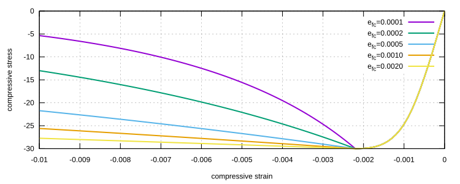
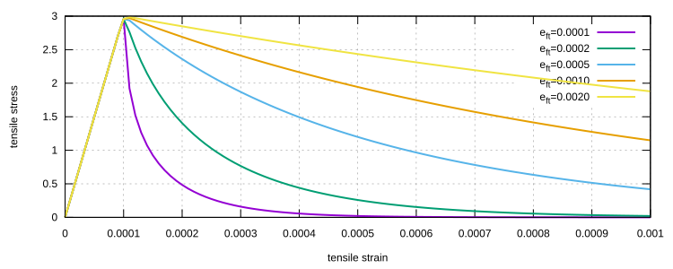
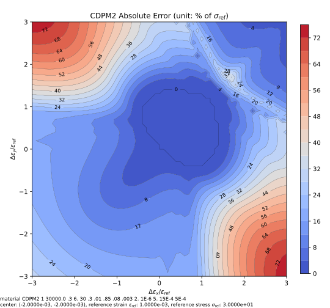

# CDPM2

CDPM2 Model for Concrete Material

## References

1. [10.1016/j.ijsolstr.2013.07.008](https://doi.org/10.1016/j.ijsolstr.2013.07.008)
2. [10.1016/j.ijsolstr.2005.05.038](https://doi.org/10.1016/j.ijsolstr.2005.05.038)
3. Grassl, P. and Jirasek, M. (2006) Damage-plastic model for concrete failure, International Journal of Solids and Structures, 43(22--23), 7166--7196, [10.1016/j.ijsolstr.2006.06.032](https://doi.org/10.1016/j.ijsolstr.2006.06.032).
4. Menetrey, P. and Willam, K. J. (1995) A triaxial failure criterion for concrete and its generalization, ACI Structural Journal, 92(3), 311--318.

## Background

CDPM2 is a damage-plasticity model for concrete that uses an effective-stress plasticity formulation with a two-surface yield criterion and two independent damage variables.
It extends the CDPM model of Grassl and Jirasek with a second hardening function, so that hardening continues after damage has been initiated, and with separate tensile and compressive damage.
The complete derivation is given in [1]; the implementation is also documented in the Constitutive Modelling Cookbook linked in the Remarks.

### Effective stress and yield surface

The elastic response is computed from the effective stress $\bar{\boldsymbol\sigma}=\boldsymbol D_e:(\boldsymbol\varepsilon-\boldsymbol\varepsilon^p)$, and the nominal stress is obtained by the degradation rules given in the Examples section below.
The yield surface is written in Haigh--Westergaard coordinates, namely the volumetric stress $\sigma_V=I_1/3$, the deviatoric norm $\rho=\sqrt{2J_2}$ and the Lode angle $\theta$,

$$
f_p=\left\{\left[1-q_{h1}\right]\left(\dfrac{\rho}{\sqrt{6}f_c}+\dfrac{\sigma_V}{f_c}\right)^2+\sqrt{\dfrac32}\dfrac{\rho}{f_c}\right\}^2
+m_0q_{h1}^2q_{h2}\left[\dfrac{\rho}{\sqrt{6}f_c}r(\cos\theta)+\dfrac{\sigma_V}{f_c}\right]-q_{h1}^2q_{h2}^2.
$$

The function $r(\cos\theta)$ is the Willam--Warnke shape function that interpolates the deviatoric section between a triangle at low confinement and a circle at high confinement; its eccentricity $e$ is computed internally from $f_t$, $f_c$ and the biaxial ratio $1.16$.
The friction parameter is

$$
m_0=3\left(\dfrac{f_c}{f_t}-\dfrac{f_t}{f_c}\right)\dfrac{e}{1+e}.
$$

!!! info "deviation from theory"
    The published model treats the Willam--Warnke eccentricity as an independent calibration parameter.
    The implementation derives it internally from $f_t$, $f_c$ and a fixed biaxial compression ratio of $1.16$, so it cannot be set independently.
    The friction parameter $m_0$ is likewise computed rather than supplied.

The two dimensionless hardening functions $q_{h1}(\kappa_p)$ and $q_{h2}(\kappa_p)$ control the size of the loading surface and the ratio between the tensile and compressive strengths.
For $q_{h2}=1$ the formulation reduces to the single-surface CDPM model.
The hardening variable $\kappa_p$ grows with the norm of the plastic strain divided by a ductility measure $x_h(\sigma_V)$, which gives greater strain capacity under confined compression than under tension.

### Damage

Damage is driven by equivalent strains that depend on the effective stress and on a split between tensile and compressive loading.
Two exponential softening laws, governed by $e_{ft}$ and $e_{fc}$, map the damage history variables to $\omega_t$ and $\omega_c$.
These reference strains control the slope of the softening branch and are the parameters through which the element size can be accounted for.
The isotropic variant degrades the whole effective stress by $(1-\omega_t)(1-\omega_c)$, whereas the anisotropic variant degrades the positive and negative spectral parts separately.

!!! warning "implementation limitation"
    Damage is skipped entirely while both damage history variables remain below the threshold $\varepsilon_0=f_t/E$, and the `CDPM2NO` token disables damage for the whole analysis.
    The default `CDPM2` token selects isotropic damage even though the class member initialises to anisotropic, so `CDPM2ANISO` must be requested explicitly.

## Syntax

```text title="CDPM2"
material CDPM2 (1) [2-16]
material CDPM2ISO (1) [2-16]
material CDPM2ANISO (1) [2-16]
material CDPM2NO (1) [2-16]
# (1) int, unique material tag
# [2] double, elastic modulus, default: 3E4
# [3] double, Poisson's ratio, default: 0.3
# [4] double, tension strength (positive), default: 3.0
# [5] double, compression strength (positive), default: 30.0
# [6] double, q_h0, initial hardening factor, default: 0.3
# [7] double, h_p hardening ratio, default: .01
# [8] double, d_f, default: .85
# [9] double, a_h, hardening related parameter, default: 0.08
# [10] double, b_h, hardening related parameter, default: 0.003
# [11] double, c_h, hardening related parameter, default: 2.0
# [12] double, d_h, hardening related parameter, default: 1E-6
# [13] double, a_s, ductility related parameter, default: 5.0
# [14] double, e_ft, tension softening parameter, default: 5E-4
# [15] double, e_fc, compression softening parameter, default: 5E-4
# [16] double, density, default: 0.0
```

## Remarks

1. The isotropic damage is implemented.
2. The anisotropic damage is implemented.
3. For detailed explanations of parameters, please refer to [10.1016/j.ijsolstr.2013.07.008](https://doi.org/10.1016/j.ijsolstr.2013.07.008).
4. The default `CDPM2` uses isotropic damage, which is equivalent to `CDPM2ISO`.
5. The token `CDPM2ANISO` uses anisotropic damage.
6. If damage is activated, both tension and compression use the exponential damage model; the degradation is controlled by parameters [14] and [15].
   The characteristic length can be accounted for by modifying them.
7. The token `CDPM2NO` disables damage entirely: it selects the `NODAMAGE` damage type, for which the damage computation is skipped and the response reduces to the plasticity part with no stiffness or strength degradation.
   It takes the same 16 arguments as `CDPM2` and is useful as a damage-free reference or when degradation is not wanted.

### Implementation and calibration notes

- The parser validates the initial hardening ratio $q_{h0}$ to be in $[0,1]$ and requires the hardening ratio $h_p$ to satisfy $h_p<1-q_{h0}$.
- The default strengths are $f_t=3$ and $f_c=30$, and the biaxial compression ratio used to derive the Willam--Warnke eccentricity is fixed at $1.16$.
- The parameters $q_{h0}$ and $h_p$ control the evolution of the two yield surfaces; $a_h$, $b_h$, $c_h$ and $d_h$ define the ductility measure that scales the hardening rate with confinement.
- The parameter $a_s$ controls the shear-related ductility of the compressive damage evolution.
- Unlike [`CDP`](CDP.md), the strengths here are entered as positive magnitudes and the model uses a Lode-angle-dependent surface rather than the Lubliner cone.
- The material is intended for solid elements such as `C3D8`; combine it with [`Rebar3D`](Rebar3D.md) through [`Stacked`](../../Wrapper/Stacked.md) for reinforced concrete.

Details of implementation can be seen in the corresponding section in [Constitutive Modelling Cookbook](https://github.com/TLCFEM/constitutive-modelling-cookbook/releases/download/latest/COOKBOOK.pdf).

!!! warning "maximum element size"
    Based on physical material limits, finite element dimensions for typical concrete cannot exceed half a meter (plain) to one meter (reinforced) if **strict** energy scaling is considered.
    The numbers are only indicative.

## Recording

This model supports the following additional history variables to be recorded.

| variable label | physical meaning              |
|----------------|-------------------------------|
| DT             | tensile damage                |
| DC             | compressive damage            |

## Examples

The isotropic damage uses the following expression for the final stress $$\mathbf{\sigma}$$,

$$
\mathbf{\sigma}=(1-\omega_c)(1-\omega_t)\mathbf{\bar{\sigma}}.
$$

The anisotropic damage uses the following expression,

$$
\mathbf{\sigma}=(1-\omega_c)\mathbf{\bar{\sigma}}_c+(1-\omega_t)\mathbf{\bar{\sigma}}_t.
$$

In the above expressions, $$\mathbf{\bar{\sigma}}$$ is the effective stress (undamaged), $$\mathbf{\bar{\sigma}}_c$$ and $$\mathbf{\bar{\sigma}}_t$$ are compressive and tensile parts of the effective stress.
They are computed via eigen decomposition of the effective stress tensor.
$$\omega_c$$ and $$\omega_t$$ are the compressive and tensile damage variables, respectively.

Both damage types have physical implications.
Depending on the damage type, the model parameters may be adjusted differently.

The reference strains $$e_{ft}$$ and $$e_{fc}$$ affect the degradation of strength.

The following are two examples, using different values of $$e_{ft}$$ and $$e_{fc}$$, while all other parameters are the default values.





## Iso-error Map

The following example iso-error maps are obtained via the following script.

```py
from plugins import ErrorMap
# note: the dependency `ErrorMap` can be found in the following link
# https://github.com/TLCFEM/suanPan-manual/blob/dev/plugins/scripts/ErrorMap.py

young_modulus = 3e4
yield_stress = 30

with ErrorMap(
    f"material CDPM2 1 {young_modulus} .3 6. {yield_stress} .3 .01 .85 .08 .003 2. 1E-6 5. 15E-4 5E-4",
    ref_strain=yield_stress / young_modulus,
    ref_stress=yield_stress,
    contour_samples=30,
) as error_map:
    error_map.contour("cdpm2.uniaxial", center=(-2, -2), size=3)
    error_map.contour("cdpm2.biaxial", center=(-2, 0), size=3)
```



