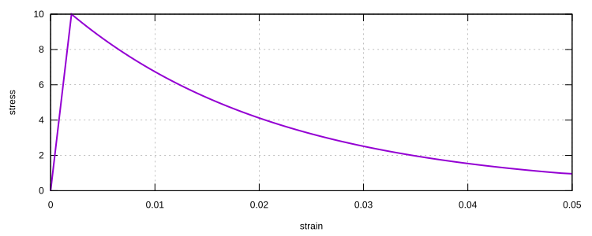
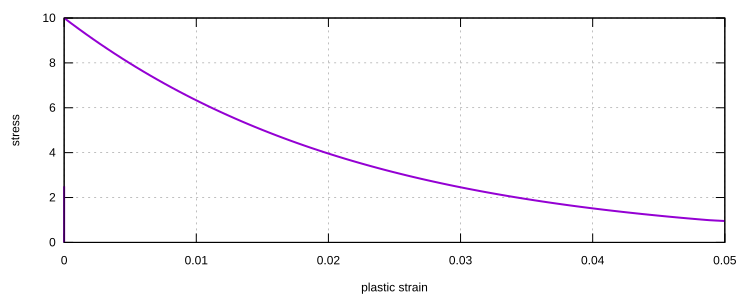
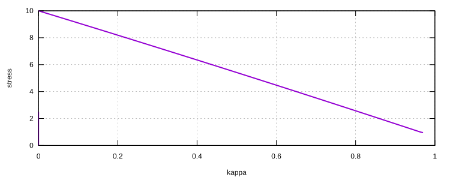

# CustomCDP

The CDP Model With Custom Backbones

The formulation is identical to that of the `CDP` model.

The user should provide the backbones and damage evolutions via expressions.

## Background

This class inherits the return mapping, yield function, flow rule and stiffness-recovery treatment of [`CDP`](CDP.md).
Only the uniaxial tension and compression backbones are supplied by the user instead of the built-in exponential functions, so the theory of the base model applies unchanged and is not repeated here.

At each local iteration the solver passes the internal variable $$\kappa$$, the damage index $$d$$, the nominal stress $$f=(1-d)\bar f$$ and the effective stress $$\bar f=f/(1-d)$$ between the expressions and the plasticity algorithm.
The tension expression must return a positive nominal stress and the compression expression a negative one; the implementation flips the sign of the returned stresses and their derivatives if necessary.
Each expression is a function of a single argument $$\kappa\in[0,1]$$ and must return six components,

$$
\left[d,\;f,\;\bar f,\;\dfrac{\mathrm{d}d}{\mathrm{d}\kappa},\;\dfrac{\mathrm{d}f}{\mathrm{d}\kappa},\;\dfrac{\mathrm{d}\bar f}{\mathrm{d}\kappa}\right],
$$

because the Newton iteration uses the analytical derivatives of the backbone.
The normalised energies (6) and (7) are required to convert the accumulated plastic work into $$\kappa=\kappa_\aleph$$ and must be of the order of the area under the stress--plastic-strain curve.
See the [`CDP`](CDP.md) page for the yield function, the Lubliner coefficient, the dilatancy parameter and the stiffness-recovery factor.

!!! info "deviation from theory"
    The sign of the returned stress is overridden by the implementation rather than being checked by the user.
    The tension expression is forced to return a positive nominal and effective stress and the compression expression a negative one, together with the corresponding derivatives.
    This variant also inherits the fixed $$K_c=1$$ and the linear Drucker--Prager potential of [`CDP`](CDP.md).

## Syntax

```text title="CustomCDP"
material CustomCDP (1) (2) (3) (4) (5) (6) (7) [8] [9] [10] [11]
# (1) int, unique material tag
# (2) int, tension expression tag
# (3) int, compression expression tag
# (4) double, elastic modulus
# (5) double, Poisson's ratio
# (6) double, normalized crack energy (+)
# (7) double, normalized crush energy (+)
# [8] double, dilatancy parameter, default: 0.2
# [9] double, biaxial compression strength ratio, default: 1.16
# [10] double, stiffness recovery ratio, default: 0.5
# [11] double, density, default: 2400e-12
```

## Restrictions

1. The expressions should take one input argument, the damage variable, $$\kappa$$.
   The $$\kappa$$ is different from the degradation denoted as $$d$$.
   The output should have a size of six.
2. The normalized energy should be provided, which is used to generate objective results.
   It is typically around the size of the area under the curve.
3. The output consists of six components, which are explained in the following.

The expression shall generate six numbers based on the input $$\kappa$$:

| Index |         Symbol         | Description                    |
|:-----:|:----------------------:|:-------------------------------|
|   1   |         $$d$$          | damage degradation index       |
|   2   |         $$f$$          | final stress: $$(1-d)\bar{f}$$ |
|   3   |      $$\bar{f}$$       | effective stress $$f/(1-d)$$   |
|   4   |    $$\mathrm{d}~d$$    | derivative of $$d$$            |
|   5   |    $$\mathrm{d}~f$$    | derivative of $$f$$            |
|   6   | $$\mathrm{d}~\bar{f}$$ | derivative of $$\bar{f}$$      |

The $$\kappa$$ ranges from 0 to 1.

The damage degradation index $$d$$ shall satisfy: $$d(0)=0$$ and $$d(1)=1$$.

The $$f$$ is the actual stress observed as the final output of the model.

By following these imposed rules, users can implement any custom backbone and damage evolution.

Further explanation of the curves can be seen in [10.1061/(ASCE)0733-9399(1998)124:8(892)](https://doi.org/10.1061/(ASCE)0733-9399(1998)124:8(892)).

## Example

For the purpose of illustration, we provide a simple example, which may not be applicable to real concrete behaviour.

For example, let the damage degradation be a linear function of $$\kappa$$, that is

$$
d(\kappa)=\kappa,
$$

so that $$d(0)=0$$ and $$d(1)=1$$.

Assume the effective stress is a constant, say $$\bar{f}=10$$.
The stress is then

$$
f=\bar{f}(1-d)=10(1-\kappa).
$$

One can define an expression as follows:

```text
expression SimpleVector 1 x y|6 example
```

where $$x$$ maps to $$\kappa$$ and $$y$$ maps to the six components of the output.

The text file `example` contains the following:

```text
y[0]:=x;
y[1]:=10*(1-x);
y[2]:=10;
y[3]:=1;
y[4]:=-10;
y[5]:=0;
```

Then it can be used in a `CustomCDP` material model such that:

```text
# A TEST MODEL FOR CUSTOMCDP MATERIAL

node 1 5 -5 0
node 2 5 5 0
node 3 -5 5 0
node 4 -5 -5 0
node 5 5 -5 10
node 6 5 5 10
node 7 -5 5 10
node 8 -5 -5 10
node 9 5 -5 20
node 10 5 5 20
node 11 -5 5 20
node 12 -5 -5 20

expression SimpleVector 1 x y|6 example

material CustomCDP 1 1 1 5000 .2 2E-1 2E-1 .23 1.16 .4 2400E-12

element C3D8 1 1 2 3 4 5 6 7 8 1 G
element C3D8 2 5 6 7 8 9 10 11 12 1 G

hdf5recorder 1 Element E33 1
hdf5recorder 2 Element S33 1
hdf5recorder 3 Element DT 1

fix 1 1 1 2 5 6 9 10
fix 2 2 1 4 5 8 9 12
fix 3 3 1 2 3 4

displacement 1 0 1 3 9 10 11 12

step static 1
set fixed_step_size 1
set ini_step_size 1E-2
set symm_mat 0

converger RelIncreDisp 1 1E-9 10 1

analyze

save recorder 1 2 3

exit
```

One can plot the strain-stress curve.



The plastic strain can be computed as

$$
\varepsilon_p=\varepsilon-\frac{\sigma}{E}
$$

The curve can be plotted as



The $$\kappa$$ is the accumulated area under the plastic strain-stress curve over the given $$g$$, in this example, $$g=0.2$$.

$$
\kappa=\dfrac{1}{g}\int_0^{\varepsilon_p^*}\sigma{}d\varepsilon_p
$$

The $$\kappa$$-$$\sigma$$ curve can be processed as



## Remarks

- The parser defaults are $$E=3\times10^4$$, $$\nu=0.2$$, $$g_t=5\times10^{-4}$$, $$g_c=5\times10^{-2}$$, $$\alpha_p=0.2$$, $$\sigma_{b0}/\sigma_{c0}=1.16$$, $$w=0.5$$ and density $$2400\times10^{-12}$$.
- The expression tags are read as integer arguments before the numeric parameters, and initialization fails if either expression is missing or is not a map from one input to six outputs.
- Derivatives must be consistent with the returned values; the local Newton iteration uses them and may fail to converge if they are inconsistent.
- This variant fixes $$K_c=1$$ and therefore has $$\zeta=0$$, so the yield surface is circular in the deviatoric plane; use [`AbaqusCDP`](AbaqusCDP.md) if $$K_c$$ must be specified.
- For tabulated data use [`TableCDP`](TableCDP.md) instead, and for the built-in exponential backbones use [`CDP`](CDP.md).

## References

1. [10.1061/(ASCE)0733-9399(1998)124:8(892)](https://doi.org/10.1061/(ASCE)0733-9399(1998)124:8(892))
2. [10.1016/0020-7683(89)90050-4](https://doi.org/10.1016/0020-7683(89)90050-4)
