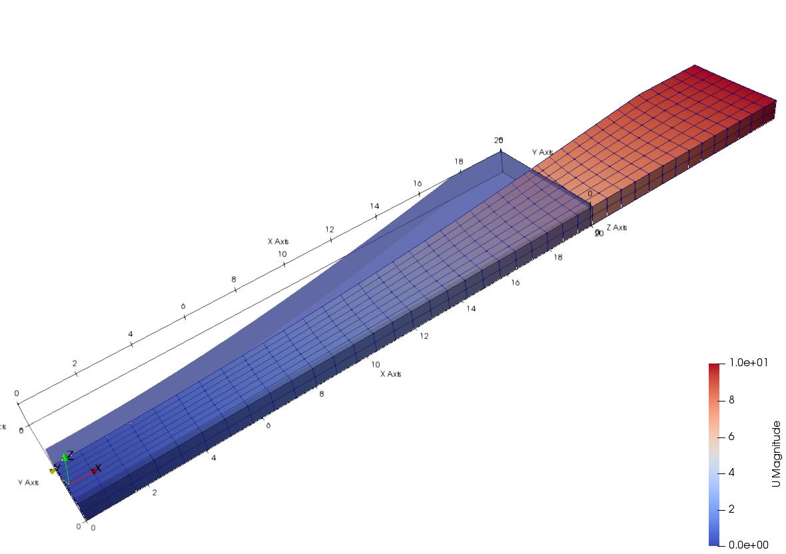

# MooneyRivlin

Mooney-Rivlin Rubber Material

The regularized Mooney-Rivlin material for compressible rubbers uses the following expression to measure strain energy.

$$
W=A_{10}(J_1-3)+A_{01}(J_2-3)+\dfrac{K}{2}(J_3-1)^2,
$$

where $$A_{10}$$ and $$A_{01}$$ are two material constants and $$K$$ is the bulk modulus.

## Background

For an isotropic material the elastic response is separated into distortional and volumetric parts using the reduced invariants of the right Cauchy-Green tensor $$\mathbf C=\mathbf F^\mathrm T\mathbf F$$.
With $$I_1=\mathrm{tr}\,\mathbf C$$, $$I_2=\tfrac12(I_1^2-\mathrm{tr}\,\mathbf C^2)$$ and $$J=\sqrt{I_3}$$, the reduced invariants are $$J_1=I_1J^{-2/3}$$ and $$J_2=I_2J^{-4/3}$$.
The model above is the two-term reduced-polynomial form with a quadratic volumetric penalty.
The initial shear modulus is $$\mu_0=2(A_{10}+A_{01})$$ and the initial bulk modulus is $$K$$.
Setting $$A_{01}=0$$ gives the compressible neo-Hookean model.

!!! info "deviation from theory"
    The classical Mooney-Rivlin model is incompressible and is written with the unreduced invariants $$I_1$$ and $$I_2$$.
    This implementation uses the reduced invariants $$J_1$$ and $$J_2$$ plus a quadratic volumetric penalty, so it is a regularised compressible variant.

The second Piola-Kirchhoff stress follows from $$\mathbf S=2\partial W/\partial\mathbf C$$ and the implementation supplies the consistent tangent obtained by differentiating the stress.
The material is intended for large deformations of compressible rubber-like solids and requires the nonlinear geometry switch in the host element.

## References

1. [10.1007/978-1-4419-1746-1](https://doi.org/10.1007/978-1-4419-1746-1)
2. [10.1063/1.1712836](https://doi.org/10.1063/1.1712836)
3. [10.1098/rsta.1948.0024](https://doi.org/10.1098/rsta.1948.0024)

## Syntax

```text title="MooneyRivlin"
material MooneyRivlin (1) (2) (3) (4) [5]
# (1) int, unique tag
# (2) double, bulk modulus
# (3) double, A_{10}
# (4) double, A_{01}
# [5] double, density, default: 0.0
```

## Remarks

1. Nonlinear geometry switch shall be turned on in related elements.
2. The model takes the Green strain as input.
   To implement any elements that incorporate this material model, the Green strain in Voigt notation shall be passed as strain input.
3. The three material parameters are replaced by their absolute values, so only positive $$K$$, $$A_{10}$$ and $$A_{01}$$ can be entered.

!!! warning "implementation limitation"
    Negative coefficients, sometimes used to fit rubber data, cannot be supplied because all three parameters are replaced by their absolute values.

4. The third invariant is floored at machine epsilon to avoid a singularity when the volume ratio vanishes.

!!! warning "implementation limitation"
    Flooring $$I_3$$ at machine epsilon modifies the potential and its derivatives near $$J=0$$.
    The exact hyperelastic response is not recovered for vanishing volume ratio.

5. The parameter `K` controls compressibility while $$A_{10}$$ and $$A_{01}$$ control the distortional response, and the initial shear modulus is $$2(A_{10}+A_{01})$$.
6. For strain stiffening at larger deformations use [`Yeoh`](Yeoh.md), which adds higher-order terms in the first reduced invariant.

## Usage


