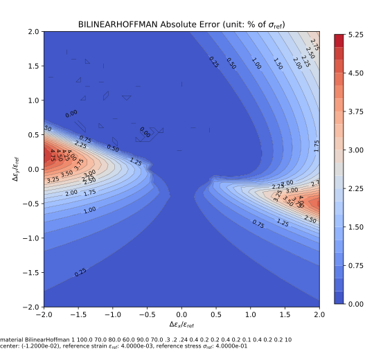
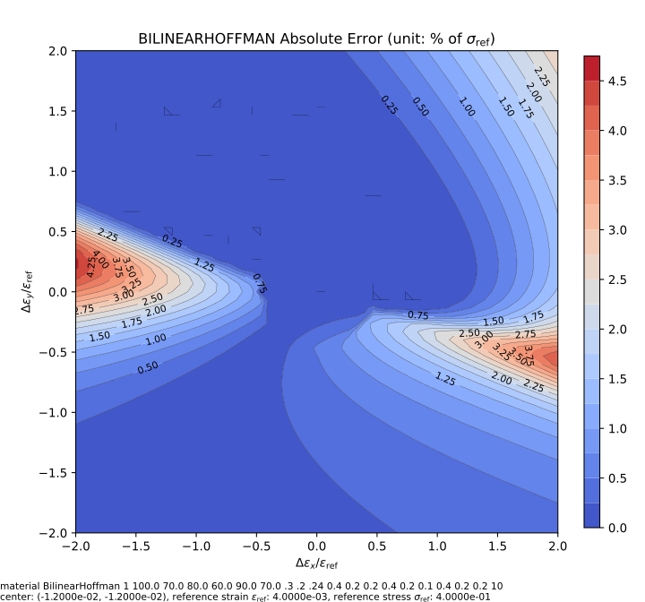
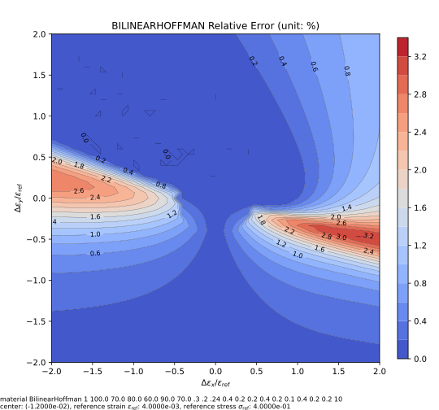
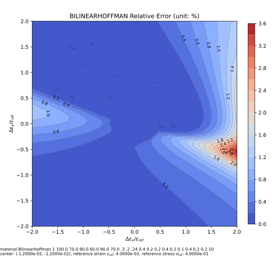

# BilinearHoffman

Bilinear Hardening Hoffman Model

## Background

This model uses the orthotropic elastic stiffness of [`OrthotropicElastic3D`](../Elastic/OrthotropicElastic3D.md) and associative plasticity with the Hoffman yield criterion.
The full yield function, the nine strength parameters and the return mapping are derived in [`ExpHoffman`](ExpHoffman.md).
The only difference is the isotropic hardening law, which is piecewise linear in the equivalent plastic strain.

## Theory

The hardening function is $$K(\bar\varepsilon_p)=1+H\bar\varepsilon_p$$, where $$H$$ is the hardening ratio supplied as `(20)`.
For $$H>0$$ the yield surface grows linearly, $$H=0$$ gives perfect plasticity and $$H<0$$ gives linear softening.

!!! warning "implementation limitation"
    For negative `H` the hardening function is clamped to zero once $$\bar\varepsilon_p$$ exceeds $$-1/H$$.
    The surface cannot shrink below zero size, so the softening branch ends abruptly.

## Syntax

```text title="BilinearHoffman"
material BilinearHoffman (1) (2...7) (8...10) (11...19) [20] [21]
# (1) int, unique material tag
# (2...7) double, six moduli: E_{xx}, E_{yy}, E_{zz}, G_{xy}, G_{yz}, G_{zx}
# (8...10) double, three Poisson's ratios: v_{xy}, v_{yz}, v_{xz}
# (11...19) double, nine yield stresses
# [20] double, hardening ratio, default: 0.0
# [21] double, density, default: 0.0
```

## Iso-error Map

The following example iso-error maps are obtained via the following script.

```py
from plugins import ErrorMap
# note: the dependency `ErrorMap` can be found in the following link
# https://github.com/TLCFEM/suanPan-manual/blob/dev/plugins/scripts/ErrorMap.py

modulus = 1e2
yield_stress = 0.4

with ErrorMap(
    f"material BilinearHoffman 1 {modulus} {0.7 * modulus} {0.8 * modulus} {0.6 * modulus} {0.9 * modulus} {0.7 * modulus} .3 .2 .24 {yield_stress} {0.5 * yield_stress} {0.5 * yield_stress} {yield_stress} {0.5 * yield_stress} {0.25 * yield_stress} {yield_stress} {0.5 * yield_stress} {0.5 * yield_stress} 10",
    ref_strain=yield_stress / modulus,
    ref_stress=yield_stress,
    contour_samples=30,
) as error_map:
    error_map.contour(
        "bilinear.hoffman.uniaxial", center=(-3, 0), size=2, type={"rel", "abs"}
    )
    error_map.contour(
        "bilinear.hoffman.biaxial", center=(-3, -3), size=2, type={"rel", "abs"}
    )
```






## Remarks

The nine yield stresses are ordered as $$\sigma_{11}^t,\sigma_{11}^c,\sigma_{22}^t,\sigma_{22}^c,\sigma_{33}^t,\sigma_{33}^c,\sigma_{12}^0,\sigma_{23}^0,\sigma_{13}^0$$.
The six moduli are ordered as $$E_1,E_2,E_3,G_{12},G_{23},G_{13}$$ and the three Poisson's ratios as $$\nu_{12},\nu_{23},\nu_{13}$$.
No input is converted to absolute value, so positive elastic and strength parameters must be supplied.
Use [`Rotation3D`](../../Wrapper/Rotation3D.md) to align the material axes with a rotated layup.

## References

1. [10.1177/002199836700100210](https://doi.org/10.1177/002199836700100210)
