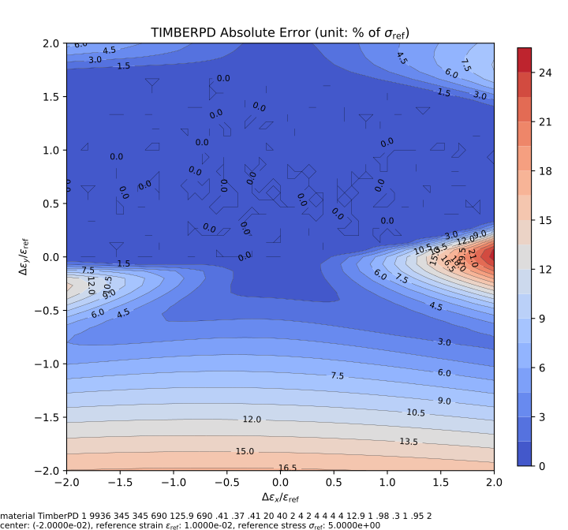
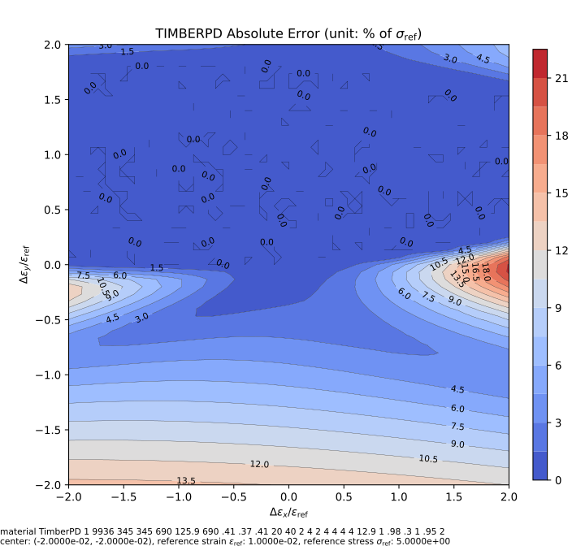
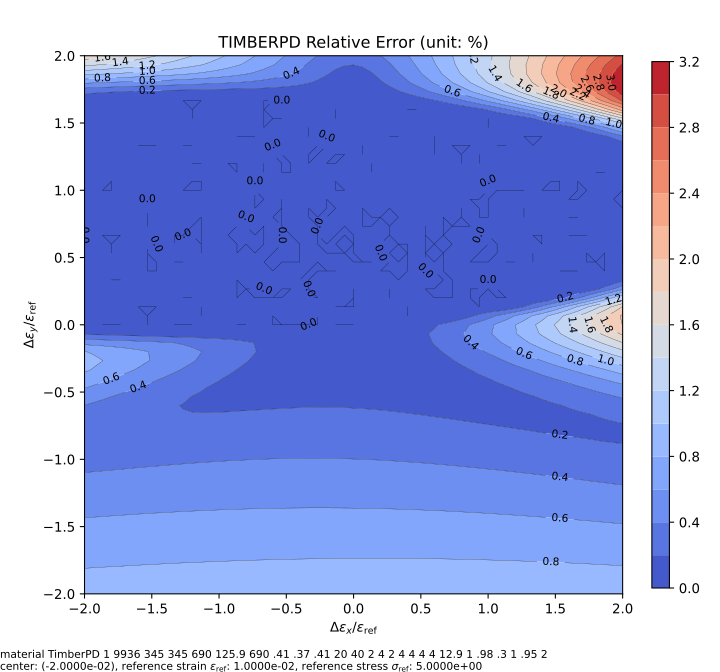
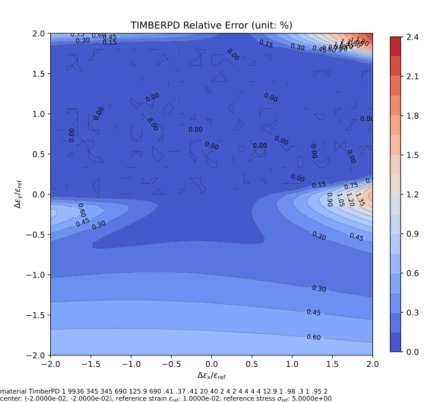

# TimberPD

Timber Plastic-Damage Model

## Background

The model couples the bilinear Hoffman plasticity of [`BilinearHoffman`](BilinearHoffman.md) with two independent scalar damage variables, one for tensile stress and one for compressive stress.
The trial stress is split into tensile and compressive parts by an eigen-decomposition of the stress tensor.
Each part is filtered by a Hill-type equivalent measure built from the corresponding set of tensile or compressive strengths.
The thresholds $r_t$ and $r_c$ are the largest equivalent stresses observed so far and are stored as history variables.
The final stress is $(1-\omega_t)\mathbf\sigma_t+(1-\omega_c)\mathbf\sigma_c$, where $\mathbf\sigma_t$ and $\mathbf\sigma_c$ are the tensile and compressive parts.

!!! info "deviation from theory"
    The damage driving measures are Hill-type equivalent stresses of the split stress, not the Hoffman yield function used for the plastic backbone.

## References

1. [Constitutive Modelling Cookbook](https://github.com/TLCFEM/constitutive-modelling-cookbook/releases/download/latest/COOKBOOK.pdf)
2. [10.1016/j.compstruc.2017.09.010](https://doi.org/10.1016/j.compstruc.2017.09.010)

## Syntax

```text title="TimberPD"
material TimberPD (1) (2...7) (8...10) (11...19) (20) (21) (22) (23) (24) (25) (26) [27]
# (1) int, unique material tag
# (2...7) double, six moduli: E_{xx}, E_{yy}, E_{zz}, G_{xy}, G_{yz}, G_{zx}
# (8...10) double, three Poisson's ratios: v_{xy}, v_{yz}, v_{xz}
# (11...19) double, nine yield stresses
# (20) double, h
# (21) double, r_t^0
# (22) double, b_t, [0,1]
# (23) double, m_t
# (24) double, r_c^0
# (25) double, b_c, [0,1]
# (26) double, m_c
# [27] double, density, default: 0.0
```

## Remarks

1. The yield stress shall be arranged in the following order: $$\sigma_{11}^t$$, $$\sigma_{11}^c$$, $$\sigma_{22}^t$$, $$\sigma_{22}^c$$, $$\sigma_{33}^t$$, $$\sigma_{33}^c$$, $$\sigma_{12}^0$$, $$\sigma_{23}^0$$, $$\sigma_{13}^0$$.
2. The original paper documents a comprehensive procedure to determine hardening parameter $$h$$.

## Damage

The damage evolutions are identical to the original formulation but with different notations.

The final stress $$\sigma$$ is calculated as

$$
\sigma=\left(1-\omega_t\right)\bar{\sigma}_t+\left(1-\omega_c\right)\bar{\sigma}_c
$$

### Tension Damage Evolution

$$
\omega_t=1-\dfrac{r_t^0}{r_t}\left(1-b_t+b_t\exp\left(m_t\left(r_t^0-r_t\right)\right)\right)
$$

The parameter $$b_t$$ will be clamped to $$0\leq{}b_t\leq1$$.

### Compression Damage Evolution

$$
\omega_c=b_c\left(1-\dfrac{r_c^0}{r_c}\right)^{m_c}
$$

The parameter $$b_c$$ will be clamped to $$0\leq{}b_c\leq1$$.

!!! warning "implementation limitation"
    The parameters $b_t$ and $b_c$ are clamped to $[0,1]$.

!!! note "developer note"
    The initial thresholds $r_t^0$ and $r_c^0$ are floored at machine epsilon.

View and edit parameters to see how they affect the damage evolution.

!!! warning "implementation limitation"
    The damage evolution is local and has no intrinsic length scale.
    Softening results can therefore depend on mesh refinement.

<iframe src="https://www.desmos.com/calculator/8v6hsu3iga?embed" width="800" height="400" style="border: 1px solid #ccc" frameborder=0></iframe>

## Recording

This model supports the following additional history variables to be recorded.

| variable label | physical meaning   |
| -------------- | ------------------ |
| DT             | tensile damage     |
| DC             | compressive damage |

## Iso-error Map

The following example iso-error maps are obtained via the following script.

```py
from plugins import ErrorMap
# note: the dependency `ErrorMap` can be found in the following link
# https://github.com/TLCFEM/suanPan-manual/blob/dev/plugins/scripts/ErrorMap.py

with ErrorMap(
    """material TimberPD 1 \
9936 345 345 690 125.9 690 \
.41 .37 .41 \
20 40 2 4 2 4 4 4 4 \
12.9 \
1 .98 .3 \
1 .95 2""",
    ref_strain=1e-2,
    ref_stress=5,
    contour_samples=30,
) as error_map:
    error_map.contour("timberpd.uniaxial", center=(-2, 0), size=2, type={"rel", "abs"})
    error_map.contour("timberpd.biaxial", center=(-2, -2), size=2, type={"rel", "abs"})
```





