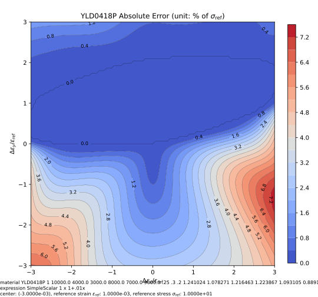
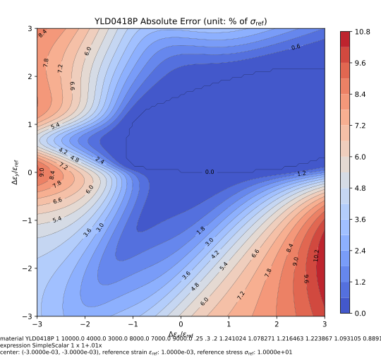
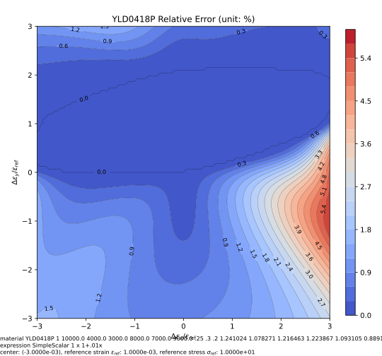
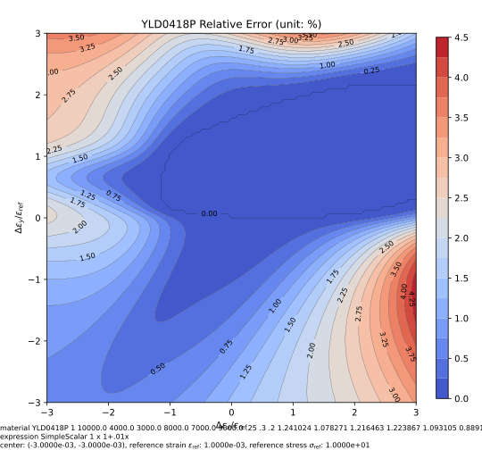

# YLD0418P

The `YLD0418P` material implements an isotropic hardening model using the YLD2004-18P yield criterion with either orthotropic or isotropic elasticity.

## Theory

The YLD2004-18p criterion applies two linear transformations to the deviatoric stress, $\mathbf S'=\mathbf C':\mathbf s$ and $\mathbf S''=\mathbf C'':\mathbf s$, where $\mathbf s$ is the deviatoric stress and $\mathbf C'$ and $\mathbf C''$ collect the 18 anisotropy coefficients.
Let $S'_i$ and $S''_j$ denote the principal values of the two transformed tensors.
The implementation evaluates

$$
f=\sum_{i=1}^3\sum_{j=1}^3\left|\dfrac{S'_i-S''_j}{\sigma_\mathrm{ref}}\right|^a,
$$

and yielding occurs when $f=4k^a(\bar\varepsilon_p)$, with $k$ the isotropic hardening function and $a$ the exponent supplied as `(29)`.

!!! info "deviation from theory"
    The condition is solved in residual form $f-4k^a=0$ and the stress differences are normalised by the reference stress for numerical conditioning.
    The exponent $a$ is not restricted to even integers.

!!! warning "implementation limitation"
    The factor $|S'_i-S''_j|^{a-2}$ is evaluated with a machine-epsilon floor on the difference.
    The criterion is therefore regularised when two transformed principal stresses nearly coincide.

The plastic flow is associative and the equivalent plastic strain uses the $\sqrt{2/3}$ norm convention.
When kinematic hardening is active the backstress follows a saturating evolution law controlled by `(32)` and `(33)`.
The history stores the equivalent plastic strain at location 0, the plastic strain at locations 1 to 6 and the backstress at locations 7 to 12.

!!! info "deviation from theory"
    Kinematic hardening is active only when both the rate and the bound are positive.
    If either is zero the model uses the reduced system without backstress.

## References

1. [10.1016/j.ijplas.2004.06.004](https://doi.org/10.1016/j.ijplas.2004.06.004)

## Syntax

### Orthotropic Elasticity

```text title="YLD0418P"
material YLD0418P (1) (2...7) (8...10) (11...28) (29) (30) (31) (32) (33) [34]
# (1) int, unique material tag
# (2...7) double, six moduli: E_{xx}, E_{yy}, E_{zz}, G_{xy}, G_{yz}, G_{zx}
# (8...10) double, three Poisson's ratios: v_{xy}, v_{yz}, v_{xz}
# (11...28) double, 18 model parameters, see documentation for details
# (29) double, exponent
# (30) double, reference stress
# (31) int, hardening backbone expression tag
# (32) double, kinematic hardening rate
# (33) double, kinematic hardening bound
# [34] double, density, default: 0.0
```

### Isotropic Elasticity

```text title="YLD0418PISO"
material YLD0418PISO (1) (2) (3) (4...21) (22) (23) (24) (25) (26) [27]
# (1) int, unique material tag
# (2) double, elastic modulus
# (3) double, Poisson's ratio
# (4...21) double, 18 model parameters, see documentation for details
# (22) double, exponent
# (23) double, reference stress
# (24) int, hardening backbone expression tag
# (25) double, kinematic hardening rate
# (26) double, kinematic hardening bound
# [27] double, density, default: 0.0
```

## Remarks

The 18 model parameters are the ones that define two transformation matrices as shown in Eq. (15) in [10.1016/j.ijplas.2004.06.004](https://doi.org/10.1016/j.ijplas.2004.06.004).
The order follows the one presented in Table 2 in the same paper.

$$
c'_{12}~c'_{13}~c'_{21}~c'_{23}~c'_{31}~c'_{32}~c'_{44}~c'_{55}~c'_{66}\\
c''_{12}~c''_{13}~c''_{21}~c''_{23}~c''_{31}~c''_{32}~c''_{44}~c''_{55}~c''_{66}
$$

The hardening expression shall be a **simple scalar-valued** expression.
Check the corresponding [page](../../../../Collection/Define/expression.md) for details.

If either the kinematic hardening rate or the bound is zero, the kinematic hardening is disabled.
The local return mapping uses different algorithms depending on whether the kinematic hardening is enabled or not.
Thus, if kinematic hardening is not important, one shall consider disabling it to improve numerical performance.

The reference stress is used to normalize the yield surface to avoid potential numerical issues.
It shall be set to a proper value, for example, the initial yield stress.

The isotropic hardening can be disabled by providing a hardening expression that always returns zero.

!!! warning "implementation limitation"
    A value returned by the hardening expression that is negative is replaced by zero together with a zero gradient.
    The 18 coefficients are read in the order $c'_{12},c'_{13},c'_{21},c'_{23},c'_{31},c'_{32},c'_{44},c'_{55},c'_{66}$ followed by the corresponding double-primed values.

## Example

```
expression SimpleScalar 1 x 1+.02x

material YLD0418PISO 1 1E4 .25 \
1.241024 1.078271 1.216463 1.223867 1.093105 0.889161 0.501909 0.557173 1.349094 \
0.775366 0.922743 0.765487 0.793356 0.918689 1.027625 1.115833 1.112273 0.589787 \
8 100. \
1 \
0. 0.
```

## Iso-error Map

The following example iso-error maps are obtained via the following script.

```py
from plugins import ErrorMap
# note: the dependency `ErrorMap` can be found in the following link
# https://github.com/TLCFEM/suanPan-manual/blob/dev/plugins/scripts/ErrorMap.py

modulus = 1e4
yield_stress = 10.0

with ErrorMap(
    f"material YLD0418P 1 {modulus} {0.4 * modulus} {0.3 * modulus} {0.8 * modulus} {0.7 * modulus} {0.9 * modulus} .25 .3 .2 \
1.241024 1.078271 1.216463 1.223867 1.093105 0.889161 0.501909 0.557173 1.349094 \
0.775366 0.922743 0.765487 0.793356 0.918689 1.027625 1.115833 1.112273 0.589787 \
8 {yield_stress} \
1 \
{0.05 * modulus} {yield_stress}\nexpression SimpleScalar 1 x 1+.01x",
    ref_strain=yield_stress / modulus,
    ref_stress=yield_stress,
    contour_samples=50,
) as error_map:
    error_map.contour("yld0418p.uniaxial", center=(-3, 0), size=3, type={"rel", "abs"})
    error_map.contour("yld0418p.biaxial", center=(-3, -3), size=3, type={"rel", "abs"})
```





