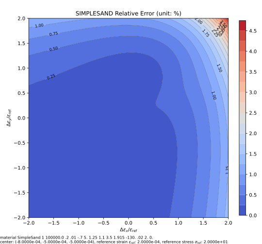

# SimpleSand

A Simple Sand Model

The continuum mechanics based sign convention (tension is positive) is used for consistency.

The `SimpleSand` model is a simple sand hardening model that adopts a bounding surface concept.

Readers can also refer to the corresponding section in [Constitutive Modelling Cookbook](https://github.com/TLCFEM/constitutive-modelling-cookbook/releases/download/latest/COOKBOOK.pdf) for details on the theory.

## Syntax

```text title="SimpleSand"
material SimpleSand (1) (2) (3) (4) (5) (6) (7) (8) (9) (10) (11) (12) (13) [14]
# (1) int, unique material tag
# (2) double, elastic modulus
# (3) double, Poisson's ratio
# (4) double, m, size of yield surface
# (5) double, A, dilatancy related parameter, often negative
# (6) double, h, dilatancy related hardening parameter
# (7) double, alpha_c, critical alpha
# (8) double, n_b, bounding surface evolution parameter
# (9) double, n_d, dilatancy surface evolution parameter
# (10) double, v_c, critical specific volume
# (11) double, p_c, critical hydrostatic stress, should be negative
# (12) double, lambda_c, the slope of critical state line
# (13) double, v_0, initial specific volume
# [14] double, density, default: 0.0
```

## Theory

### Critical State

The state parameter is defined as

$$
\psi=v-v_c+\lambda_c\ln\left(\dfrac{p}{p_c}\right)
$$

The specific volume can be expressed in terms of strain,

$$
v=v_0\left(1+\mathrm{tr}~\varepsilon\right).
$$

Thus, the bounding surface and dilatancy surface can be defined to evolve with $$\psi$$,

$$
\alpha^b=\alpha^c\exp\left(-n^b\psi\right),\qquad \alpha^d=\alpha^c\exp\left(n^d\psi\right),
$$

where $$\alpha^c$$ is the initial size of surfaces.

### Yield Surface

The following wedge-like function is chosen to be the yield surface,

$$
F=|s+p\alpha|+mp,
$$

where $$s$$ is the deviatoric stress, $$p$$ is the hydrostatic stress, $$\alpha$$ is the back stress ratio and $$m$$ is a constant that controls the size of the wedge.

The following is a visualization of the yield surface in the $$p-q$$ plane.

<iframe src="https://www.desmos.com/calculator/2ed6067910?embed" width="800" height="400" style="border: 1px solid #ccc" frameborder=0></iframe>

### Flow Rule

A non-associated flow rule is defined.

$$
\Delta\varepsilon^p=\Delta\gamma{}\left(n+\dfrac{1}{3}DI\right),
$$

where $$n=\dfrac{s+p\alpha}{|s+p\alpha|}$$ is a unit tensor, $$I$$ is the second order unit tensor and $$D=A\left(\alpha^d-\alpha:n\right)$$ is the dilatancy parameter.

Note due to the change of sign convention, a negative $$D$$ leads to contractive response, thus $$A$$ often needs to be negative.

!!! info "deviation from theory"
    The model uses $$D=A\left(\alpha^d-m-\alpha:\mathbf n\right)$$, that is, the distance from the stress-ratio point to the dilatancy surface measured relative to the wedge size $$m$$.
    The expression shown above omits the $$-m$$ term.
    This form makes $$D$$ vanish when the stress ratio reaches the dilatancy surface at $$\alpha:\mathbf n=\alpha^d-m$$.

### Hardening Rule

The evolution of $$\alpha$$ is similar to the Armstrong-Frederick hardening law.

$$
\Delta\alpha=\Delta\gamma{}h\left(\alpha^bn-\alpha\right),
$$

where $$h$$ is a constant that controls the speed of hardening.

## Remarks

- The parser defaults are $E=10^5$, $\nu=0.2$, $m=0.01$, $A=-0.7$, $h=5$, $\alpha_c=1.25$, $n_b=1.1$, $n_d=3.5$, $v_c=1.915$, $p_c=-130$, $\lambda_c=0.02$, $v_0=2$ and density zero.
- The constructor converts $m$, $n_b$, $n_d$, $v_c$, $\lambda_c$ and $v_0$ to absolute values and forces $p_c$ to be negative.
- The size parameter $m$ and the dilatancy constant $A$ are dimensionless, while $p_c$ and the elastic modulus have stress units and $v_0$ and $v_c$ are specific volumes.
- Because the sign convention is tension positive, a negative $A$ is required for contractive response during shearing of loose sand.
- The yield surface has no Lode-angle dependence, so its deviatoric section is a circle rather than the triangular shape of true sand failure surfaces.
- Only the six components of the back stress ratio are stored as history variables; the plastic strain tensor is not recorded.
- This is a simplified relative of [`DafaliasManzari`](DafaliasManzari.md): it uses linear elasticity instead of pressure- and void-ratio-dependent hyperelasticity and omits the fabric tensor and load-reversal memory.

!!! warning "implementation limitation"
    The state parameter is evaluated with a smoothed lower bound on the pressure so that the logarithm remains finite near zero confinement.
    When the trial pressure exceeds a small fraction of $|p_c|$ the model returns a deviatoric-only stress with no plastic correction, so no tensile strength is available.

## Example

Please refer to [triaxial-compression-of-sand](../../../../Example/Geotechnical/triaxial-compression-of-sand.md).

## Iso-error Map

The following example iso-error maps are obtained via the following script.

```py
from plugins import ErrorMap
# note: the dependency `ErrorMap` can be found in the following link
# https://github.com/TLCFEM/suanPan-manual/blob/dev/plugins/scripts/ErrorMap.py

young_modulus = 1e5
ref_stress = 20

with ErrorMap(
    f"material SimpleSand 1 {young_modulus} .2 .01 -.7 5. 1.25 1.1 3.5 1.915 -130. .02 2. 0.",
    ref_strain=ref_stress / young_modulus,
    ref_stress=ref_stress,
    contour_samples=40,
) as error_map:
    error_map.contour(
        "simple.sand.uniaxial", center=(-4, -2.5, -2.5), size=2, type="rel"
    )
```



## References

1. [10.1061/(ASCE)0733-9399(2004)130:6(622)](https://doi.org/10.1061/(ASCE)0733-9399(2004)130:6(622))
2. A state parameter for sands
