# ArmstrongFrederick

Armstrong-Frederick Steel Model

## References

1. [10.1016/S0749-6419(01)00049-3](https://doi.org/10.1016/S0749-6419(01)00049-3)
2. [10.1115/1.3264257](https://doi.org/10.1115/1.3264257)
3. [10.1179/096034007X207589](https://doi.org/10.1179/096034007X207589)
4. J. L. Chaboche, Constitutive equations for cyclic plasticity and cyclic viscoplasticity, *International Journal of Plasticity* 5 (1989) 247--301, [doi:10.1016/0749-6419(89)90015-6](https://doi.org/10.1016/0749-6419(89)90015-6).
5. J. C. Simo and T. J. R. Hughes, *Computational Inelasticity*, Springer, New York, 1998, [doi:10.1007/b98904](https://doi.org/10.1007/b98904).

## Theory

Implementation can be found in a separate [document](ArmstrongFrederick.pdf).

A von Mises type yield function is used.
The associated plasticity is assumed.
Both isotropic and kinematic hardening rules are employed.

Although the plastic flow is associative, the hardening rules are not.
As a result, the consistent tangent modulus is not symmetric.

### Isotropic Hardening

An exponential function is added to the linear hardening law.

$$
k=\sigma_y+k_s(1-e^{-mp})+k_lp,
$$

where $$\sigma_y$$ is the initial elastic limit (yielding stress), $$k_s$$ is the saturation stress, $$k_l$$ is the linear hardening modulus, $$m$$ is a constant that controls the speed of hardening, $$\mathrm{d}p=\sqrt{\dfrac{2}{3}\mathrm{d}\varepsilon^p:\mathrm{d}\varepsilon^p}$$ is the rate of accumulated plastic strain $$p$$.

!!! warning "implementation limitation"
    A negative isotropic radius is clamped to zero and its derivative is discarded during the local iteration.

### Kinematic Hardening

The Armstrong-Frederick type rule is used.
Multiple back stresses are defined,

$$
\beta=\sum\beta^i
$$

in which

$$
\mathrm{d}\beta^i=\sqrt{\dfrac{2}{3}}a^i~\mathrm{d}\varepsilon^p-b^i\beta~\mathrm{d}p,
$$

where $$a^i$$ and $$b^i$$ are material constants.
Note here a slightly different definition is adopted as in the original literature $$\dfrac{2}{3}$$ is used instead of $$\sqrt{\dfrac{2}{3}}$$.
This is purely for a slightly more tidy derivation and does not affect anything.

!!! info "deviation from theory"
    The recovery term in the displayed rate equation is written with the total back stress $$\beta$$.
    The implementation applies recovery separately to each component $$\beta^i$$ using its own $$b^i$$, which is the form used in the derivation document.

### Return Mapping

With the multiplier normalisation $$\mathrm{d}\boldsymbol\varepsilon^p=\sqrt{3/2}\,\gamma\,\boldsymbol n$$ one has $$\mathrm{d}p=\gamma$$ and $$\mathrm{d}\boldsymbol\beta^i=a^i\gamma\boldsymbol n-b^i\gamma\boldsymbol\beta^i$$.
The incremental update of each back stress is therefore available in closed form,

$$
\boldsymbol\beta^i=\dfrac{\boldsymbol\beta_n^i+a^i\gamma\,\boldsymbol n}{1+b^i\gamma},\qquad \boldsymbol n=\dfrac{\boldsymbol s^{tr}-\sum_i\boldsymbol\beta_n^i/(1+b^i\gamma)}{\left\lVert\boldsymbol s^{tr}-\sum_i\boldsymbol\beta_n^i/(1+b^i\gamma)\right\rVert}.
$$

The elastic predictor gives the trial deviatoric stress $$\boldsymbol s^{tr}$$, and the direction $$\boldsymbol n$$ is corrected iteratively together with the scalar multiplier.
The scalar residual solved by Newton's method is

$$
F=\sqrt{\dfrac{3}{2}}\left(\left\lVert\boldsymbol s^{tr}-\sum_i\dfrac{\boldsymbol\beta_n^i}{1+b^i\gamma}\right\rVert-\sqrt{6}G\gamma-\sum_i\dfrac{a^i\gamma}{1+b^i\gamma}\right)-\left[\sigma_y+k_l(p_n+\gamma)+k_s\left(1-e^{-m(p_n+\gamma)}\right)\right].
$$

The stress is updated by radial return as $$\boldsymbol\sigma=\boldsymbol\sigma^{tr}-\sqrt{6}G\gamma\,\boldsymbol n$$.
Because the Armstrong-Frederick rules are not associative, the consistent tangent is not symmetric and the user may need `set symm_mat 0` for non-symmetric solvers.
The maximum back-stress magnitude contributed by one pair is $$\sqrt{3/2}\,a^i/b^i$$, which gives the saturation stress shown in the examples below.

## Syntax

The following applies to `v3.6` and later.
Check the older syntax in the older version of the documentation.

```text title="ArmstrongFrederick"
material ArmstrongFrederick (1) (2) (3) (4) (5) (6) (7) [(8) (9)...] [10]
# (1) int, unique material tag
# (2) double, elastic modulus
# (3) double, Poisson's ratio
# (4) double, yield stress
# (5) double, linear hardening modulus
# (6) double, saturation stress
# (7) double, m, saturation rate
# (8) double, a, kinematic hardening parameter
# (9) double, b, kinematic hardening parameter
# [10] double, density, default: 0.0
```

## History Layout

| location                | parameter                                                         |
|-------------------------|-------------------------------------------------------------------|
| `initial_history(0)`    | accumulated plastic strain                                        |
| `initial_history(1-6)`  | back stress for the first pair of $$a^1$$ and $$b^1$$             |
| `initial_history(7-12)` | back stress for the second pair of $$a^2$$ and $$b^2$$ if defined |
| ...                     | more back stresses                                                |

## Remarks

The parser supplies defaults for the first six numbers, namely $$E=2\times10^5$$, $$\nu=0.2$$, $$\sigma_y=4\times10^2$$, $$k_l=0$$, $$k_s=5\times10^2$$ and $$m=10$$.
After those six numbers the remaining values are read as consecutive pairs of $$a^i$$ and $$b^i$$.
An odd number of trailing values is interpreted as a final density.
Setting $$b^i=0$$ with $$a^i\neq0$$ gives linear kinematic hardening rather than the classic J2 model, despite the wording in the example below.
Setting all $$a^i=0$$ leaves pure isotropic hardening.
The isotropic part is a Voce law plus a linear term, so the saturated stress is $$\sigma_y+k_s+k_l p$$.
Use [`VAFCRP`](VAFCRP.md) when viscosity is required, and [`ArmstrongFrederick1D`](../../Material1D/vonMises/ArmstrongFrederick1D.md) for the uniaxial version.
Use a three-dimensional solid element such as `C3D8` with this material.

## Example

Here a few examples are shown.

### Isotropic Hardening Only

There is no difference between the classic J2 plasticity model and this AF steel model if only isotropic hardening is defined.

```
material ArmstrongFrederick 1 2E2 .2 .1 1. .05 1000.
```

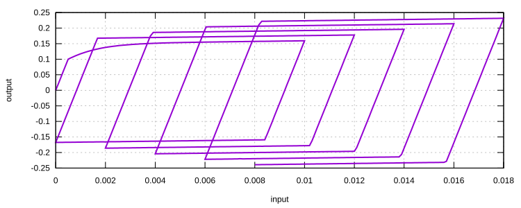

### Kinematic Hardening Only

If $$a\neq0$$ and $$b=0$$, there is no difference between the classic J2 plasticity model and this AF steel model.
A linear kinematic hardening rule is implied.
Normally at least one set of $$a^1$$ and $$b^1$$ is defined.

```
material ArmstrongFrederick 1 2E2 .2 .1 0. 0. 0. 50. 500.
```

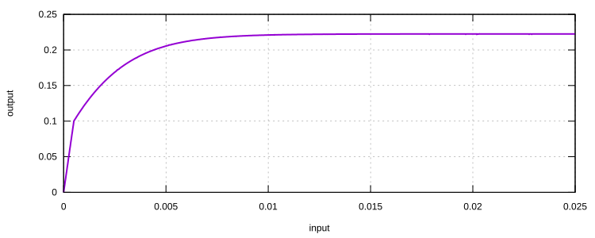

By definition, if one set of $$a^1$$ and $$b^1$$ is defined, then the maximum stress can be computed as

$$
\sigma_{max}=\sigma_y+\sqrt{\dfrac{3}{2}}\dfrac{a^1}{b^1}.
$$

In this case, it is

$$
\sigma_{max}=0.1~\mathrm{GPa}+\sqrt{\dfrac{3}{2}}\dfrac{50}{500}~\mathrm{GPa}=222.47~\mathrm{MPa}.
$$

The cyclic response is shown as follows.

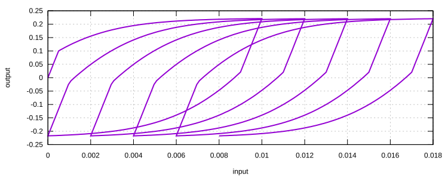

Of course, multiple sets of $$a^i$$ and $$b^i$$ can be defined.

```
material ArmstrongFrederick 1 2E2 .2 .1 0. 0. 0. 50. 500. 100. 600.
```

Accordingly, the maximum stress is

$$
\sigma_{max}=\sigma_y+\sqrt{\dfrac{3}{2}}\sum\dfrac{a^i}{b^i}=0.1+\sqrt{\dfrac{3}{2}}\left(
\dfrac{50}{500}+\dfrac{100}{600}\right)=426.60~\mathrm{MPa}.
$$

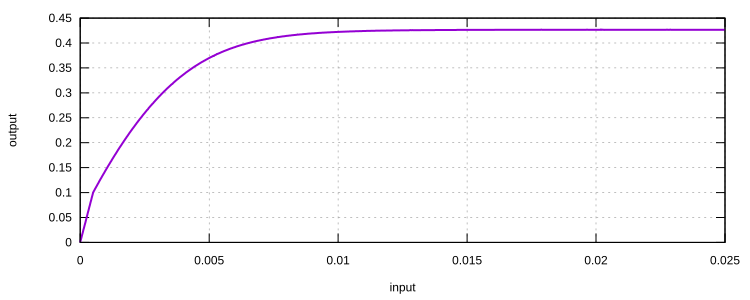

The cyclic response is shown as follows.

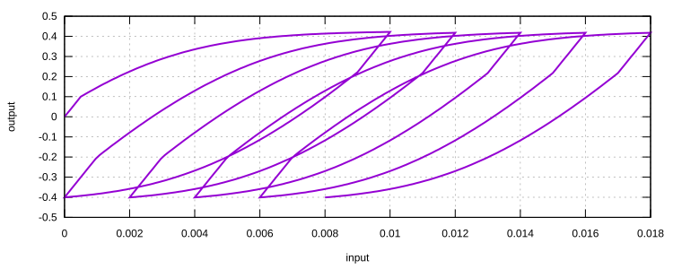

### Zero Elastic Range

It is possible to define a zero plastic range response, although the initial stiffness cannot be explicitly assigned.

```
material ArmstrongFrederick 1 2E2 .2 0. 0. 0. 0. 40.82482305 500.
```

The corresponding maximum stress is $$100~\mathrm{MPa}$$.

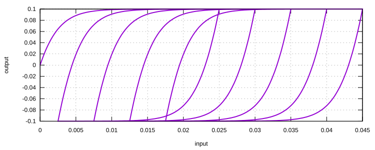

With some linear isotropic hardening,

```
material ArmstrongFrederick 1 2E2 .2 0. .1 0. 0. 40.82482305 500.
```

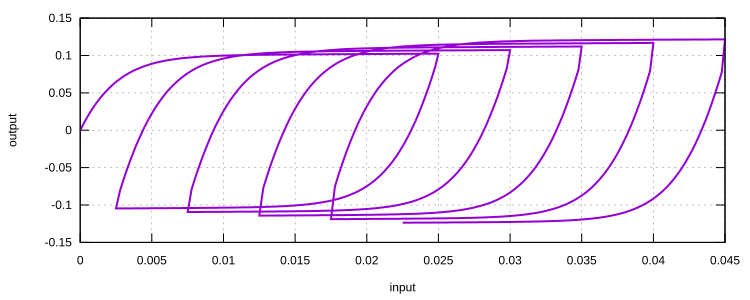

## Iso-error Map

The following example iso-error maps are obtained via the following script.

```py
from plugins import ErrorMap
# note: the dependency `ErrorMap` can be found in the following link
# https://github.com/TLCFEM/suanPan-manual/blob/dev/plugins/scripts/ErrorMap.py

young_modulus = 2e2
yield_stress = 0.2
hardening_ratio = 0.01

with ErrorMap(
    f"material ArmstrongFrederick 1 {young_modulus} .2 0. {hardening_ratio * young_modulus} 0. 0. 40.82482305 500.",
    ref_strain=yield_stress / young_modulus,
    ref_stress=yield_stress,
    contour_samples=30,
) as error_map:
    error_map.contour("af.uniaxial", center=(-5, 0), size=3, type={"rel", "abs"})
    error_map.contour("af.biaxial", center=(-5, -5), size=3, type={"rel", "abs"})
```

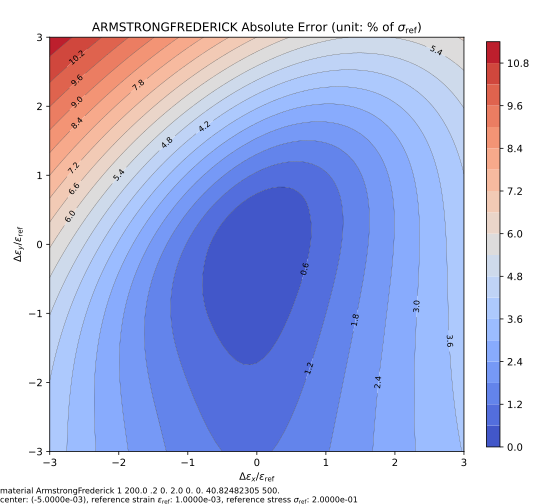
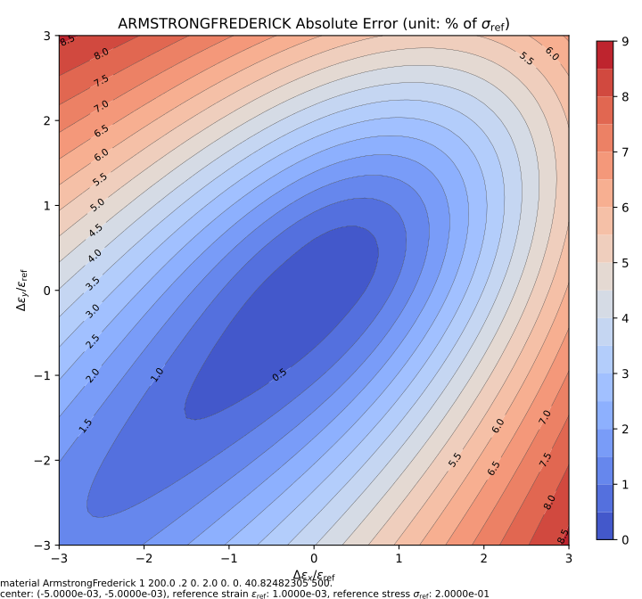
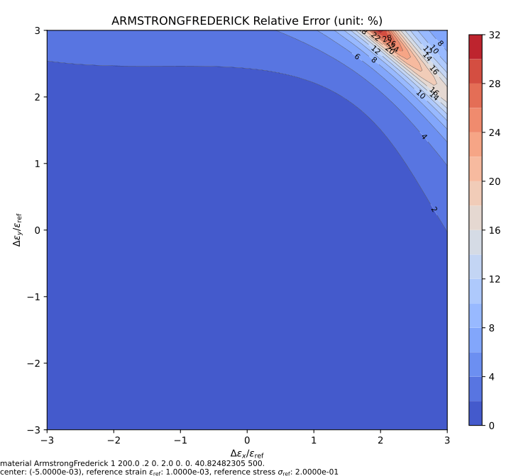
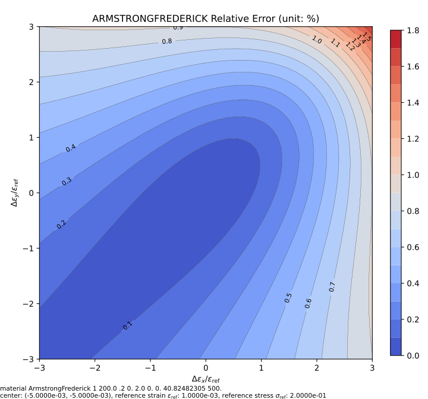
