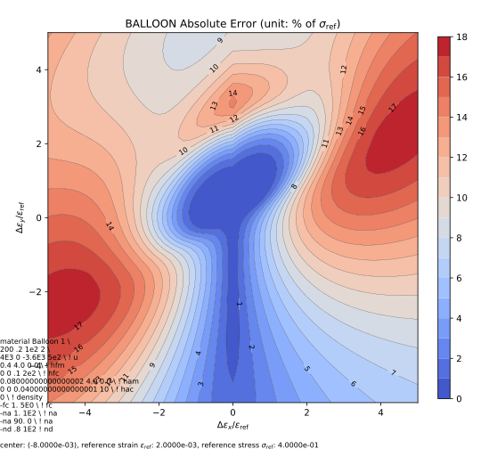
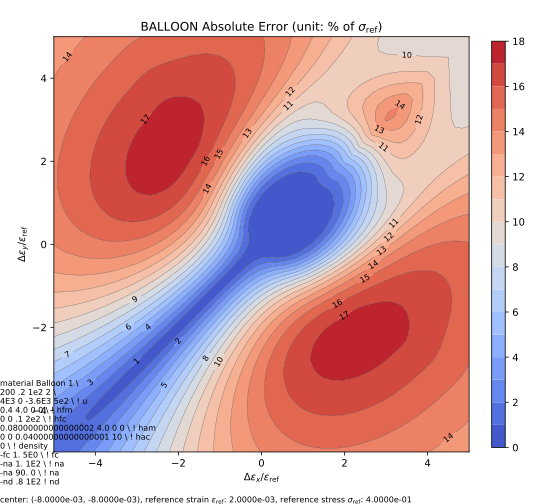
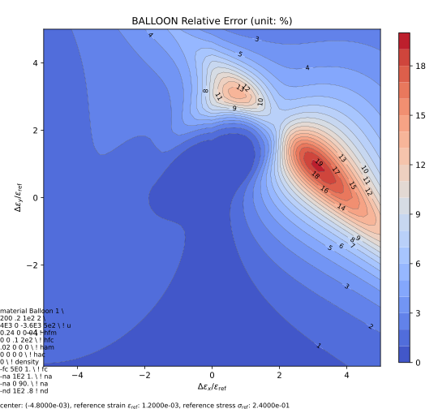
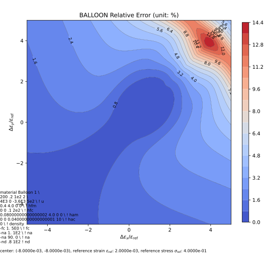

# Balloon

Balloon Model

The Balloon-v1 model is an advanced model for metals with enhanced cyclic behaviour.

Both this model and [Balloon1D](../../Material1D/vonMises/Balloon1D.md) share the same definitions of parameters.
Both models shall yield the same uniaxial behaviour if the same parameter set is used.

## References

1. [10.31224/6937](https://doi.org/10.31224/6937)

## Syntax

```text title="Balloon"
material Balloon (1) (2...25) (26) [(27) (28) (29)...]
# (1) int, unique material tag
# (2) double, elastic modulus
# (3) double, Poisson's ratio
# (4) double, k_r
# (5) double, load reversal memory size
# (6 7 8 9) double, u bound, initial, linear, saturation, rate
# (10 11 12 13) double, fm bound, initial, linear, saturation, rate
# (14 15 16 17) double, fc bound, initial, linear, saturation, rate
# (18 19 20 21) double, am bound, initial, linear, saturation, rate
# (22 23 24 25) double, ac bound, initial, linear, saturation, rate
# (26) double, density
# (27) string, token, one of '-fc', '-ac', '-na', '-nd', '-memory'
# (28 29) double, saturation and rate, omitted for '-memory'
```

## Theory

### Bound Function

The scalar bounds use the following general form.

$$
\chi\left(q\right)=\chi_0+kq+\chi_s\left(1-\exp\left(-rq\right)\right).
$$

In which $$q$$ is the proper accumulated plastic strain.
Effectively, it has three parts: 1) initial value $$\chi_0$$, 2) linear part $$kq$$ and 3) saturation part $$\chi_s\left(1-\exp\left(-rq\right)\right)$$.
The parameter tuple takes $$\chi_0$$, $$k$$, $$\chi_s$$ and $$r$$.

The model extends the [subloading surface](Subloading.md) framework with a split of the accumulated plastic strain into a monotonic part and a cyclic part.
The split ratio $$k_r$$ controls how much of each increment feeds the monotonic branch, and the remaining fraction feeds the cyclic branch.

!!! info "deviation from theory"
    The standard subloading surface model drives all hardening from a single accumulated plastic strain.
    This model splits that strain according to the distance between the current yield ratio and the memorised reversal ratio.

The bound $$u$$ scales the normal yield surface, $$f_m$$ and $$f_c$$ scale the monotonic and cyclic isotropic hardening, and $$a_m$$ and $$a_c$$ scale the corresponding kinematic hardening.
The normal yield ratio $$z$$ evolves towards unity under plastic flow, which gives a smooth elastic-to-plastic transition like the parent model.
The memory buffer stores a limited number of previous load reversal ratios, and its content is used as the reference for the monotonic-cyclic split.
Four sets of back-stress-like tensors are available, two scalar bounds are driven by the cyclic branch and two by the monotonic branch.
The return mapping solves two coupled residuals for the plastic multiplier and the yield ratio and uses the resulting consistent tangent.

### Cyclic Evolution

The key-value tuples indicated by tokens '-fc' and '-ac' control the evolutions of cyclic bounds (scalars).
The key-value tuples indicated by tokens '-na' and '-nd' control the evolutions of back stress like quantities (tensors).
For all four sets, the Armstrong-Frederick style exponential rule is used, and two parameters indicate the saturation target and the corresponding saturation rate.

Typically, the saturation value can be fixed to unity such that those quantities saturate to unity (either scalar or tensor) as the actual magnitudes need to account for the previous bounds.
For the same quantity, more than one tuple can be defined.
For example, `-fc .4 100 -fc .6 200` means there are two components, one saturates to 0.4 with a rate of 100 and the other saturates to 0.6 with a rate of 200.
The two parts are summed up so $$F_c$$ will eventually saturate to 1.0.

## Remarks

The fourth input is the load reversal memory size, and the parser also accepts a `-memory` token followed by `minimum`, `maximum` or `mean`.
The default memory type is `mean`, which averages the stored reversal ratios.

!!! warning "implementation limitation"
    Only the minimum, maximum and mean of the stored reversal ratios are available as memory types.
    The yield ratio is bounded below by a small positive value and above by unity, and the scalar bounds are clamped to zero when negative.

!!! note "developer note"
    The lower bound on the yield ratio is $$10^{-15}$$.

A zero rate in any `-fc`, `-ac`, `-na` or `-nd` tuple gives a linear evolution instead of an exponential saturation.
The scalar bounds are clamped to zero when they would become negative, so a strongly negative saturation stress is truncated.
The fourth bound argument of each tuple is the rate, and it controls how quickly the corresponding part approaches its bound.
The history stores the iteration counter, the loading flag, the accumulated plastic strain, its monotonic part and the yield ratio, followed by the scalar and tensor internal variables.
The local solver uses a tight tolerance and a hard limit of twenty iterations, so use small strain increments around load reversals.
All parameter meanings are shared with [`Balloon1D`](../../Material1D/vonMises/Balloon1D.md).
The [demo page](Balloon.Demo.md) illustrates each parameter with a uniaxial example.
Use a three-dimensional solid element such as `C3D8` with this material.

## Iso-error Map

The Balloon-v1 model extends the subloading surface model and behaves in a similar way under monotonic loading.
The iso-error maps are thus similar to that of the subloading surface model.

The following example iso-error maps are obtained via the following script.

```py
from plugins import ErrorMap

# note: the dependency `ErrorMap` can be found in the following link
# https://github.com/TLCFEM/suanPan-manual/blob/dev/plugins/scripts/ErrorMap.py

young_modulus = 200
yield_stress = 0.4

with ErrorMap(
    rf"""
material Balloon 1 \
{young_modulus} .2 1e2 2 \
4E3 0 -3.6E3 5e2 \ ! u
{yield_stress} {0.02 * young_modulus} 0 0 \ ! hfm
0 0 .1 2e2 \ ! hfc
{0.2 * yield_stress} {0.02 * young_modulus} 0 0 \ ! ham
0 0 {0.1 * yield_stress} 10 \ ! hac
0 \ ! density
-fc 1. 5E0 \ ! fc
-na 1. 1E2 \ ! na
-na 90. 0 \ ! na
-nd .8 1E2 ! nd
""",
    ref_strain=yield_stress / young_modulus,
    ref_stress=yield_stress,
    contour_samples=30,
) as error_map:
    error_map.contour("balloon.uniaxial", center=(-4, 0), size=5, type={"rel", "abs"})
    error_map.contour("balloon.biaxial", center=(-4, -4), size=5, type={"rel", "abs"})
```






## Examples

See the [demo](Balloon.Demo.md) page.
