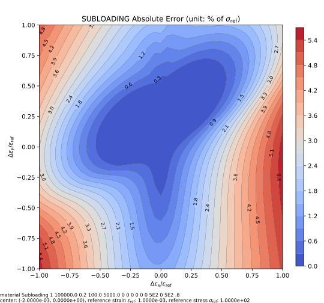
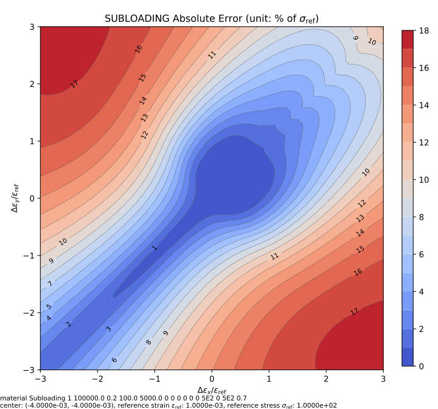
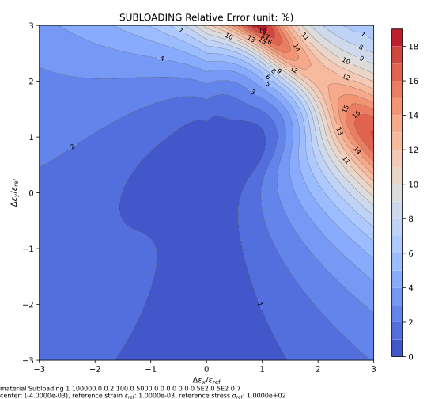
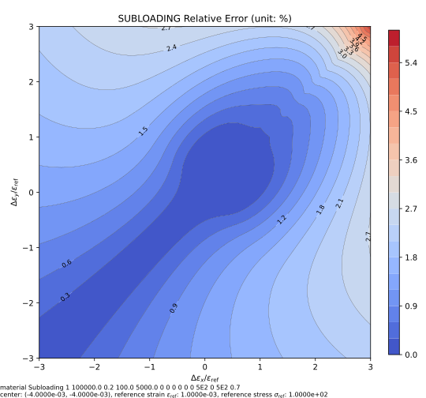

# Subloading

The Modified Extended 3D Subloading Surface (Hashiguchi) Model

The subloading surface framework provides a very versatile approach to model cyclic behaviour.
It is highly recommended to try it out.

## References

The implementation is based on the following paper.

1. [10.1007/s00707-025-04339-0](https://doi.org/10.1007/s00707-025-04339-0)

Additional material on the same topic can be found in the following literature.

2. [10.1007/978-3-030-93138-4](https://doi.org/10.1007/978-3-030-93138-4)
3. [10.1007/s11831-023-10022-1](https://doi.org/10.1007/s11831-023-10022-1)
4. [10.1007/s11831-022-09880-y](https://doi.org/10.1007/s11831-022-09880-y)

Prof. Koichi Hashiguchi has published a large number of papers on this topic.
To find more references, please refer to the monograph and the references therein.

## Theory

Refer to the corresponding section in [Constitutive Modelling Cookbook](https://github.com/TLCFEM/constitutive-modelling-cookbook/releases/download/latest/COOKBOOK.pdf) for theory, formulation and implementation details.

The subloading surface framework introduces a similarity ratio $$z$$ with $$0<z\leqslant1$$ that measures how close the current stress is to the conventional yield surface.
The subloading surface always passes through the current stress point and has the same shape as the normal yield surface scaled by $$z$$ about a centre defined by the back stress.
For the von Mises based implementation the surface is

$$
f=\left\lVert\mathrm{dev}\,\mathbf\sigma-\mathbf\alpha\right\rVert-z\,y(p),
$$

in which $$y(p)$$ is the isotropic radius, $$\mathbf\alpha$$ is a normalised back stress and $$p$$ is the accumulated plastic strain.
Plastic flow can occur for any $$z<1$$, so there is no sharp elastic-to-plastic transition and the smooth return to $$z=1$$ recovers conventional J2 plasticity.

The normal yield ratio evolves according to

$$
\dot z=u\left(-\ln z\right)\dot p,
$$

where $$u\geqslant0$$ is the yield ratio evolution rate.

!!! warning "implementation limitation"
    The yield ratio is bounded below by a small positive value and above by unity.
    Near the lower bound the driving term $$-\ln z$$ is replaced by a finite value instead of growing without limit.

!!! note "developer note"
    The lower bound on the yield ratio is $$10^{-15}$$.

The isotropic and kinematic bounds follow the common form

$$
\chi(q)=\chi_0+kq+\chi_s\left(1-e^{-rq}\right),
$$

with separate parameter sets for the two bounds.

!!! warning "implementation limitation"
    The isotropic and kinematic bounds are clamped to zero when their evaluated value becomes negative.
    The elastic core size is capped just below unity.

The normalised back stress $$\mathbf\alpha$$ and the normalised elastic core $$\mathbf d$$ evolve with Armstrong-Frederick type rules, saturating towards the kinematic bound and towards the elastic core size $$z_e$$, respectively.
The elastic core is a second internal tensor of Hashiguchi's extended model that improves the description of reverse loading.
The return mapping solves two coupled residuals, one for the plastic multiplier and one for the yield ratio, using the consistent tangent derived from their linearisation.
The [Balloon](Balloon.md) model extends this framework with a monotonic/cyclic split of the plastic strain and a memory of load reversals.

## Syntax

```text title="Subloading"
material Subloading (1) (2) (3) (4) (5) (6) (7) (8) (9) (10) (11) (12) (13) (14) (15) [16]
# (1) int, unique material tag
# (2) double, elastic modulus
# (3) double, Poisson's ratio
# (4) double, isotropic initial stress, \sigma^i>=0
# (5) double, isotropic linear hardening modulus, k_{iso}>=0
# (6) double, isotropic saturation stress, \sigma^s>=0
# (7) double, isotropic saturation rate, m^s_{iso}>=0
# (8) double, kinematic initial stress, a^i>=0
# (9) double, kinematic linear hardening modulus, k_{kin}>=0
# (10) double, kinematic saturation stress, a^s>=0
# (11) double, kinematic saturation rate, m^s_{kin}>=0
# (12) double, yield ratio evolution rate, u>=0
# (13) double, kinematic hardening rate, b>=0
# (14) double, elastic core evolution rate, c_e>=0
# (15) double, elastic core size, 1>z_e>=0
# [16] double, density, default: 0.0
```

## History Layout

| location                | parameter                                  |
| ----------------------- | ------------------------------------------ |
| `initial_history(0)`    | iteration counter                          |
| `initial_history(1)`    | accumulated plastic strain $$q$$           |
| `initial_history(2)`    | normal yield ratio $$z$$                   |
| `initial_history(3:8)`  | normalised back stress $$\mathbf{\alpha}$$ |
| `initial_history(9:14)` | normalised elastic core $$\mathbf{d}$$     |

## Remarks

All fifteen material inputs are optional and the parser supplies defaults.
The defaults are $$E=2\times10^5$$, $$\nu=0.3$$, isotropic bound $$(2\times10^2,0,2\times10^2,10)$$, kinematic bound $$(2\times10^2,0,2\times10^2,10)$$, $$u=10$$, $$b=10$$, $$c_e=10$$ and $$z_e=0.7$$.
The evolution rates of the isotropic and kinematic bounds must be non-negative, and the elastic core size is capped just below unity.
The parameter $$u$$ controls the smoothness of the elastic-to-plastic transition, with larger values approaching the conventional yield surface more quickly.
The history can be overridden with the `initial material history` command to start from a non-virgin state.
The local solver uses a tight tolerance and a hard limit of twenty iterations, so use sufficiently small strain increments at the onset of yielding.
The parameters have the same meaning as in [`Subloading1D`](../../Material1D/vonMises/Subloading1D.md).
For cyclic metals with a split of monotonic and cyclic plasticity use [Balloon](Balloon.md).
Use a three-dimensional solid element such as `C3D8` with this material.

## Example

See [this](../../../../Example/Structural/Statics/calibration-subloading.md) example.

## Iso-error Map

The following example iso-error maps are obtained via the following script.

```py
from plugins import ErrorMap
# note: the dependency `ErrorMap` can be found in the following link
# https://github.com/TLCFEM/suanPan-manual/blob/dev/plugins/scripts/ErrorMap.py

young_modulus = 1e5
yield_stress = 100.0
hardening_ratio = 0.05

with ErrorMap(
    f"""material Subloading 1 {young_modulus} 0.2 \
{yield_stress} {hardening_ratio * young_modulus} 0 0 \
0 0 0 0 \
5E2 0 5E2 0.7""",
    ref_strain=yield_stress / young_modulus,
    ref_stress=yield_stress,
    contour_samples=30,
) as error_map:
    error_map.contour(
        "subloading.uniaxial", center=(-4, 0), size=3, type={"rel", "abs"}
    )
    error_map.contour(
        "subloading.biaxial", center=(-4, -4), size=3, type={"rel", "abs"}
    )
```





