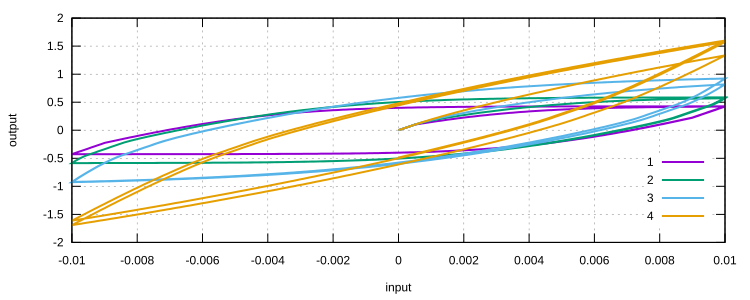
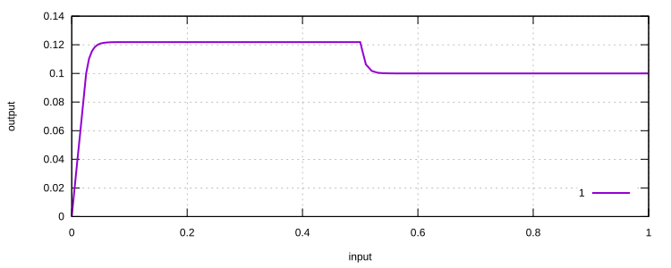

# VAFCRP

Viscous J2 Steel Model

Before I can find a proper name for it, I would call it `VAFCRP` model.
Although the name is a bit weird, it contains all the initials of researchers.
Similar models are available as: [`ArmstrongFrederick`](ArmstrongFrederick.md), [`ExpJ2`](ExpJ2.md) and [`NonlinearPeric`](NonlinearPeric.md).

## References

1. [10.1017/S0368393100118759](https://doi.org/10.1017/S0368393100118759)
2. [10.1179/096034007X207589](https://doi.org/10.1179/096034007X207589)
3. [10.1016/0749-6419(89)90015-6](https://doi.org/10.1016/0749-6419(89)90015-6)
4. [10.1002/nme.1620360807](https://doi.org/10.1002/nme.1620360807)
5. [ISBN 978-0-387-97520-7](https://search.worldcat.org/search?q=bn:9780387975207)

## Theory

The `VAFCRP` model is a von Mises J2 yield criterion based model and uses an associative plasticity flow.
The yield function is defined as

$$
F=\sqrt{\dfrac{3}{2}(s-\beta):(s-\beta)}-k=q-k.
$$

So the plastic flow is

$$
\dot{\varepsilon}^p=\gamma\dfrac{\partial{}F}{\partial{}\sigma}=\sqrt{\dfrac{3}{2}}\gamma{}n,
$$

where $$n=\dfrac{\eta}{|\eta|}=\dfrac{s-\beta}{|s-\beta|}$$.

### Return Mapping

The plastic multiplier uses the normalisation $$\mathrm{d}\boldsymbol\varepsilon^p=\sqrt{3/2}\,\gamma\,\boldsymbol n$$, so that $$\mathrm{d}p=\gamma$$ and the stress is returned by $$\boldsymbol\sigma=\boldsymbol\sigma^{tr}-\sqrt{6}G\gamma\,\boldsymbol n$$.
Each Armstrong-Frederick back stress is updated in closed form,

$$
\boldsymbol\beta^i=\dfrac{\boldsymbol\beta_n^i+a^i\gamma\,\boldsymbol n}{1+b^i\gamma}.
$$

With $$\Delta t$$ the analysis step time, the discrete Peric residual solved by Newton's method is

$$
\left[\sqrt{\dfrac{3}{2}}\left(\left\lVert\boldsymbol s^{tr}-\sum_i\dfrac{\boldsymbol\beta_n^i}{1+b^i\gamma}\right\rVert-\sqrt{6}G\gamma-\sum_i\dfrac{a^i\gamma}{1+b^i\gamma}\right)\right]\left(\dfrac{\Delta t}{\Delta t+\mu\gamma}\right)^\epsilon-k(p_n+\gamma)=0.
$$

This is the implicit form of the rate law shown below, since it is equivalent to $$q=k\,(1+\mu\gamma/\Delta t)^\epsilon$$.
The multiplier and the accumulated plastic strain are corrected together because $$\mathrm{d}p=\gamma$$ in this normalisation.
The consistent tangent is obtained by linearising the same residual and is generally not symmetric because of the non-associative kinematic rules.
When the step time is not positive, the implementation substitutes unit time.

### V

The Voce (1955) type isotropic hardening equation is used.

$$
k=\sigma_y+k_s(1-e^{-mp})+k_lp,
$$

where $$\sigma_y$$ is the initial elastic limit (yielding stress), $$k_s$$ is the saturated stress, $$k_l$$ is the linear hardening modulus, $$m$$ is a constant that controls the speed of hardening, $$\mathrm{d}p=\sqrt{\dfrac{2}{3}\mathrm{d}\varepsilon^p:\mathrm{d}\varepsilon^p}$$ is the rate of accumulated plastic strain $$p$$.

!!! warning "implementation limitation"
    A negative value of the isotropic radius is clamped to zero and its derivative is discarded.

### AF

The Armstrong-Frederick (1966) kinematic hardening rule is used.
The rate form of back stress $$\beta^i$$ is

$$
\mathrm{d}\beta^i=\sqrt{\dfrac{2}{3}}a^i~\mathrm{d}\varepsilon^p-b^i\beta~\mathrm{d}p,
$$

where $$a^i$$ and $$b^i$$ are material constants.
Note here a slightly different definition is adopted as in the original literature $$\dfrac{2}{3}$$ is used instead of $$\sqrt{\dfrac{2}{3}}$$.
This is purely for a slightly more tidy derivation and does not affect anything.

### CR

A multiplicative formulation (Chaboche and Rousselier, 1983) is used for the total back stress.

$$
\beta=\sum\beta^i.
$$

### P

The Peric (1993) type definition is used for viscosity.

$$
\dfrac{\gamma}{\Delta{}t}=\dot{\gamma}=\dfrac{1}{\mu}\left(\left(\dfrac{q}{k}\right)^{\dfrac{1}{\epsilon}}-1\right),
$$

where $$\mu$$ and $$\epsilon$$ are two material constants that control viscosity.
Note either $$\mu$$ or $$\epsilon$$ can be set to zero to disable rate-dependent response.

!!! info "deviation from theory"
    The flow rule printed above is the Peric overstress law with the power applied before the subtraction of unity.
    The more common Perzyna law raises the overstress ratio minus unity to the power, and it is not used here.

In that case this model is identical to the [`ArmstrongFrederick`](ArmstrongFrederick.md) model.

Also note the Perzyna type definition, which is defined as

$$
\dfrac{\gamma}{\Delta{}t}=\dot{\gamma}=\dfrac{1}{\mu}\left(\dfrac{q}{k}-1\right)^{\dfrac{1}{\epsilon}},
$$

is **not** used.
It shall in fact be avoided as it is less numerically stable than the Peric definition since it is not known whether $$\dfrac{q}{k}-1$$ is greater or smaller than $$1$$.

## Syntax

The following applies to `v3.6` and later.
Check the older syntax in the older version of the documentation.

```text title="VAFCRP"
material VAFCRP (1) (2) (3) (4) (5) (6) (7) (8) (9) [10 11...] [12]
# (1) int, unique material tag
# (2) double, elastic modulus
# (3) double, Poisson's ratio
# (4) double, yield stress
# (5) double, linear hardening modulus
# (6) double, saturation stress
# (7) double, m, saturation rate
# (8) double, mu
# (9) double, epsilon
# (10) double, a, kinematic hardening parameter
# (11) double, b, kinematic hardening parameter
# [12] double, density, default: 0.0
```

## Remarks

The parser supplies defaults for the first eight numbers and reads the remaining values as consecutive pairs of $$a^i$$ and $$b^i$$.
An odd number of trailing values is interpreted as a final density.
The defaults are $$E=2\times10^5$$, $$\nu=0.2$$, $$\sigma_y=4\times10^2$$, saturation $$=0$$, linear modulus $$=5\times10^2$$, $$m=10$$, $$\mu=0$$ and $$\epsilon=0$$.
The current parser assigns the fifth input to the saturation stress and the sixth to the linear hardening modulus, which is the reverse of the order implied by the syntax comments above and by [`VAFCRP1D`](../../Material1D/vonMises/VAFCRP1D.md).
Verify the two isotropic inputs with a simple monotonic test before calibrating a full set.

!!! warning "implementation limitation"
    The order of the linear and saturation inputs differs from the syntax block shown above.
    This discrepancy is not resolved by the documentation.

The viscosity parameter $$\mu$$ has units of time and $$\epsilon$$ is dimensionless.
Either $$\mu=0$$ or $$\epsilon=0$$ disables viscosity and recovers the [`ArmstrongFrederick`](ArmstrongFrederick.md) response.
The history stores the accumulated plastic strain followed by six components for each back-stress pair.
Because the tangent is generally unsymmetric, consider `set symm_mat 0` when using a non-symmetric solver.
Use a three-dimensional solid element such as `C3D8` with this material.

## Example

This model is essentially a viscous extension of the [`ArmstrongFrederick`](ArmstrongFrederick.md) model.
Only some different behaviour is shown here.

### Viscosity

For static analysis with viscosity material, the step time is not analytical time any more, it represents real time as it is used in the computation of viscous response.
The step time shall be properly set to be consistent with the material parameters used in the model.

```
material VAFCRP 1 2E2 .2 .1 0. 0. 0. 1. 0. 50. 500. 100. 600.
material VAFCRP 2 2E2 .2 .1 0. 0. 0. 1. 10. 50. 500. 100. 600.
material VAFCRP 3 2E2 .2 .1 0. 0. 0. 1. 20. 50. 500. 100. 600.
material VAFCRP 4 2E2 .2 .1 0. 0. 0. 1. 50. 50. 500. 100. 600.
```



### Relaxation

```
material VAFCRP 1 2E2 .2 .1 0. 0. 0. 1. 10.
```


