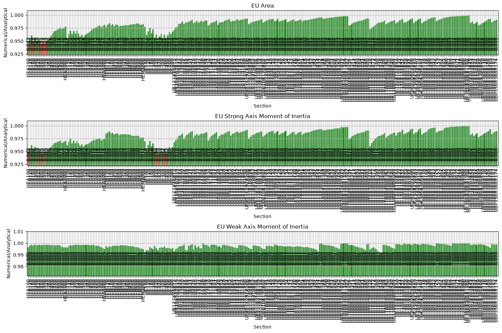

# Validation EU Designation

All HEA, HEB, HEM, IPE, UB, UC and UBP section designations are supported.

The reference values are the tabulated EN 10365:2017 section properties.


```python
from io import StringIO

from pandas import read_csv

section_table = read_csv(
    StringIO("""
designation,h,b,tw,tf,hi,A,Iy,Iz
HEA100,96,100,5,8,80,21.2,349.2,133.8
HEA120,114,120,5,8,98,25.3,606.2,230.9
HEA140,133,140,5.5,8.5,116,31.4,1033,389.3
HEA160,152,160,6,9,134,38.8,1673,615.6
HEA180,171,180,6,9.5,152,45.3,2510,924.6
HEA200,190,200,6.5,10,170,53.8,3692,1336
HEA220,210,220,7,11,188,64.3,5410,1955
HEA240,230,240,7.5,12,206,76.8,7763,2769
HEA260,250,260,7.5,12.5,225,86.8,10450,3668
HEA280,270,280,8,13,244,97.3,13670,4763
HEA300,290,300,8.5,14,262,112.5,18260,6310
HEA320,310,300,9,15.5,279,124.4,22930,6985
HEA340,330,300,9.5,16.5,297,133.5,27690,7436
HEA360,350,300,10,17.5,315,142.8,33090,7887
HEA400,390,300,11,19,352,159,45070,8564
HEA450,440,300,11.5,21,398,178,63720,9465
HEA500,490,300,12,23,444,197.5,86970,10370
HEA550,540,300,12.5,24,492,211.8,111900,10820
HEA600,590,300,13,25,540,226.5,141200,11270
HEA650,640,300,13.5,26,588,241.6,175200,11720
HEA700,690,300,14.5,27,636,260.5,215300,12180
HEA800,790,300,15,28,734,285.8,303400,12640
HEA900,890,300,16,30,830,320.5,422100,13550
HEA1000,990,300,16.5,31,928,346.8,553800,14000
HEB100,100,100,6,10,80,26,449.5,167.3
HEB120,120,120,6.5,11,98,34,864.4,317.5
HEB140,140,140,7,12,116,43,1509,549.7
HEB160,160,160,8,13,134,54.3,2492,889.2
HEB180,180,180,8.5,14,152,65.3,3831,1363
HEB200,200,200,9,15,170,78.1,5696,2003
HEB220,220,220,9.5,16,188,91,8091,2843
HEB240,240,240,10,17,206,106,11260,3923
HEB260,260,260,10,17.5,225,118.4,14920,5135
HEB280,280,280,10.5,18,244,131.4,19270,6595
HEB300,300,300,11,19,262,149.1,25170,8563
HEB320,320,300,11.5,20.5,279,161.3,30820,9239
HEB340,340,300,12,21.5,297,170.9,36660,9690
HEB360,360,300,12.5,22.5,315,180.6,43190,10140
HEB400,400,300,13.5,24,352,197.8,57680,10820
HEB450,450,300,14,26,398,218,79890,11720
HEB500,500,300,14.5,28,444,238.6,107200,12620
HEB550,550,300,15,29,492,254.1,136700,13080
HEB600,600,300,15.5,30,540,270,171000,13530
HEB650,650,300,16,31,588,286.3,210600,13980
HEB700,700,300,17,32,636,306.4,256900,14440
HEB800,800,300,17.5,33,734,334.2,359100,14900
HEB900,900,300,18.5,35,830,371.3,494100,15820
HEB1000,1000,300,19,36,928,400,644700,16280
HEM100,120,106,12,20,80,53.2,1143,399.2
HEM120,140,126,12.5,21,98,66.4,2018,702.8
HEM140,160,146,13,22,116,80.6,3291,1144
HEM160,180,166,14,23,134,97.1,5098,1759
HEM180,200,186,14.5,24,152,113.3,7483,2580
HEM200,220,206,15,25,170,131.3,10640,3651
HEM220,240,226,15.5,26,188,149.4,14600,5012
HEM240,270,248,18,32,206,199.6,24290,8153
HEM260,290,268,18,33,225,219.6,31310,10450
HEM280,310,288,18.5,33,244,240.2,39550,13160
HEM300,340,310,21,39,262,303.1,59200,19400
HEM320,359,309,21,40,279,312,68130,19710
HEM340,377,309,21,40,297,315.8,76370,19710
HEM360,395,308,21,40,315,318.8,84870,19520
HEM400,432,307,21,40,352,325.8,104100,19340
HEM450,478,307,21,40,398,335.4,131500,19340
HEM500,524,306,21,40,444,344.3,161900,19150
HEM550,572,306,21,40,492,354.4,198000,19160
HEM600,620,305,21,40,540,363.7,237400,18980
HEM650,668,305,21,40,588,373.7,281700,18980
HEM700,716,304,21,40,636,383,329300,18800
HEM800,814,303,21,40,734,404.3,442600,18630
HEM900,910,302,21,40,830,423.6,570400,18450
HEM1000,1008,302,21,40,928,444.2,722300,18460
IPE80,80,46,3.8,5.2,69.6,7.6,80,8.5
IPE100,100,55,4.1,5.7,88.6,10.3,171,15.9
IPE120,120,64,4.4,6.3,107.4,13.2,318,27.7
IPE140,140,73,4.7,6.9,126.2,16.4,541,44.9
IPE160,160,82,5,7.4,145.2,20.1,869,68.3
IPE180,180,91,5.3,8,164,23.9,1317,101
IPE200,200,100,5.6,8.5,183,28.5,1943,142
IPE220,220,110,5.9,9.2,201.6,33.4,2772,205
IPE240,240,120,6.2,9.8,220.4,39.1,3892,284
IPE270,270,135,6.6,10.2,249.6,45.9,5790,420
IPE300,300,150,7.1,10.7,278.6,53.8,8356,604
IPE330,330,160,7.5,11.5,307,62.6,11770,788
IPE360,360,170,8,12.7,334.6,72.7,16270,1043
IPE400,400,180,8.6,13.5,373,84.5,23130,1318
IPE450,450,190,9.4,14.6,420.8,98.8,33740,1676
IPE500,500,200,10.2,16,468,115.5,48200,2142
IPE550,550,210,11.1,17.2,515.6,134.4,67120,2668
IPE600,600,220,12,19,562,156,92080,3387
UB127X76X13,127,76,4,7.6,111.8,16.5,473.4,56
UB152X89X16,152.4,88.7,4.5,7.7,137,20.3,834.3,90
UB178X102X19,177.8,101.2,4.8,7.9,162,24.3,1356,137
UB203X102X23,203.2,101.8,5.4,9.3,184.6,29.4,2105,164
UB203X133X25,203.2,133.2,5.7,7.8,187.6,32,2340,308
UB203X133X30,206.8,133.9,6.4,9.6,187.6,38.2,2896,385
UB254X102X22,254,101.6,5.7,6.8,240.4,28,2841,119
UB254X102X25,257.2,101.9,6,8.4,240.4,32,3415,149
UB254X102X28,260.4,102.2,6.3,10,240.4,36.1,4005,179
UB254X146X31,251.4,146.1,6,8.6,234.2,39.7,4413,448
UB254X146X37,256,146.4,6.3,10.9,234.2,47.2,5537,571
UB254X146X43,259.6,147.3,7.2,12.7,234.2,54.8,6544,677
UB305X102X25,305.1,101.6,5.8,7,291.1,31.6,4455,123
UB305X102X28,308.7,101.8,6,8.8,291.1,35.9,5366,155
UB305X102X33,312.7,102.4,6.6,10.8,291.1,41.8,6501,194
UB305X127X37,304.4,123.4,7.1,10.7,283,47.2,7171,336
UB305X127X42,307.2,124.3,8,12.1,283,53.4,8196,389
UB305X127X48,311,125.3,9,14,283,61.2,9575,461
UB305X165X40,303.4,165,6,10.2,283,51.3,8503,764
UB305X165X46,306.6,165.7,6.7,11.8,283,58.7,9899,896
UB305X165X54,310.4,166.9,7.9,13.7,283,68.8,11700,1063
UB356X127X33,349,125.4,6,8.5,332,42.1,8249,280
UB356X127X39,353.4,126,6.6,10.7,332,49.8,10170,358
UB356X171X45,351.4,171.1,7,9.7,332,57.3,12070,811
UB356X171X51,355,171.5,7.4,11.5,332,64.9,14140,968
UB356X171X57,358,172.2,8.1,13,332,72.6,16040,1108
UB356X171X67,363.4,173.2,9.1,15.7,332,85.5,19460,1362
UB406X140X39,398,141.8,6.4,8.6,380.8,49.7,12510,410
UB406X140X46,403.2,142.2,6.8,11.2,380.8,58.6,15690,538
UB406X140X53,406.6,143.3,7.9,12.9,380.8,68,18280,635
UB406X178X54,402.6,177.7,7.7,10.9,380.8,69,18720,1021
UB406X178X60,406.4,177.9,7.9,12.8,380.8,76.5,21600,1203
UB406X178X67,409.4,178.8,8.8,14.3,380.8,85.5,24330,1365
UB406X178X74,412.8,179.5,9.5,16,380.8,94.5,27310,1545
UB406X178X85,417,181,10.9,18.2,380.6,108.2,31530,1803
UB457X152X52,449.8,152.4,7.6,10.9,428,66.6,21370,645
UB457X152X60,454.6,152.9,8.1,13.3,428,76.2,25500,795
UB457X152X67,458,153.8,9,15,428,85.6,28930,913
UB457X152X74,462,154.4,9.6,17,428,94.5,32670,1047
UB457X152X82,465.8,155.3,10.5,18.9,428,104.5,36590,1185
UB457X191X67,453.4,189.9,8.5,12.7,428,85.5,29380,1452
UB457X191X74,457,190.4,9,14.5,428,94.6,33320,1671
UB457X191X82,460,191.3,9.9,16,428,104.5,37050,1871
UB457X191X89,463.4,191.9,10.5,17.7,428,113.8,41020,2089
UB457X191X98,467.2,192.8,11.4,19.6,428,125.3,45730,2347
UB457X191X106,469,194,12.6,20.6,427.8,134.7,48790,2515
UB533X165X66,525,165,8.9,11.4,502.2,83.8,35100,857
UB533X165X74,529,166,9.7,13.6,501.8,95.3,41100,1042
UB533X165X85,535,166,10.3,16.5,502,107.9,48580,1264
UB533X210X82,528.3,208.8,9.6,13.2,501.9,104.7,47540,2007
UB533X210X92,533.1,209.3,10.1,15.6,501.9,117.4,55230,2389
UB533X210X101,536.7,210,10.8,17.4,501.9,128.7,61520,2692
UB533X210X109,539.5,210.8,11.6,18.8,501.9,138.9,66820,2943
UB533X210X122,544.5,211.9,12.7,21.3,501.9,155.4,76040,3388
UB533X210X138,549,214,14.7,23.6,501.8,176.2,86160,3870
UB610X178X82,599,178,10,12.8,573.4,104.4,56030,1209
UB610X178X92,603,179,10.9,15,573,117.6,64680,1441
UB610X229X101,602.6,227.6,10.5,14.8,573,128.9,75780,2915
UB610X229X113,607.6,228.2,11.1,17.3,573,143.9,87320,3434
UB610X229X125,612.2,229,11.9,19.6,573,159.3,98610,3932
UB610X229X140,617.2,230.2,13.1,22.1,573,178.2,111800,4505
UB610X229X153,623,229,14,24.9,573.2,195.7,125200,4998
UB610X305X149,612.4,304.8,11.8,19.7,573,190,125900,9308
UB610X305X179,620.2,307.1,14.1,23.6,573,228.1,153000,11410
UB610X305X238,635.8,311.4,18.4,31.4,573,303.3,209500,15840
UB686X254X125,677.9,253,11.7,16.2,645.5,159.5,118000,4383
UB686X254X140,683.5,253.7,12.4,19,645.5,178.4,136300,5183
UB686X254X152,687.5,254.5,13.2,21,645.5,194.1,150400,5784
UB686X254X170,692.9,255.8,14.5,23.7,645.5,216.8,170300,6630
UB686X254X192,702,254,15.5,27.9,646.2,243.8,197900,7643
UB762X267X134,750,264.4,12,15.5,719,170.6,150700,4788
UB762X267X147,754,265.2,12.8,17.5,719,187.2,168500,5455
UB762X267X173,762.2,266.7,14.3,21.6,719,220.4,205300,6850
UB762X267X197,769.8,268,15.6,25.4,719,250.6,240000,8175
UB762X267X220,779,266,16.5,30,719,280.7,278200,9440
UB838X292X176,834.9,291.7,14,18.8,797.3,224,246000,7799
UB838X292X194,840.7,292.4,14.7,21.7,797.3,246.8,279200,9066
UB838X292X226,850.9,293.8,16.1,26.8,797.3,288.6,339700,11360
UB838X292X251,859,292,17,31,797,319.3,386500,12900
UB914X305X201,903,303.3,15.1,20.2,862.6,255.9,325300,9423
UB914X305X224,910.4,304.1,15.9,23.9,862.6,285.6,376400,11240
UB914X305X238,915,305,16.5,25.9,863.2,303.5,406400,12290
UB914X305X253,918.4,305.5,17.3,27.9,862.6,322.8,436300,13300
UB914X305X271,923,307,18.4,30,863,346.1,471600,14520
UB914X305X289,926.6,307.7,19.5,32,862.6,368.3,504200,15600
UB914X305X313,932,309,21.1,34.5,863,398.4,548200,17040
UB914X305X345,943,308,22.1,39.9,863.2,439.7,625600,19520
UB914X305X381,951,310,24.4,43.9,863.2,485.9,696800,21910
UB914X305X425,961,313,26.9,49,863,542,788200,25190
UB914X305X474,971,316,30,54.1,862.8,603.9,885700,28660
UB914X305X521,981,319,33,58.9,863.2,663.7,982400,32140
UB914X305X576,993,322,36.1,65,863,733.2,1102000,36520
UB920X420X344,927,418,19.3,32,863,437.2,645000,39010
UB920X420X368,931,419,20.3,34.3,862.4,465.6,692200,42120
UB920X420X390,936,420,21.3,36.6,862.8,494.3,741700,45270
UB920X420X420,943,422,22.5,39.9,863.2,534.1,813300,50070
UB920X420X449,948,423,24,42.7,862.6,571.4,874700,53970
UB920X420X491,957,422,25.9,47,863,623.3,966300,59000
UB920X420X537,965,425,28.4,51.1,862.8,682.5,1066000,65550
UB920X420X588,975,427,31,55.9,863.2,748.1,1181000,72760
UB920X420X656,987,431,34.5,62,863,835.3,1335000,83040
UB920X420X725,999,434,38.1,68.1,862.8,922.9,1492000,93200
UB920X420X787,1011,437,40.9,73.9,863.2,1002,1646000,103300
UB920X420X970,1043,446,50,89.9,863.2,1237,2100000,133900
UB920X420X1077,1061,451,55,99.1,862.8,1372,2377000,152700
UB920X420X1194,1081,457,60.5,109,863,1522,2694000,175000
UB920X420X1269,1093,461,64,115.1,862.8,1617,2900000,189900
UB920X420X1377,1093,473,76.7,115.1,862.8,1754,3034000,206300
UB1000X400X296,982,400,16.5,27.1,927.8,377.6,620300,28960
UB1000X400X321,990,400,16.5,31,928,408.8,696400,33120
UB1000X400X371,1000,400,19,36.1,927.8,472.8,813700,38580
UB1000X400X412,1008,402,21.1,40,928,525.1,910500,43400
UB1000X400X443,1012,402,23.6,41.9,928.2,563.7,966500,45500
UB1000X400X483,1020,404,25.4,46,928,615.1,1067000,50710
UB1000X400X539,1030,407,28.4,51.1,927.8,687.2,1203000,57630
UB1000X400X554,1032,408,29.5,52,928,705.8,1232000,59100
UB1000X400X591,1040,409,31,55.9,928.2,752.7,1331000,64010
UB1000X400X642,1048,412,34,60,928,817.6,1451000,70280
UB1000X400X748,1068,417,39,70,928,953.4,1732000,85110
UB1000X400X883,1092,424,45.5,82,928,1125,2096000,105000
UB1000X400X976,1108,428,50,89.9,928.2,1243,2349000,118500
UB1016X305X222,970,300,16,21.1,927.8,282.8,407700,9546
UB1016X305X249,980,300,16.5,26,928,316.8,481100,11750
UB1016X305X272,990,300,16.5,31,928,346.8,553800,14000
UB1016X305X314,1000,300,19.1,35.9,928.2,400.4,644200,16230
UB1016X305X350,1008,302,21.1,40,928,445.1,723000,18460
UB1016X305X393,1016,303,24.4,43.9,928.2,500.2,807700,20500
UB1016X305X415,1020,304,26,46,928,528.7,853100,21710
UB1016X305X438,1026,305,26.9,49,928,556.3,909200,23360
UB1016X305X494,1036,309,31,54,928,629.1,1028000,26820
UB1016X305X584,1056,314,36,64,928,743.7,1246000,33430
UB1100X400X343,1090,400,18,31,1028,440.7,878360,33130
UB1100X400X390,1100,400,20,36,1028,501.3,1016300,38490
UB1100X400X433,1108,402,22,40,1028,555.4,1136500,43430
UB1100X400X499,1118,405,26,45,1028,639.5,1305000,50010
UB1100X400X548,1128,407,28,50,1028,702.5,1456600,56410
UB1100X400X607,1138,410,31,55,1028,777.4,1624100,63470
UC152X152X23,152.4,152.2,5.8,6.8,138.8,29.2,1250,399.9
UC152X152X30,157.6,152.9,6.5,9.4,138.8,38.3,1748,560.5
UC152X152X37,161.8,154.4,8,11.5,138.8,47.1,2210,706.2
UC152X152X44,166,155.9,9.5,13.6,138.8,56.1,2706,860.1
UC152X152X51,170.2,157.4,11,15.7,138.8,65.2,3230,1022
UC203X203X46,203.2,203.6,7.2,11,181.2,58.7,4568,1548
UC203X203X52,206.2,204.3,7.9,12.5,181.2,66.3,5259,1778
UC203X203X60,209.6,205.8,9.4,14.2,181.2,76.4,6125,2065
UC203X203X71,215.8,206.4,10,17.3,181.2,90.4,7618,2537
UC203X203X86,222.2,209.1,12.7,20.5,181.2,109.6,9449,3127
UC203X203X100,229,210,14.5,23.7,181.6,126.7,11330,3663
UC254X254X73,254.1,254.6,8.6,14.2,225.7,93.1,11410,3908
UC254X254X89,260.3,256.3,10.3,17.3,225.7,113.3,14270,4857
UC254X254X107,266.7,258.8,12.8,20.5,225.7,136.4,17510,5928
UC254X254X132,276.3,261.3,15.3,25.3,225.7,168.1,22530,7531
UC254X254X167,289.1,265.2,19.2,31.7,225.7,212.9,30000,9870
UC305X305X97,307.9,305.3,9.9,15.4,277.1,123.4,22250,7308
UC305X305X118,314.5,307.4,12,18.7,277.1,150.2,27670,9059
UC305X305X137,320.5,309.2,13.8,21.7,277.1,174.4,32810,10700
UC305X305X158,327.1,311.2,15.8,25,277.1,201.4,38750,12570
UC305X305X198,339.9,314.5,19.1,31.4,277.1,252.4,50900,16300
UC305X305X240,352.5,318.4,23,37.7,277.1,305.8,64200,20310
UC305X305X283,365.3,322.2,26.8,44.1,277.1,360.4,78870,24630
UC305X305X313,374,325,30,48.3,277.4,399.1,89560,27700
UC305X305X342,382,328,32.6,52.6,276.8,437.2,100500,31020
UC356X368X129,355.6,368.6,10.4,17.5,320.6,164.3,40250,14610
UC356X368X153,362,370.5,12.3,20.7,320.6,194.8,48590,17550
UC356X368X177,368.2,372.6,14.4,23.8,320.6,225.5,57120,20530
UC356X368X202,374.6,374.7,16.5,27,320.6,257.2,66260,23690
UC356X406X235,381,394.8,18.4,30.2,320.6,299,79080,30990
UC356X406X287,393.6,399,22.6,36.5,320.6,365.7,99880,38680
UC356X406X340,406.4,403,26.6,42.9,320.6,433,122500,46850
UC356X406X393,419,407,30.6,49.2,320.6,500.6,146600,55370
UC356X406X467,436.6,412.2,35.8,58,320.6,594.9,183000,67830
UC356X406X509,446,416,39.1,62.7,320.6,649,204500,75400
UC356X406X551,455.6,418.5,42.1,67.5,320.6,701.9,226900,82670
UC356X406X592,465,421,45,72.3,320.4,754.9,250200,90170
UC356X406X634,474.6,424,47.6,77,320.6,807.5,274800,98130
UC356X406X677,483,428,51.2,81.5,320,863.4,299500,106900
UC356X406X744,498,432,55.6,88.9,320.2,948.1,342100,119900
UC356X406X818,514,437,60.5,97,320,1043.3,392200,135500
UC356X406X900,531,442,65.9,106,319,1149.2,450200,153300
UC356X406X990,550,448,71.9,115,320,1262.4,518900,173400
UC356X406X1086,569,454,78,125,319,1385.8,595700,196200
UC356X406X1202,580,471,95,130,320,1530.5,663600,228700
UC356X406X1299,600,476,100,140,320,1654.7,754600,254400
UBP203X203X45,200.2,205.9,9.5,9.5,181.2,57.2,4100,1384
UBP203X203X54,204,207.7,11.3,11.4,181.2,68.7,5027,1705
UBP254X254X63,247.1,256.6,10.6,10.7,225.7,80.2,8860,3016
UBP254X254X71,249.7,258,12,12,225.7,90.4,10070,3439
UBP254X254X85,254.3,260.4,14.4,14.3,225.7,108.4,12280,4215
UBP305X305X79,299.3,306.4,11,11.1,277.1,100.5,16440,5326
UBP305X305X88,301.7,307.8,12.4,12.3,277.1,112.1,18420,5984
UBP305X305X95,303.7,308.7,13.3,13.3,277.1,120.9,20040,6529
UBP305X305X110,307.9,310.7,15.3,15.4,277.1,140.1,23560,7709
UBP305X305X126,312.3,312.9,17.5,17.6,277.1,160.6,27410,9002
UBP305X305X149,318.5,316,20.6,20.7,277.1,189.9,33070,10910
UBP305X305X186,328.3,320.9,25.5,25.6,277.1,236.9,42610,14140
UBP305X305X223,337.9,325.7,30.3,30.4,277.1,284,52700,17580
UBP356X368X109,346.4,371,12.8,12.9,320.6,138.7,30630,10990
UBP356X368X133,352,373.8,15.6,15.7,320.6,169.4,37980,13680
UBP356X368X152,356.4,376,17.8,17.9,320.6,193.7,43970,15880
UBP356X368X174,361.4,378.5,20.3,20.4,320.6,221.5,51010,18460
""")
)


def get_properties(designation: str):
    section = section_table[section_table["designation"] == designation]
    return (
        1e2 * section["A"].values[0],
        1e4 * section["Iy"].values[0],
        1e4 * section["Iz"].values[0],
    )
```


```python
import subprocess
import tempfile

import matplotlib.pyplot as plt

template = """
node 1 0 0 0

material Elastic1D 1 1

section EU3D $designation$ 1 1 1

element SingleSection3D 1 1 1

displacement 1 0 1 axial 1
displacement 2 0 1 rs 1
displacement 3 0 1 rw 1

step static 1 1
set ini_step_size 1

analyze

peek node 1

exit
"""


all_results = {}


def validate(designation: str):
    def run_analysis():
        with tempfile.NamedTemporaryFile() as fp:
            with open(fp.name, "w") as f:
                f.write(template.replace("$designation$", designation))

            result = (
                subprocess.check_output(["suanpan", "-nu", "-nc", "-f", fp.name])
                .decode("utf-8")
                .splitlines()
            )

        for i, line in enumerate(result):
            if line.startswith("Resistance"):
                return [float(x) for x in result[i + 1].split()]

    if result := run_analysis():
        all_results[designation] = [
            x / y for x, y in zip(result, get_properties(designation))
        ]


for _, row in section_table.iterrows():
    validate(row["designation"])
```


```python
fig = plt.figure(figsize=(15, 10), tight_layout=True)


def plot(title, index):
    values = [x[index] for x in all_results.values()]
    min_value = min(values)
    max_value = max(values)
    colors = ["red" if abs(x - 1) > 0.05 else "green" for x in values]
    ax = fig.add_subplot(3, 1, index + 1)
    ax.bar(all_results.keys(), values, color=colors)
    ax.set_ylabel("Numerical/Analytical")
    ax.set_xlabel("Section")
    ax.set_ybound(min_value - 0.02, max_value + 0.01)
    ax.set_xlim(-1, len(all_results))
    ax.grid()

    for i, v in enumerate(values):
        ax.text(
            i, min_value - 0.01, f"{v:.3f}", horizontalalignment="center", rotation=90
        )

    ax.set_title(title)
    ax.set_xticks(ax.get_xticks())
    ax.set_xticklabels(ax.get_xticklabels(), rotation=90)


plot("EU Area", 0)
plot("EU Strong Axis Moment of Inertia", 1)
plot("EU Weak Axis Moment of Inertia", 2)

fig.savefig("EU.pdf")
```





```python
import json

eu_section = {}
for key, value in all_results.items():
    num_ip = 6

    eu_section[f"{key}-2D"] = {
        "prefix": key,
        "description": f"EU 2D section {key}, accuracy: {value[0]:.2f}/{value[1]:.2f}",
        "body": [
            f"section EU2D {key} " + "${1:(1)} ${2:(2)} ${3:[3]} ${4:[4]} ${5:[5]}",
            "# (1) int, unique tag",
            "# (2) int, material tag",
            "# [3] double, scale, default: 1.0",
            f"# [4] int, number of integration points, default: {num_ip}",
            "# [5] double, eccentricity, default: 0.0",
            "",
        ],
    }
    eu_section[f"{key}-3D"] = {
        "prefix": key,
        "description": f"EU 3D section {key}, accuracy: {value[0]:.2f}/{value[1]:.2f}/{value[2]:.2f}",
        "body": [
            f"section EU3D {key} "
            + "${1:(1)} ${2:(2)} ${3:[3]} ${4:[4]} ${5:[5]} ${6:[6]}",
            "# (1) int, unique tag",
            "# (2) int, material tag",
            "# [3] double, scale, default: 1.0",
            f"# [4] int, number of integration points, default: {num_ip}",
            "# [5] double, eccentricity of y axis, default: 0.0",
            "# [6] double, eccentricity of z axis, default: 0.0",
            "",
        ],
    }


with open("eu_sections_completion.json", "w") as f:
    json.dump({k: v for k, v in sorted(eu_section.items())}, f, indent=4)

highlighting = []
for key in sorted(all_results.keys()):
    highlighting.append(
        {
            "name": "support.constant.section",
            "match": "\\b(?i)" + key.replace(".", "\\.") + "\\b",
        },
    )

with open("eu_sections_highlight.json", "w") as f:
    json.dump(highlighting, f, indent=4)

print(
    r"\b(?i)("
    + "|".join([x.replace(".", r"\.") for x in sorted(all_results.keys())])
    + r")\b"
)
```

    \b(?i)(HEA100|HEA1000|HEA120|HEA140|HEA160|HEA180|HEA200|HEA220|HEA240|HEA260|HEA280|HEA300|HEA320|HEA340|HEA360|HEA400|HEA450|HEA500|HEA550|HEA600|HEA650|HEA700|HEA800|HEA900|HEB100|HEB1000|HEB120|HEB140|HEB160|HEB180|HEB200|HEB220|HEB240|HEB260|HEB280|HEB300|HEB320|HEB340|HEB360|HEB400|HEB450|HEB500|HEB550|HEB600|HEB650|HEB700|HEB800|HEB900|HEM100|HEM1000|HEM120|HEM140|HEM160|HEM180|HEM200|HEM220|HEM240|HEM260|HEM280|HEM300|HEM320|HEM340|HEM360|HEM400|HEM450|HEM500|HEM550|HEM600|HEM650|HEM700|HEM800|HEM900|IPE100|IPE120|IPE140|IPE160|IPE180|IPE200|IPE220|IPE240|IPE270|IPE300|IPE330|IPE360|IPE400|IPE450|IPE500|IPE550|IPE600|IPE80|UB1000X400X296|UB1000X400X321|UB1000X400X371|UB1000X400X412|UB1000X400X443|UB1000X400X483|UB1000X400X539|UB1000X400X554|UB1000X400X591|UB1000X400X642|UB1000X400X748|UB1000X400X883|UB1000X400X976|UB1016X305X222|UB1016X305X249|UB1016X305X272|UB1016X305X314|UB1016X305X350|UB1016X305X393|UB1016X305X415|UB1016X305X438|UB1016X305X494|UB1016X305X584|UB1100X400X343|UB1100X400X390|UB1100X400X433|UB1100X400X499|UB1100X400X548|UB1100X400X607|UB127X76X13|UB152X89X16|UB178X102X19|UB203X102X23|UB203X133X25|UB203X133X30|UB254X102X22|UB254X102X25|UB254X102X28|UB254X146X31|UB254X146X37|UB254X146X43|UB305X102X25|UB305X102X28|UB305X102X33|UB305X127X37|UB305X127X42|UB305X127X48|UB305X165X40|UB305X165X46|UB305X165X54|UB356X127X33|UB356X127X39|UB356X171X45|UB356X171X51|UB356X171X57|UB356X171X67|UB406X140X39|UB406X140X46|UB406X140X53|UB406X178X54|UB406X178X60|UB406X178X67|UB406X178X74|UB406X178X85|UB457X152X52|UB457X152X60|UB457X152X67|UB457X152X74|UB457X152X82|UB457X191X106|UB457X191X67|UB457X191X74|UB457X191X82|UB457X191X89|UB457X191X98|UB533X165X66|UB533X165X74|UB533X165X85|UB533X210X101|UB533X210X109|UB533X210X122|UB533X210X138|UB533X210X82|UB533X210X92|UB610X178X82|UB610X178X92|UB610X229X101|UB610X229X113|UB610X229X125|UB610X229X140|UB610X229X153|UB610X305X149|UB610X305X179|UB610X305X238|UB686X254X125|UB686X254X140|UB686X254X152|UB686X254X170|UB686X254X192|UB762X267X134|UB762X267X147|UB762X267X173|UB762X267X197|UB762X267X220|UB838X292X176|UB838X292X194|UB838X292X226|UB838X292X251|UB914X305X201|UB914X305X224|UB914X305X238|UB914X305X253|UB914X305X271|UB914X305X289|UB914X305X313|UB914X305X345|UB914X305X381|UB914X305X425|UB914X305X474|UB914X305X521|UB914X305X576|UB920X420X1077|UB920X420X1194|UB920X420X1269|UB920X420X1377|UB920X420X344|UB920X420X368|UB920X420X390|UB920X420X420|UB920X420X449|UB920X420X491|UB920X420X537|UB920X420X588|UB920X420X656|UB920X420X725|UB920X420X787|UB920X420X970|UBP203X203X45|UBP203X203X54|UBP254X254X63|UBP254X254X71|UBP254X254X85|UBP305X305X110|UBP305X305X126|UBP305X305X149|UBP305X305X186|UBP305X305X223|UBP305X305X79|UBP305X305X88|UBP305X305X95|UBP356X368X109|UBP356X368X133|UBP356X368X152|UBP356X368X174|UC152X152X23|UC152X152X30|UC152X152X37|UC152X152X44|UC152X152X51|UC203X203X100|UC203X203X46|UC203X203X52|UC203X203X60|UC203X203X71|UC203X203X86|UC254X254X107|UC254X254X132|UC254X254X167|UC254X254X73|UC254X254X89|UC305X305X118|UC305X305X137|UC305X305X158|UC305X305X198|UC305X305X240|UC305X305X283|UC305X305X313|UC305X305X342|UC305X305X97|UC356X368X129|UC356X368X153|UC356X368X177|UC356X368X202|UC356X406X1086|UC356X406X1202|UC356X406X1299|UC356X406X235|UC356X406X287|UC356X406X340|UC356X406X393|UC356X406X467|UC356X406X509|UC356X406X551|UC356X406X592|UC356X406X634|UC356X406X677|UC356X406X744|UC356X406X818|UC356X406X900|UC356X406X990)\b
