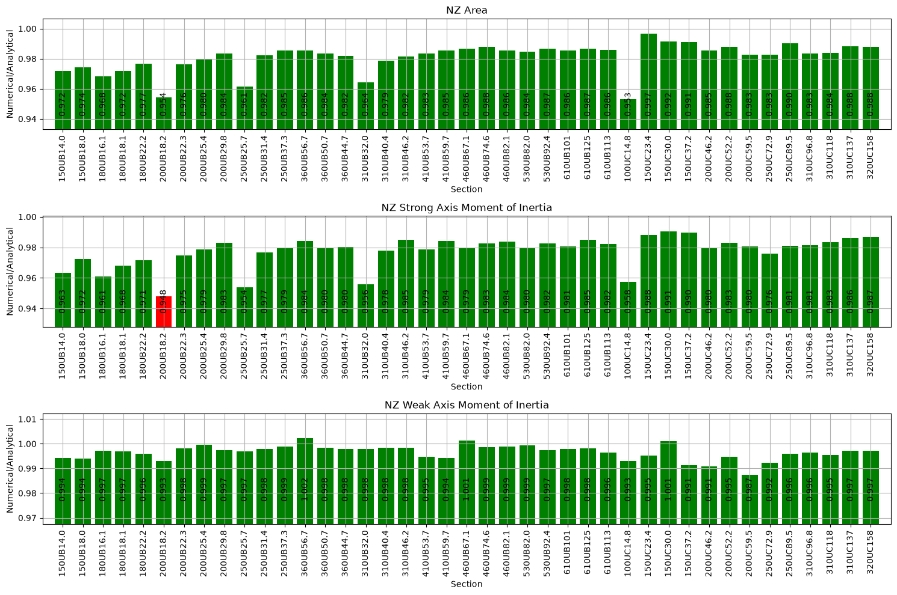

# Validation NZ Designation

All AS/NZS 3679.1 UB and UC section designations are supported.

The reference values are the tabulated AS/NZS 3679.1 section properties.


```python
from io import StringIO

from pandas import read_csv

section_table = read_csv(
    StringIO("""
designation,h,b,tw,tf,hi,A,Iy,Iz
150UB14.0,150,75,5,7,136,17.8,666,49.5
150UB18.0,155,75,6,9.5,136,23,905,67.2
180UB16.1,173,90,4.5,7,159,20.4,1060,85.3
180UB18.1,175,90,5,8,159,23,1210,97.5
180UB22.2,179,90,6,10,159,28.2,1530,122
200UB18.2,198,99,4.5,7,184,23.2,1580,114
200UB22.3,202,133,5,7,188,28.7,2100,275
200UB25.4,203,133,5.8,7.8,187.4,32.3,2360,306
200UB29.8,207,134,6.3,9.6,187.8,38.2,2910,386
250UB25.7,248,124,5,8,232,32.7,3540,255
250UB31.4,252,146,6.1,8.6,234.8,40.1,4450,447
250UB37.3,256,146,6.4,10.9,234.2,47.5,5570,566
360UB56.7,359,172,8,13,333,72.4,16100,1100
360UB50.7,356,171,7.3,11.5,333,64.7,14200,960
360UB44.7,352,171,6.9,9.7,332.6,57.2,12100,810
310UB32.0,298,149,5.5,8,282,40.8,6320,442
310UB40.4,304,165,6.1,10.2,283.6,52.1,8640,765
310UB46.2,307,166,6.7,11.8,283.4,59.3,10000,901
410UB53.7,403,178,7.6,10.9,381.2,68.9,18800,1030
410UB59.7,406,178,7.8,12.8,380.4,76.4,21600,1210
460UB67.1,454,190,8.5,12.7,428.6,85.8,29600,1450
460UB74.6,457,190,9.1,14.5,428,95.2,33500,1660
460UB82.1,460,191,9.9,16,428,105,37200,1860
530UB82.0,533,210,9.6,13.2,506.6,105,47700,2010
530UB92.4,533,210,10.2,15.6,501.8,118,55400,2380
610UB101,602,228,10.6,14.8,572.4,130,76100,2930
610UB125,612,229,11.9,19.6,572.8,160,98600,3930
610UB113,607,228,11.2,17.3,572.4,145,87500,3430
100UC14.8,97,99,5,7,83,18.9,318,114
150UC23.4,152,152,6.1,6.8,138.4,29.25,1250,399.9
150UC30.0,158,153,6.6,9.4,139.2,38.26,1748,560.5
150UC37.2,162,154,8.1,11.5,139,47.11,2210,706.2
200UC46.2,203,203,7.3,11,181,58.73,4568,1548
200UC52.2,206,204,7.9,12.5,181,66.28,5259,1778
200UC59.5,210,205,9.4,14.2,181.6,76.37,6125,2065
250UC72.9,254,254,8.6,14.2,225.6,93.1,11410,3908
250UC89.5,260,256,10.3,17.3,225.4,113.3,14270,4857
310UC96.8,308,305,9.9,15.4,277.2,123.4,22250,7308
310UC118,315,307,12,18.7,277.6,150.2,27670,9059
310UC137,321,309,13.8,21.7,277.6,174.4,32810,10700
320UC158,327,311,15.8,25,277,201.4,38750,12570
""")
)


def get_properties(designation: str):
    section = section_table[section_table["designation"] == designation]
    return (
        1e2 * section["A"].values[0],
        1e4 * section["Iy"].values[0],
        1e4 * section["Iz"].values[0],
    )
```


```python
import subprocess
import tempfile

import matplotlib.pyplot as plt

template = """
node 1 0 0 0

material Elastic1D 1 1

section NZ3D $designation$ 1 1 1

element SingleSection3D 1 1 1

displacement 1 0 1 axial 1
displacement 2 0 1 rs 1
displacement 3 0 1 rw 1

step static 1 1
set ini_step_size 1

analyze

peek node 1

exit
"""


all_results = {}


def validate(designation: str):
    def run_analysis():
        with tempfile.NamedTemporaryFile() as fp:
            with open(fp.name, "w") as f:
                f.write(template.replace("$designation$", designation))

            result = (
                subprocess.check_output(["suanpan", "-nu", "-nc", "-f", fp.name])
                .decode("utf-8")
                .splitlines()
            )

        for i, line in enumerate(result):
            if line.startswith("Resistance"):
                return [float(x) for x in result[i + 1].split()]

    if result := run_analysis():
        all_results[designation] = [
            x / y for x, y in zip(result, get_properties(designation))
        ]


for _, row in section_table.iterrows():
    validate(row["designation"])
```


```python
fig = plt.figure(figsize=(15, 10), tight_layout=True)


def plot(title, index):
    values = [x[index] for x in all_results.values()]
    min_value = min(values)
    max_value = max(values)
    colors = ["red" if abs(x - 1) > 0.05 else "green" for x in values]
    ax = fig.add_subplot(3, 1, index + 1)
    ax.bar(all_results.keys(), values, color=colors)
    ax.set_ylabel("Numerical/Analytical")
    ax.set_xlabel("Section")
    ax.set_ybound(min_value - 0.02, max_value + 0.01)
    ax.set_xlim(-1, len(all_results))
    ax.grid()

    for i, v in enumerate(values):
        ax.text(
            i, min_value - 0.01, f"{v:.3f}", horizontalalignment="center", rotation=90
        )

    ax.set_title(title)
    ax.set_xticks(ax.get_xticks())
    ax.set_xticklabels(ax.get_xticklabels(), rotation=90)


plot("NZ Area", 0)
plot("NZ Strong Axis Moment of Inertia", 1)
plot("NZ Weak Axis Moment of Inertia", 2)

fig.savefig("NZ.pdf")
```





```python
import json

nz_section = {}
for key, value in all_results.items():
    num_ip = 6

    nz_section[f"{key}-2D"] = {
        "prefix": key,
        "description": f"NZ 2D section {key}, accuracy: {value[0]:.2f}/{value[1]:.2f}",
        "body": [
            f"section NZ2D {key} " + "${1:(1)} ${2:(2)} ${3:[3]} ${4:[4]} ${5:[5]}",
            "# (1) int, unique tag",
            "# (2) int, material tag",
            "# [3] double, scale, default: 1.0",
            f"# [4] int, number of integration points, default: {num_ip}",
            "# [5] double, eccentricity, default: 0.0",
            "",
        ],
    }
    nz_section[f"{key}-3D"] = {
        "prefix": key,
        "description": f"NZ 3D section {key}, accuracy: {value[0]:.2f}/{value[1]:.2f}/{value[2]:.2f}",
        "body": [
            f"section NZ3D {key} "
            + "${1:(1)} ${2:(2)} ${3:[3]} ${4:[4]} ${5:[5]} ${6:[6]}",
            "# (1) int, unique tag",
            "# (2) int, material tag",
            "# [3] double, scale, default: 1.0",
            f"# [4] int, number of integration points, default: {num_ip}",
            "# [5] double, eccentricity of y axis, default: 0.0",
            "# [6] double, eccentricity of z axis, default: 0.0",
            "",
        ],
    }


with open("nz_sections_completion.json", "w") as f:
    json.dump({k: v for k, v in sorted(nz_section.items())}, f, indent=4)

highlighting = []
for key in sorted(all_results.keys()):
    highlighting.append(
        {
            "name": "support.constant.section",
            "match": "\\b(?i)" + key.replace(".", "\\.") + "\\b",
        },
    )

with open("nz_sections_highlight.json", "w") as f:
    json.dump(highlighting, f, indent=4)

print(
    r"\b(?i)("
    + "|".join([x.replace(".", r"\.") for x in sorted(all_results.keys())])
    + r")\b"
)
```

    \b(?i)(100UC14\.8|150UB14\.0|150UB18\.0|150UC23\.4|150UC30\.0|150UC37\.2|180UB16\.1|180UB18\.1|180UB22\.2|200UB18\.2|200UB22\.3|200UB25\.4|200UB29\.8|200UC46\.2|200UC52\.2|200UC59\.5|250UB25\.7|250UB31\.4|250UB37\.3|250UC72\.9|250UC89\.5|310UB32\.0|310UB40\.4|310UB46\.2|310UC118|310UC137|310UC96\.8|320UC158|360UB44\.7|360UB50\.7|360UB56\.7|410UB53\.7|410UB59\.7|460UB67\.1|460UB74\.6|460UB82\.1|530UB82\.0|530UB92\.4|610UB101|610UB113|610UB125)\b
