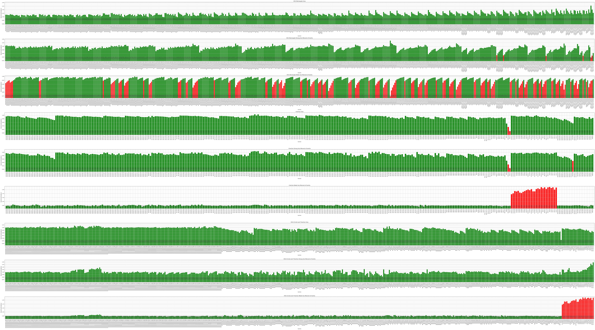

# Validation US Designation

On this page, we validate the section properties of some US designations.
All W, S, M, WT, ST, MT, HP, HSS designations, which are compiled and well documented in the [AISC Shapes Database v16.0](https://www.aisc.org/publications/steel-construction-manual-resources/16th-ed-steel-construction-manual/aisc-shapes-database-v16.0/), are included.

## Some Utilities

The bundled spreadsheet is loaded directly.


```python
import pandas

section_table = pandas.read_excel(
    "aisc-shapes-database-v16.0.xlsx",
    sheet_name=1,
    usecols="A:CF",
)
print(section_table.head())
```

      Type EDI_Std_Nomenclature AISC_Manual_Label T_F  ...   PD   T  WGi WGo
    0    W              W44X408           W44X408   T  ...  122  38  5.5   3
    1    W              W44X368           W44X368   F  ...  121  38  5.5   3
    2    W              W44X335           W44X335   F  ...  120  38  5.5   3
    3    W              W44X290           W44X290   F  ...  119  38  5.5   3
    4    W              W44X262           W44X262   F  ...  118  38  5.5   3

    [5 rows x 84 columns]


We define a function to get the area, moment of inertia about the strong and weak axes.


```python
def get_properties(designation: str):
    section = section_table[section_table["AISC_Manual_Label"] == designation]
    return [section[x].values[0] for x in ("A", "Ix", "Iy")]
```

## Analysis Template

Next, we define the function to run the analysis and extract the result.

The following is the template model file that will be used.
A few things to note:

1. The material is assumed to be elastic with a unit elastic modulus.
2. The default integration scheme is used for each designation.
3. A unit displacement load is applied to axial, strong axis bending and weak axis bending.
4. The `US3DC` category is used; it automatically recentres the section to its barycentre if it is not symmetric.


```python
template = """
node 1 0 0 0

material Elastic1D 1 1

section US3DC $designation$ 1 1 1

element SingleSection3D 1 1 1

displacement 1 0 1 axial 1
displacement 2 0 1 rs 1
displacement 3 0 1 rw 1

step static 1 1
set ini_step_size 1

analyze

peek node 1

exit
"""
```

By using the above settings, the resistances on three DoFs are effectively the area and moments of inertia.

## Extract Results

To extract the data, we process the output.


```python
import subprocess
import tempfile


def run_analysis(designation: str):
    with tempfile.NamedTemporaryFile() as fp:
        with open(fp.name, "w") as f:
            f.write(template.replace("$designation$", designation))

        result = (
            subprocess.check_output(["suanpan", "-nu", "-nc", "-f", fp.name])
            .decode("utf-8")
            .splitlines()
        )

    for i, line in enumerate(result):
        if line.startswith("Resistance"):
            return [float(x) for x in result[i + 1].split()]
```

The ratio between the numerical result and the reference value given in the database is stored.
Ideally, this ratio shall be close to unity, meaning a good match.


```python
all_results = {}


def validate(designation: str):
    if result := run_analysis(designation):
        all_results[designation] = [
            x / y for x, y in zip(result, get_properties(designation))
        ]
```

## Collect All Sections

We can now iterate over all sections.


```python
for _, row in section_table[
    section_table["AISC_Manual_Label"].str.startswith(("W", "M", "S", "HP", "HSS"))
].iterrows():
    designation = row["AISC_Manual_Label"]
    # ignore C sections
    if designation.startswith("MC"):
        continue

    validate(designation)
```


```python
import matplotlib.pyplot as plt

fig = plt.figure(figsize=(90, 50), tight_layout=True)


rhs_results = {
    k: v for k, v in all_results.items() if k.startswith("HSS") and k.count("X") == 2
}
chs_results = {
    k: v for k, v in all_results.items() if k.startswith("HSS") and k.count("X") == 1
}
i_results = {
    k: v for k, v in all_results.items() if not k.startswith("HSS") and "T" not in k
}
t_results = {
    k: v for k, v in all_results.items() if not k.startswith("HSS") and "T" in k
}
chs_t_results = {**chs_results, **t_results}

total = 3 * (int(bool(rhs_results)) + int(bool(i_results)) + int(bool(chs_t_results)))

counter = 0


def plot(title, index, results):
    if not results:
        return
    values = [x[index] for x in results.values()]
    min_value = min(values)
    max_value = max(values)
    colors = ["red" if abs(x - 1) > 0.05 else "green" for x in values]
    global counter
    counter += 1
    ax = fig.add_subplot(total, 1, counter)
    ax.bar(results.keys(), values, color=colors)
    ax.set_ylabel("Numerical/Analytical")
    ax.set_xlabel("Section")
    ax.set_ybound(min_value - 0.02, max_value + 0.01)
    ax.set_xlim(-1, len(results))
    ax.grid()

    for i, v in enumerate(values):
        ax.text(
            i, min_value - 0.01, f"{v:.3f}", horizontalalignment="center", rotation=90
        )

    ax.set_title(title)
    ax.set_xticks(ax.get_xticks())
    ax.set_xticklabels(ax.get_xticklabels(), rotation=90)


plot("HSS (Rectangle) Area", 0, rhs_results)
plot("HSS (Rectangle) Strong Axis Moment of Inertia", 1, rhs_results)
plot("HSS (Rectangle) Weak Axis Moment of Inertia", 2, rhs_results)
plot("I-Section Area", 0, i_results)
plot("I-Section Strong Axis Moment of Inertia", 1, i_results)
plot("I-Section Weak Axis Moment of Inertia", 2, i_results)
plot("HSS (Circle) and T-Section Area", 0, chs_t_results)
plot(
    "HSS (Circle) and T-Section Strong Axis Moment of Inertia",
    1,
    chs_t_results,
)
plot("HSS (Circle) and T-Section Weak Axis Moment of Inertia", 2, chs_t_results)
```





## Area

In general, the area can be relatively accurately computed.
However, as all those sections are internally modelled by three flat pieces, the root fillet cannot be accounted for.
As a result, the numerical area is often smaller than the reference value.

Some very light M shapes cannot be well approximated.

## Strong Axis Bending

Some very heavy T sections tend to have poor strong axis moment of inertia.
In these shapes, the thickness of the flange accounts for a significant portion of the overall depth.
The normal stress in the flange presents gradient.
In the meantime, there is only one layer of integration points along the thickness of flange, which is not accurate enough in this case.

## Weak Axis Bending

The tapered shapes tend to have more material towards the centre.
As a result, the weak axis moment of inertia is smaller.
It is modelled by a flat rectangle in numerical models, which overestimates the moment of inertia, mainly for S and ST shapes.


```python
fig.savefig("US.pdf")
```

The figures can be downloaded: [us](../US.pdf).

## Automation Utilities

The following is the script to generate autocompletion.
Readers can safely ignore it.


```python
us_section = {}
for key, value in all_results.items():
    num_ip = 10 if "HSS" in key and key.count("X") == 1 else 6

    us_section[f"{key}-2D"] = {
        "prefix": key,
        "description": f"US 2D section {key}, accuracy: {value[0]:.2f}/{value[1]:.2f}",
        "body": [
            f"section US2D {key} " + "${1:(1)} ${2:(2)} ${3:[3]} ${4:[4]} ${5:[5]}",
            "# (1) int, unique tag",
            "# (2) int, material tag",
            "# [3] double, scale, default: 1.0",
            f"# [4] int, number of integration points, default: {num_ip}",
            "# [5] double, eccentricity, default: 0.0",
            "",
        ],
    }
    us_section[f"{key}-3D"] = {
        "prefix": key,
        "description": f"US 3D section {key}, accuracy: {value[0]:.2f}/{value[1]:.2f}/{value[2]:.2f}",
        "body": [
            f"section US3D {key} "
            + "${1:(1)} ${2:(2)} ${3:[3]} ${4:[4]} ${5:[5]} ${6:[6]}",
            "# (1) int, unique tag",
            "# (2) int, material tag",
            "# [3] double, scale, default: 1.0",
            f"# [4] int, number of integration points, default: {num_ip}",
            "# [5] double, eccentricity of y axis, default: 0.0",
            "# [6] double, eccentricity of z axis, default: 0.0",
            "",
        ],
    }
```


```python
import json

with open("us_sections_completion.json", "w") as f:
    json.dump({k: v for k, v in sorted(us_section.items())}, f, indent=4)
```


```python
highlighting = []
for key in sorted(all_results.keys()):
    highlighting.append(
        {
            "name": "support.constant.section",
            "match": "\\b(?i)" + key.replace(".", "\\.") + "\\b",
        },
    )

with open("us_sections_highlight.json", "w") as f:
    json.dump(highlighting, f, indent=4)

print(
    r"\b(?i)("
    + "|".join([x.replace(".", r"\.") for x in sorted(all_results.keys())])
    + r")\b"
)
```

    \b(?i)(HP10X42|HP10X57|HP12X53|HP12X63|HP12X74|HP12X84|HP12X89|HP14X102|HP14X117|HP14X73|HP14X89|HP16X101|HP16X121|HP16X141|HP16X162|HP16X183|HP16X88|HP18X135|HP18X157|HP18X181|HP18X204|HP8X36|HSS1-1/2X1-1/2X1/4|HSS1-1/2X1-1/2X1/8|HSS1-1/2X1-1/2X3/16|HSS1\.660X0\.140|HSS1\.900X0\.120|HSS1\.900X0\.145|HSS1\.900X0\.188|HSS10\.000X0\.188|HSS10\.000X0\.250|HSS10\.000X0\.312|HSS10\.000X0\.375|HSS10\.000X0\.500|HSS10\.000X0\.625|HSS10\.750X0\.188|HSS10\.750X0\.250|HSS10\.750X0\.313|HSS10\.750X0\.375|HSS10\.750X0\.500|HSS10\.750X0\.625|HSS10X10X1/2|HSS10X10X1/4|HSS10X10X3/16|HSS10X10X3/4|HSS10X10X3/8|HSS10X10X5/16|HSS10X10X5/8|HSS10X2X1/4|HSS10X2X1/8|HSS10X2X3/16|HSS10X2X3/8|HSS10X2X5/16|HSS10X3-1/2X1/4|HSS10X3-1/2X3/16|HSS10X3-1/2X3/8|HSS10X3-1/2X5/16|HSS10X3X1/4|HSS10X3X1/8|HSS10X3X3/16|HSS10X3X3/8|HSS10X3X5/16|HSS10X4X1/2|HSS10X4X1/4|HSS10X4X1/8|HSS10X4X3/16|HSS10X4X3/8|HSS10X4X5/16|HSS10X4X5/8|HSS10X5X1/4|HSS10X5X3/8|HSS10X5X5/16|HSS10X6X1/2|HSS10X6X1/4|HSS10X6X3/16|HSS10X6X3/8|HSS10X6X5/16|HSS10X6X5/8|HSS10X8X1/2|HSS10X8X1/4|HSS10X8X3/16|HSS10X8X3/8|HSS10X8X5/16|HSS10X8X5/8|HSS11\.750X0\.250|HSS11\.750X0\.337|HSS11\.750X0\.375|HSS11\.750X0\.500|HSS11\.750X0\.625|HSS12\.000X0\.250|HSS12\.000X0\.375|HSS12\.000X0\.500|HSS12\.000X0\.625|HSS12\.750X0\.188|HSS12\.750X0\.250|HSS12\.750X0\.375|HSS12\.750X0\.500|HSS12\.750X0\.625|HSS12\.750X0\.750|HSS12X10X1/2|HSS12X10X1/4|HSS12X10X3/16|HSS12X10X3/8|HSS12X10X5/16|HSS12X10X5/8|HSS12X12X1|HSS12X12X1/2|HSS12X12X1/4|HSS12X12X3/16|HSS12X12X3/4|HSS12X12X3/8|HSS12X12X5/16|HSS12X12X5/8|HSS12X12X7/8|HSS12X2X1/4|HSS12X2X3/16|HSS12X2X5/16|HSS12X3X1/4|HSS12X3X3/16|HSS12X3X5/16|HSS12X4X1/2|HSS12X4X1/4|HSS12X4X3/16|HSS12X4X3/8|HSS12X4X5/16|HSS12X4X5/8|HSS12X6X1/2|HSS12X6X1/4|HSS12X6X3/16|HSS12X6X3/8|HSS12X6X5/16|HSS12X6X5/8|HSS12X8X1/2|HSS12X8X1/4|HSS12X8X3/16|HSS12X8X3/8|HSS12X8X5/16|HSS12X8X5/8|HSS13\.375X0\.188|HSS13\.375X0\.250|HSS13\.375X0\.313|HSS13\.375X0\.375|HSS13\.375X0\.500|HSS13\.375X0\.625|HSS14\.000X0\.188|HSS14\.000X0\.250|HSS14\.000X0\.312|HSS14\.000X0\.375|HSS14\.000X0\.500|HSS14\.000X0\.625|HSS14\.000X0\.750|HSS14\.000X0\.875|HSS14\.000X1\.000|HSS14X10X1/2|HSS14X10X1/4|HSS14X10X3/4|HSS14X10X3/8|HSS14X10X5/16|HSS14X10X5/8|HSS14X10X7/8|HSS14X12X1/2|HSS14X12X1/4|HSS14X12X3/8|HSS14X12X5/16|HSS14X12X5/8|HSS14X14X1|HSS14X14X1/2|HSS14X14X1/4|HSS14X14X3/4|HSS14X14X3/8|HSS14X14X5/16|HSS14X14X5/8|HSS14X14X7/8|HSS14X4X1/2|HSS14X4X1/4|HSS14X4X3/16|HSS14X4X3/8|HSS14X4X5/16|HSS14X4X5/8|HSS14X6X1/2|HSS14X6X1/4|HSS14X6X3/16|HSS14X6X3/8|HSS14X6X5/16|HSS14X6X5/8|HSS14X8X1/2|HSS14X8X1/4|HSS14X8X3/16|HSS14X8X3/8|HSS14X8X5/16|HSS14X8X5/8|HSS16\.000X0\.250|HSS16\.000X0\.312|HSS16\.000X0\.375|HSS16\.000X0\.438|HSS16\.000X0\.500|HSS16\.000X0\.625|HSS16\.000X0\.750|HSS16\.000X0\.875|HSS16\.000X1\.000|HSS16X10X1/2|HSS16X10X1/4|HSS16X10X3/8|HSS16X10X5/16|HSS16X10X5/8|HSS16X12X1|HSS16X12X1/2|HSS16X12X3/4|HSS16X12X3/8|HSS16X12X5/16|HSS16X12X5/8|HSS16X12X7/8|HSS16X16X1|HSS16X16X1/2|HSS16X16X1/4|HSS16X16X3/4|HSS16X16X3/8|HSS16X16X5/16|HSS16X16X5/8|HSS16X16X7/8|HSS16X4X1/2|HSS16X4X1/4|HSS16X4X3/16|HSS16X4X3/8|HSS16X4X5/16|HSS16X4X5/8|HSS16X6X1/2|HSS16X6X1/4|HSS16X6X3/16|HSS16X6X3/8|HSS16X6X5/16|HSS16X6X5/8|HSS16X8X1/2|HSS16X8X1/4|HSS16X8X3/4|HSS16X8X3/8|HSS16X8X5/16|HSS16X8X5/8|HSS16X8X7/8|HSS18\.000X0\.250|HSS18\.000X0\.313|HSS18\.000X0\.375|HSS18\.000X0\.500|HSS18\.000X0\.625|HSS18\.000X0\.750|HSS18\.000X0\.875|HSS18\.000X1\.000|HSS18X10X1/2|HSS18X10X1/4|HSS18X10X3/8|HSS18X10X5/16|HSS18X10X5/8|HSS18X18X1|HSS18X18X1/2|HSS18X18X1/4|HSS18X18X3/4|HSS18X18X3/8|HSS18X18X5/16|HSS18X18X5/8|HSS18X18X7/8|HSS18X6X1/2|HSS18X6X1/4|HSS18X6X3/4|HSS18X6X3/8|HSS18X6X5/16|HSS18X6X5/8|HSS18X8X1/2|HSS18X8X1/4|HSS18X8X3/8|HSS18X8X5/16|HSS18X8X5/8|HSS2-1/2X1-1/2X1/4|HSS2-1/2X1-1/2X1/8|HSS2-1/2X1-1/2X3/16|HSS2-1/2X1X1/8|HSS2-1/2X1X3/16|HSS2-1/2X2-1/2X1/4|HSS2-1/2X2-1/2X1/8|HSS2-1/2X2-1/2X3/16|HSS2-1/2X2-1/2X5/16|HSS2-1/2X2X1/4|HSS2-1/2X2X1/8|HSS2-1/2X2X3/16|HSS2-1/4X2-1/4X1/4|HSS2-1/4X2-1/4X1/8|HSS2-1/4X2-1/4X3/16|HSS2\.375X0\.125|HSS2\.375X0\.154|HSS2\.375X0\.188|HSS2\.375X0\.218|HSS2\.375X0\.250|HSS2\.500X0\.125|HSS2\.500X0\.188|HSS2\.500X0\.250|HSS2\.875X0\.125|HSS2\.875X0\.188|HSS2\.875X0\.203|HSS2\.875X0\.250|HSS20\.000X0\.250|HSS20\.000X0\.313|HSS20\.000X0\.375|HSS20\.000X0\.500|HSS20\.000X0\.625|HSS20\.000X0\.750|HSS20\.000X0\.875|HSS20\.000X1\.000|HSS20X12X1|HSS20X12X1/2|HSS20X12X3/4|HSS20X12X3/8|HSS20X12X5/16|HSS20X12X5/8|HSS20X12X7/8|HSS20X16X1/2|HSS20X16X1/4|HSS20X16X3/4|HSS20X16X3/8|HSS20X16X5/16|HSS20X16X5/8|HSS20X20X1|HSS20X20X1/2|HSS20X20X3/4|HSS20X20X3/8|HSS20X20X5/16|HSS20X20X5/8|HSS20X20X7/8|HSS20X4X1/2|HSS20X4X1/4|HSS20X4X3/8|HSS20X4X5/16|HSS20X6X1/2|HSS20X6X1/4|HSS20X6X3/8|HSS20X6X5/16|HSS20X6X5/8|HSS20X8X1|HSS20X8X1/2|HSS20X8X3/4|HSS20X8X3/8|HSS20X8X5/16|HSS20X8X5/8|HSS20X8X7/8|HSS22\.000X0\.313|HSS22\.000X0\.375|HSS22\.000X0\.500|HSS22\.000X0\.625|HSS22\.000X0\.750|HSS22X10X1/2|HSS22X10X1/4|HSS22X10X3/8|HSS22X10X5/16|HSS22X10X5/8|HSS22X14X1/2|HSS22X14X1/4|HSS22X14X3/4|HSS22X14X3/8|HSS22X14X5/16|HSS22X14X5/8|HSS22X16X1/2|HSS22X16X1/4|HSS22X16X3/4|HSS22X16X3/8|HSS22X16X5/16|HSS22X16X5/8|HSS22X18X1/2|HSS22X18X3/4|HSS22X18X3/8|HSS22X18X5/16|HSS22X18X5/8|HSS22X20X1/2|HSS22X20X3/4|HSS22X20X3/8|HSS22X20X5/16|HSS22X20X5/8|HSS22X22X1|HSS22X22X1/2|HSS22X22X3/4|HSS22X22X5/8|HSS22X22X7/8|HSS24\.000X0\.313|HSS24\.000X0\.375|HSS24\.000X0\.500|HSS24\.000X0\.625|HSS24\.000X0\.750|HSS24\.000X0\.875|HSS24\.000X1\.000|HSS24X12X1|HSS24X12X1/2|HSS24X12X1/4|HSS24X12X3/4|HSS24X12X3/8|HSS24X12X5/16|HSS24X12X5/8|HSS24X12X7/8|HSS24X14X1/2|HSS24X14X1/4|HSS24X14X3/4|HSS24X14X3/8|HSS24X14X5/16|HSS24X14X5/8|HSS24X16X1/2|HSS24X16X3/4|HSS24X16X3/8|HSS24X16X5/16|HSS24X16X5/8|HSS24X18X1/2|HSS24X18X3/4|HSS24X18X3/8|HSS24X18X5/16|HSS24X18X5/8|HSS24X20X1/2|HSS24X20X3/4|HSS24X20X3/8|HSS24X20X5/16|HSS24X20X5/8|HSS24X8X1/2|HSS24X8X1/4|HSS24X8X3/8|HSS24X8X5/16|HSS26\.000X0\.313|HSS26\.000X0\.375|HSS26\.000X0\.500|HSS26\.000X0\.625|HSS26\.000X0\.750|HSS28\.000X0\.375|HSS28\.000X0\.500|HSS28\.000X0\.625|HSS28\.000X0\.750|HSS28\.000X0\.875|HSS28\.000X1\.000|HSS2X1-1/2X1/8|HSS2X1-1/2X3/16|HSS2X1X1/8|HSS2X1X3/16|HSS2X2X1/4|HSS2X2X1/8|HSS2X2X3/16|HSS3-1/2X1-1/2X1/4|HSS3-1/2X1-1/2X1/8|HSS3-1/2X1-1/2X3/16|HSS3-1/2X2-1/2X1/4|HSS3-1/2X2-1/2X1/8|HSS3-1/2X2-1/2X3/16|HSS3-1/2X2-1/2X3/8|HSS3-1/2X2-1/2X5/16|HSS3-1/2X2X1/4|HSS3-1/2X2X1/8|HSS3-1/2X2X3/16|HSS3-1/2X3-1/2X1/4|HSS3-1/2X3-1/2X1/8|HSS3-1/2X3-1/2X3/16|HSS3-1/2X3-1/2X3/8|HSS3-1/2X3-1/2X5/16|HSS3\.000X0\.125|HSS3\.000X0\.134|HSS3\.000X0\.152|HSS3\.000X0\.188|HSS3\.000X0\.203|HSS3\.000X0\.216|HSS3\.000X0\.250|HSS3\.500X0\.125|HSS3\.500X0\.188|HSS3\.500X0\.203|HSS3\.500X0\.216|HSS3\.500X0\.250|HSS3\.500X0\.300|HSS3\.500X0\.313|HSS30X10X1|HSS30X10X1/2|HSS30X10X3/4|HSS30X10X5/8|HSS30X10X7/8|HSS34X10X1|HSS34X10X3/4|HSS34X10X5/8|HSS34X10X7/8|HSS3X1-1/2X1/4|HSS3X1-1/2X1/8|HSS3X1-1/2X3/16|HSS3X1X1/8|HSS3X1X3/16|HSS3X2-1/2X1/4|HSS3X2-1/2X1/8|HSS3X2-1/2X3/16|HSS3X2-1/2X5/16|HSS3X2X1/4|HSS3X2X1/8|HSS3X2X3/16|HSS3X2X5/16|HSS3X3X1/4|HSS3X3X1/8|HSS3X3X3/16|HSS3X3X3/8|HSS3X3X5/16|HSS4-1/2X4-1/2X1/2|HSS4-1/2X4-1/2X1/4|HSS4-1/2X4-1/2X1/8|HSS4-1/2X4-1/2X3/16|HSS4-1/2X4-1/2X3/8|HSS4-1/2X4-1/2X5/16|HSS4\.000X0\.125|HSS4\.000X0\.188|HSS4\.000X0\.220|HSS4\.000X0\.226|HSS4\.000X0\.237|HSS4\.000X0\.250|HSS4\.000X0\.313|HSS4\.500X0\.125|HSS4\.500X0\.188|HSS4\.500X0\.237|HSS4\.500X0\.337|HSS4\.500X0\.375|HSS4X1-1/2X1/4|HSS4X1-1/2X1/8|HSS4X1-1/2X3/16|HSS4X2-1/2X1/4|HSS4X2-1/2X1/8|HSS4X2-1/2X3/16|HSS4X2X1/4|HSS4X2X1/8|HSS4X2X3/16|HSS4X2X3/8|HSS4X2X5/16|HSS4X3X1/4|HSS4X3X1/8|HSS4X3X3/16|HSS4X3X3/8|HSS4X3X5/16|HSS4X4X1/2|HSS4X4X1/4|HSS4X4X1/8|HSS4X4X3/16|HSS4X4X3/8|HSS4X4X5/16|HSS5-1/2X5-1/2X1/4|HSS5-1/2X5-1/2X1/8|HSS5-1/2X5-1/2X3/16|HSS5-1/2X5-1/2X3/8|HSS5-1/2X5-1/2X5/16|HSS5\.000X0\.125|HSS5\.000X0\.188|HSS5\.000X0\.250|HSS5\.000X0\.258|HSS5\.000X0\.312|HSS5\.000X0\.375|HSS5\.000X0\.500|HSS5\.500X0\.258|HSS5\.500X0\.375|HSS5\.500X0\.500|HSS5\.563X0\.134|HSS5\.563X0\.188|HSS5\.563X0\.258|HSS5\.563X0\.375|HSS5\.563X0\.500|HSS5X2-1/2X1/4|HSS5X2-1/2X1/8|HSS5X2-1/2X3/16|HSS5X2X1/4|HSS5X2X1/8|HSS5X2X3/16|HSS5X2X3/8|HSS5X2X5/16|HSS5X3X1/2|HSS5X3X1/4|HSS5X3X1/8|HSS5X3X3/16|HSS5X3X3/8|HSS5X3X5/16|HSS5X4X1/2|HSS5X4X1/4|HSS5X4X1/8|HSS5X4X3/16|HSS5X4X3/8|HSS5X4X5/16|HSS5X5X1/2|HSS5X5X1/4|HSS5X5X1/8|HSS5X5X3/16|HSS5X5X3/8|HSS5X5X5/16|HSS6\.000X0\.125|HSS6\.000X0\.188|HSS6\.000X0\.250|HSS6\.000X0\.280|HSS6\.000X0\.312|HSS6\.000X0\.375|HSS6\.000X0\.500|HSS6\.625X0\.125|HSS6\.625X0\.188|HSS6\.625X0\.250|HSS6\.625X0\.280|HSS6\.625X0\.312|HSS6\.625X0\.375|HSS6\.625X0\.432|HSS6\.625X0\.500|HSS6\.875X0\.188|HSS6\.875X0\.250|HSS6\.875X0\.312|HSS6\.875X0\.375|HSS6X2X1/4|HSS6X2X1/8|HSS6X2X3/16|HSS6X2X3/8|HSS6X2X5/16|HSS6X3X1/2|HSS6X3X1/4|HSS6X3X1/8|HSS6X3X3/16|HSS6X3X3/8|HSS6X3X5/16|HSS6X4X1/2|HSS6X4X1/4|HSS6X4X1/8|HSS6X4X3/16|HSS6X4X3/8|HSS6X4X5/16|HSS6X5X1/2|HSS6X5X1/4|HSS6X5X1/8|HSS6X5X3/16|HSS6X5X3/8|HSS6X5X5/16|HSS6X6X1/2|HSS6X6X1/4|HSS6X6X1/8|HSS6X6X3/16|HSS6X6X3/8|HSS6X6X5/16|HSS6X6X5/8|HSS7\.000X0\.125|HSS7\.000X0\.188|HSS7\.000X0\.250|HSS7\.000X0\.312|HSS7\.000X0\.375|HSS7\.000X0\.500|HSS7\.500X0\.188|HSS7\.500X0\.250|HSS7\.500X0\.312|HSS7\.500X0\.375|HSS7\.500X0\.500|HSS7X2X1/4|HSS7X2X1/8|HSS7X2X3/16|HSS7X3X1/2|HSS7X3X1/4|HSS7X3X1/8|HSS7X3X3/16|HSS7X3X3/8|HSS7X3X5/16|HSS7X4X1/2|HSS7X4X1/4|HSS7X4X1/8|HSS7X4X3/16|HSS7X4X3/8|HSS7X4X5/16|HSS7X5X1/2|HSS7X5X1/4|HSS7X5X1/8|HSS7X5X3/16|HSS7X5X3/8|HSS7X5X5/16|HSS7X7X1/2|HSS7X7X1/4|HSS7X7X1/8|HSS7X7X3/16|HSS7X7X3/8|HSS7X7X5/16|HSS7X7X5/8|HSS8\.625X0\.188|HSS8\.625X0\.250|HSS8\.625X0\.322|HSS8\.625X0\.375|HSS8\.625X0\.500|HSS8\.625X0\.625|HSS8X2X1/2|HSS8X2X1/4|HSS8X2X1/8|HSS8X2X3/16|HSS8X2X3/8|HSS8X2X5/16|HSS8X3X1/2|HSS8X3X1/4|HSS8X3X1/8|HSS8X3X3/16|HSS8X3X3/8|HSS8X3X5/16|HSS8X4X1/2|HSS8X4X1/4|HSS8X4X1/8|HSS8X4X3/16|HSS8X4X3/8|HSS8X4X5/16|HSS8X4X5/8|HSS8X6X1/2|HSS8X6X1/4|HSS8X6X3/16|HSS8X6X3/8|HSS8X6X5/16|HSS8X6X5/8|HSS8X8X1/2|HSS8X8X1/4|HSS8X8X1/8|HSS8X8X3/16|HSS8X8X3/8|HSS8X8X5/16|HSS8X8X5/8|HSS9\.625X0\.188|HSS9\.625X0\.250|HSS9\.625X0\.312|HSS9\.625X0\.375|HSS9\.625X0\.500|HSS9\.625X0\.625|HSS9X3X1/2|HSS9X3X1/4|HSS9X3X3/16|HSS9X3X3/8|HSS9X3X5/16|HSS9X5X1/2|HSS9X5X1/4|HSS9X5X3/16|HSS9X5X3/8|HSS9X5X5/16|HSS9X5X5/8|HSS9X7X1/2|HSS9X7X1/4|HSS9X7X3/16|HSS9X7X3/8|HSS9X7X5/16|HSS9X7X5/8|HSS9X9X1/2|HSS9X9X1/4|HSS9X9X1/8|HSS9X9X3/16|HSS9X9X3/8|HSS9X9X5/16|HSS9X9X5/8|M10X7\.5|M10X8|M10X9|M12\.5X11\.6|M12\.5X12\.4|M12X10|M12X10\.8|M12X11\.8|M3X2\.9|M4X4\.08|M4X6|M5X18\.9|M6X3\.7|M6X4\.4|M8X6\.2|M8X6\.5|MT2\.5X9\.45|MT2X3|MT3X1\.85|MT3X2\.2|MT4X3\.1|MT4X3\.25|MT5X3\.75|MT5X4|MT5X4\.5|MT6\.25X5\.8|MT6\.25X6\.2|MT6X5|MT6X5\.4|MT6X5\.9|S10X25\.4|S10X35|S12X31\.8|S12X35|S12X40\.8|S12X50|S15X42\.9|S15X50|S18X54\.7|S18X70|S20X66|S20X75|S20X86|S20X96|S24X100|S24X106|S24X121|S24X80|S24X90|S3X5\.7|S3X7\.5|S4X7\.7|S4X9\.5|S5X10|S6X12\.5|S6X17\.25|S8X18\.4|S8X23|ST1\.5X2\.85|ST1\.5X3\.75|ST10X33|ST10X37\.5|ST10X43|ST10X48|ST12X40|ST12X45|ST12X50|ST12X53|ST12X60\.5|ST2\.5X5|ST2X3\.85|ST2X4\.75|ST3X6\.25|ST3X8\.6|ST4X11\.5|ST4X9\.2|ST5X12\.7|ST5X17\.5|ST6X15\.9|ST6X17\.5|ST6X20\.4|ST6X25|ST7\.5X21\.45|ST7\.5X25|ST9X27\.35|ST9X35|W10X100|W10X112|W10X12|W10X15|W10X17|W10X19|W10X22|W10X26|W10X30|W10X33|W10X39|W10X45|W10X49|W10X54|W10X60|W10X68|W10X77|W10X88|W12X106|W12X120|W12X136|W12X14|W12X152|W12X16|W12X170|W12X19|W12X190|W12X210|W12X22|W12X230|W12X252|W12X26|W12X279|W12X30|W12X305|W12X336|W12X35|W12X40|W12X45|W12X50|W12X53|W12X58|W12X65|W12X72|W12X79|W12X87|W12X96|W14X109|W14X120|W14X132|W14X145|W14X159|W14X176|W14X193|W14X211|W14X22|W14X233|W14X257|W14X26|W14X283|W14X30|W14X311|W14X34|W14X342|W14X370|W14X38|W14X398|W14X426|W14X43|W14X455|W14X48|W14X500|W14X53|W14X550|W14X605|W14X61|W14X665|W14X68|W14X730|W14X74|W14X808|W14X82|W14X873|W14X90|W14X99|W16X100|W16X26|W16X31|W16X36|W16X40|W16X45|W16X50|W16X57|W16X67|W16X77|W16X89|W18X106|W18X119|W18X130|W18X143|W18X158|W18X175|W18X192|W18X211|W18X234|W18X258|W18X283|W18X311|W18X35|W18X40|W18X46|W18X50|W18X55|W18X60|W18X65|W18X71|W18X76|W18X86|W18X97|W21X101|W21X111|W21X122|W21X132|W21X147|W21X166|W21X182|W21X201|W21X223|W21X248|W21X275|W21X44|W21X48|W21X50|W21X55|W21X57|W21X62|W21X68|W21X73|W21X83|W21X93|W24X103|W24X104|W24X117|W24X131|W24X146|W24X162|W24X176|W24X192|W24X207|W24X229|W24X250|W24X279|W24X306|W24X335|W24X370|W24X55|W24X62|W24X68|W24X76|W24X84|W24X94|W27X102|W27X114|W27X129|W27X146|W27X161|W27X178|W27X194|W27X217|W27X235|W27X258|W27X281|W27X307|W27X336|W27X368|W27X539|W27X84|W27X94|W30X108|W30X116|W30X124|W30X132|W30X148|W30X173|W30X191|W30X211|W30X235|W30X261|W30X292|W30X326|W30X357|W30X391|W30X90|W30X99|W33X118|W33X130|W33X141|W33X152|W33X169|W33X201|W33X221|W33X241|W33X263|W33X291|W33X318|W33X354|W33X387|W36X135|W36X150|W36X160|W36X170|W36X182|W36X194|W36X210|W36X231|W36X232|W36X247|W36X256|W36X262|W36X282|W36X286|W36X302|W36X318|W36X330|W36X350|W36X361|W36X387|W36X395|W36X441|W36X487|W36X529|W36X652|W36X723|W36X802|W36X853|W36X925|W40X149|W40X167|W40X183|W40X199|W40X211|W40X215|W40X235|W40X249|W40X264|W40X277|W40X278|W40X294|W40X297|W40X324|W40X327|W40X331|W40X362|W40X372|W40X392|W40X397|W40X431|W40X503|W40X593|W40X655|W44X230|W44X262|W44X290|W44X335|W44X368|W44X408|W4X13|W5X16|W5X19|W6X12|W6X15|W6X16|W6X20|W6X25|W6X8\.5|W6X9|W8X10|W8X13|W8X15|W8X18|W8X21|W8X24|W8X28|W8X31|W8X35|W8X40|W8X48|W8X58|W8X67|WT10\.5X100\.5|WT10\.5X111\.5|WT10\.5X124|WT10\.5X137\.5|WT10\.5X22|WT10\.5X24|WT10\.5X25|WT10\.5X27\.5|WT10\.5X28\.5|WT10\.5X31|WT10\.5X34|WT10\.5X36\.5|WT10\.5X41\.5|WT10\.5X46\.5|WT10\.5X50\.5|WT10\.5X55\.5|WT10\.5X61|WT10\.5X66|WT10\.5X73\.5|WT10\.5X83|WT10\.5X91|WT12X103\.5|WT12X114\.5|WT12X125|WT12X139\.5|WT12X153|WT12X167\.5|WT12X185|WT12X27\.5|WT12X31|WT12X34|WT12X38|WT12X42|WT12X47|WT12X51\.5|WT12X52|WT12X58\.5|WT12X65\.5|WT12X73|WT12X81|WT12X88|WT12X96|WT13\.5X108\.5|WT13\.5X117\.5|WT13\.5X129|WT13\.5X140\.5|WT13\.5X153\.5|WT13\.5X168|WT13\.5X184|WT13\.5X269\.5|WT13\.5X42|WT13\.5X47|WT13\.5X51|WT13\.5X57|WT13\.5X64\.5|WT13\.5X73|WT13\.5X80\.5|WT13\.5X89|WT13\.5X97|WT15X105\.5|WT15X117\.5|WT15X130\.5|WT15X146|WT15X163|WT15X178\.5|WT15X195\.5|WT15X45|WT15X49\.5|WT15X54|WT15X58|WT15X62|WT15X66|WT15X74|WT15X86\.5|WT15X95\.5|WT16\.5X100\.5|WT16\.5X110\.5|WT16\.5X120\.5|WT16\.5X131\.5|WT16\.5X145\.5|WT16\.5X159|WT16\.5X177|WT16\.5X193\.5|WT16\.5X59|WT16\.5X65|WT16\.5X70\.5|WT16\.5X76|WT16\.5X84\.5|WT18X105|WT18X115\.5|WT18X116|WT18X123\.5|WT18X128|WT18X131|WT18X141|WT18X151|WT18X165|WT18X180\.5|WT18X197\.5|WT18X220\.5|WT18X243\.5|WT18X264\.5|WT18X326|WT18X361\.5|WT18X401|WT18X426\.5|WT18X462\.5|WT18X67\.5|WT18X75|WT18X80|WT18X85|WT18X91|WT18X97|WT2\.5X8|WT2\.5X9\.5|WT20X105\.5|WT20X107\.5|WT20X117\.5|WT20X124\.5|WT20X132|WT20X138\.5|WT20X139|WT20X147|WT20X148\.5|WT20X162|WT20X163\.5|WT20X165\.5|WT20X181|WT20X186|WT20X196|WT20X198\.5|WT20X215\.5|WT20X251\.5|WT20X296\.5|WT20X327\.5|WT20X74\.5|WT20X83\.5|WT20X91\.5|WT20X99\.5|WT22X115|WT22X131|WT22X145|WT22X167\.5|WT2X6\.5|WT3X10|WT3X12\.5|WT3X4\.25|WT3X4\.5|WT3X6|WT3X7\.5|WT3X8|WT4X10\.5|WT4X12|WT4X14|WT4X15\.5|WT4X17\.5|WT4X20|WT4X24|WT4X29|WT4X33\.5|WT4X5|WT4X6\.5|WT4X7\.5|WT4X9|WT5X11|WT5X13|WT5X15|WT5X16\.5|WT5X19\.5|WT5X22\.5|WT5X24\.5|WT5X27|WT5X30|WT5X34|WT5X38\.5|WT5X44|WT5X50|WT5X56|WT5X6|WT5X7\.5|WT5X8\.5|WT5X9\.5|WT6X105|WT6X11|WT6X115|WT6X126|WT6X13|WT6X139\.5|WT6X15|WT6X152\.5|WT6X168|WT6X17\.5|WT6X20|WT6X22\.5|WT6X25|WT6X26\.5|WT6X29|WT6X32\.5|WT6X36|WT6X39\.5|WT6X43\.5|WT6X48|WT6X53|WT6X60|WT6X68|WT6X7|WT6X76|WT6X8|WT6X85|WT6X9\.5|WT6X95|WT7X105\.5|WT7X11|WT7X116\.5|WT7X128\.5|WT7X13|WT7X141\.5|WT7X15|WT7X155\.5|WT7X17|WT7X171|WT7X185|WT7X19|WT7X199|WT7X21\.5|WT7X213|WT7X227\.5|WT7X24|WT7X250|WT7X26\.5|WT7X275|WT7X30\.5|WT7X302\.5|WT7X332\.5|WT7X34|WT7X365|WT7X37|WT7X404|WT7X41|WT7X436\.5|WT7X45|WT7X49\.5|WT7X54\.5|WT7X60|WT7X66|WT7X72\.5|WT7X79\.5|WT7X88|WT7X96\.5|WT8X13|WT8X15\.5|WT8X18|WT8X20|WT8X22\.5|WT8X25|WT8X28\.5|WT8X33\.5|WT8X38\.5|WT8X44\.5|WT8X50|WT9X105\.5|WT9X117|WT9X129|WT9X141\.5|WT9X155\.5|WT9X17\.5|WT9X20|WT9X23|WT9X25|WT9X27\.5|WT9X30|WT9X32\.5|WT9X35\.5|WT9X38|WT9X43|WT9X48\.5|WT9X53|WT9X59\.5|WT9X65|WT9X71\.5|WT9X79|WT9X87\.5|WT9X96)\b


```python
from itertools import zip_longest

all_w = [x for x in all_results if x.startswith("W") and not x.startswith("WT")]
all_m = [x for x in all_results if x.startswith("M")]
all_s = [x for x in all_results if x.startswith("S") and not x.startswith("ST")]
all_hp = [x for x in all_results if x.startswith("HP")]
all_wt = [x for x in all_results if x.startswith("WT")]
all_mt = [x for x in all_results if x.startswith("MT")]
all_st = [x for x in all_results if x.startswith("ST")]
all_rhs = [x for x in all_results if x.startswith("HSS") and x.count("X") == 2]
all_chs = [x for x in all_results if x.startswith("HSS") and x.count("X") == 1]

md_table = [
    "| W       | M          | S        | HP       | WT           | MT         | ST          | HSS (Rectangle)     | HSS (Circle)    |",
    "|:--------|:-----------|:---------|:---------|:-------------|:-----------|:------------|:--------------------|:----------------|",
]
for w, m, s, hp, wt, mt, st, rhs, chs in zip_longest(
    all_w, all_m, all_s, all_hp, all_wt, all_mt, all_st, all_rhs, all_chs, fillvalue=""
):
    md_table.append(f"|{w}|{m}|{s}|{hp}|{wt}|{mt}|{st}|{rhs}|{chs}|")


print("\n".join(md_table))
```

    | W       | M          | S        | HP       | WT           | MT         | ST          | HSS (Rectangle)     | HSS (Circle)    |
    |:--------|:-----------|:---------|:---------|:-------------|:-----------|:------------|:--------------------|:----------------|
    |W44X408|M12.5X12.4|S24X121|HP18X204|WT22X167.5|MT6.25X6.2|ST12X60.5|HSS34X10X1|HSS28.000X1.000|
    |W44X368|M12.5X11.6|S24X106|HP18X181|WT22X145|MT6.25X5.8|ST12X53|HSS34X10X7/8|HSS28.000X0.875|
    |W44X335|M12X11.8|S24X100|HP18X157|WT22X131|MT6X5.9|ST12X50|HSS34X10X3/4|HSS28.000X0.750|
    |W44X290|M12X10.8|S24X90|HP18X135|WT22X115|MT6X5.4|ST12X45|HSS34X10X5/8|HSS28.000X0.625|
    |W44X262|M12X10|S24X80|HP16X183|WT20X327.5|MT6X5|ST12X40|HSS30X10X1|HSS28.000X0.500|
    |W44X230|M10X9|S20X96|HP16X162|WT20X296.5|MT5X4.5|ST10X48|HSS30X10X7/8|HSS28.000X0.375|
    |W40X655|M10X8|S20X86|HP16X141|WT20X251.5|MT5X4|ST10X43|HSS30X10X3/4|HSS26.000X0.750|
    |W40X593|M10X7.5|S20X75|HP16X121|WT20X215.5|MT5X3.75|ST10X37.5|HSS30X10X5/8|HSS26.000X0.625|
    |W40X503|M8X6.5|S20X66|HP16X101|WT20X198.5|MT4X3.25|ST10X33|HSS30X10X1/2|HSS26.000X0.500|
    |W40X431|M8X6.2|S18X70|HP16X88|WT20X186|MT4X3.1|ST9X35|HSS24X20X3/4|HSS26.000X0.375|
    |W40X397|M6X4.4|S18X54.7|HP14X117|WT20X181|MT3X2.2|ST9X27.35|HSS24X20X5/8|HSS26.000X0.313|
    |W40X372|M6X3.7|S15X50|HP14X102|WT20X162|MT3X1.85|ST7.5X25|HSS24X20X1/2|HSS24.000X1.000|
    |W40X362|M5X18.9|S15X42.9|HP14X89|WT20X148.5|MT2.5X9.45|ST7.5X21.45|HSS24X20X3/8|HSS24.000X0.875|
    |W40X324|M4X6|S12X50|HP14X73|WT20X138.5|MT2X3|ST6X25|HSS24X20X5/16|HSS24.000X0.750|
    |W40X297|M4X4.08|S12X40.8|HP12X89|WT20X124.5||ST6X20.4|HSS24X18X3/4|HSS24.000X0.625|
    |W40X277|M3X2.9|S12X35|HP12X84|WT20X107.5||ST6X17.5|HSS24X18X5/8|HSS24.000X0.500|
    |W40X249|MT6.25X6.2|S12X31.8|HP12X74|WT20X99.5||ST6X15.9|HSS24X18X1/2|HSS24.000X0.375|
    |W40X215|MT6.25X5.8|S10X35|HP12X63|WT20X196||ST5X17.5|HSS24X18X3/8|HSS24.000X0.313|
    |W40X199|MT6X5.9|S10X25.4|HP12X53|WT20X165.5||ST5X12.7|HSS24X18X5/16|HSS22.000X0.750|
    |W40X392|MT6X5.4|S8X23|HP10X57|WT20X163.5||ST4X11.5|HSS24X16X3/4|HSS22.000X0.625|
    |W40X331|MT6X5|S8X18.4|HP10X42|WT20X147||ST4X9.2|HSS24X16X5/8|HSS22.000X0.500|
    |W40X327|MT5X4.5|S6X17.25|HP8X36|WT20X139||ST3X8.6|HSS24X16X1/2|HSS22.000X0.375|
    |W40X294|MT5X4|S6X12.5||WT20X132||ST3X6.25|HSS24X16X3/8|HSS22.000X0.313|
    |W40X278|MT5X3.75|S5X10||WT20X117.5||ST2.5X5|HSS24X16X5/16|HSS20.000X1.000|
    |W40X264|MT4X3.25|S4X9.5||WT20X105.5||ST2X4.75|HSS24X14X3/4|HSS20.000X0.875|
    |W40X235|MT4X3.1|S4X7.7||WT20X91.5||ST2X3.85|HSS24X14X5/8|HSS20.000X0.750|
    |W40X211|MT3X2.2|S3X7.5||WT20X83.5||ST1.5X3.75|HSS24X14X1/2|HSS20.000X0.625|
    |W40X183|MT3X1.85|S3X5.7||WT20X74.5||ST1.5X2.85|HSS24X14X3/8|HSS20.000X0.500|
    |W40X167|MT2.5X9.45|||WT18X462.5|||HSS24X14X5/16|HSS20.000X0.375|
    |W40X149|MT2X3|||WT18X426.5|||HSS24X14X1/4|HSS20.000X0.313|
    |W36X925||||WT18X401|||HSS24X12X1|HSS20.000X0.250|
    |W36X853||||WT18X361.5|||HSS24X12X7/8|HSS18.000X1.000|
    |W36X802||||WT18X326|||HSS24X12X3/4|HSS18.000X0.875|
    |W36X723||||WT18X264.5|||HSS24X12X5/8|HSS18.000X0.750|
    |W36X652||||WT18X243.5|||HSS24X12X1/2|HSS18.000X0.625|
    |W36X529||||WT18X220.5|||HSS24X12X3/8|HSS18.000X0.500|
    |W36X487||||WT18X197.5|||HSS24X12X5/16|HSS18.000X0.375|
    |W36X441||||WT18X180.5|||HSS24X12X1/4|HSS18.000X0.313|
    |W36X395||||WT18X165|||HSS24X8X1/2|HSS18.000X0.250|
    |W36X361||||WT18X151|||HSS24X8X3/8|HSS16.000X1.000|
    |W36X330||||WT18X141|||HSS24X8X5/16|HSS16.000X0.875|
    |W36X302||||WT18X131|||HSS24X8X1/4|HSS16.000X0.750|
    |W36X282||||WT18X123.5|||HSS22X22X1|HSS16.000X0.625|
    |W36X262||||WT18X115.5|||HSS22X22X7/8|HSS16.000X0.500|
    |W36X247||||WT18X128|||HSS22X22X3/4|HSS16.000X0.438|
    |W36X231||||WT18X116|||HSS22X22X5/8|HSS16.000X0.375|
    |W36X387||||WT18X105|||HSS22X22X1/2|HSS16.000X0.312|
    |W36X350||||WT18X97|||HSS22X20X3/4|HSS16.000X0.250|
    |W36X318||||WT18X91|||HSS22X20X5/8|HSS14.000X1.000|
    |W36X286||||WT18X85|||HSS22X20X1/2|HSS14.000X0.875|
    |W36X256||||WT18X80|||HSS22X20X3/8|HSS14.000X0.750|
    |W36X232||||WT18X75|||HSS22X20X5/16|HSS14.000X0.625|
    |W36X210||||WT18X67.5|||HSS22X18X3/4|HSS14.000X0.500|
    |W36X194||||WT16.5X193.5|||HSS22X18X5/8|HSS14.000X0.375|
    |W36X182||||WT16.5X177|||HSS22X18X1/2|HSS14.000X0.312|
    |W36X170||||WT16.5X159|||HSS22X18X3/8|HSS14.000X0.250|
    |W36X160||||WT16.5X145.5|||HSS22X18X5/16|HSS14.000X0.188|
    |W36X150||||WT16.5X131.5|||HSS22X16X3/4|HSS13.375X0.625|
    |W36X135||||WT16.5X120.5|||HSS22X16X5/8|HSS13.375X0.500|
    |W33X387||||WT16.5X110.5|||HSS22X16X1/2|HSS13.375X0.375|
    |W33X354||||WT16.5X100.5|||HSS22X16X3/8|HSS13.375X0.313|
    |W33X318||||WT16.5X84.5|||HSS22X16X5/16|HSS13.375X0.250|
    |W33X291||||WT16.5X76|||HSS22X16X1/4|HSS13.375X0.188|
    |W33X263||||WT16.5X70.5|||HSS22X14X3/4|HSS12.750X0.750|
    |W33X241||||WT16.5X65|||HSS22X14X5/8|HSS12.750X0.625|
    |W33X221||||WT16.5X59|||HSS22X14X1/2|HSS12.750X0.500|
    |W33X201||||WT15X195.5|||HSS22X14X3/8|HSS12.750X0.375|
    |W33X169||||WT15X178.5|||HSS22X14X5/16|HSS12.750X0.250|
    |W33X152||||WT15X163|||HSS22X14X1/4|HSS12.750X0.188|
    |W33X141||||WT15X146|||HSS22X10X5/8|HSS12.000X0.625|
    |W33X130||||WT15X130.5|||HSS22X10X1/2|HSS12.000X0.500|
    |W33X118||||WT15X117.5|||HSS22X10X3/8|HSS12.000X0.375|
    |W30X391||||WT15X105.5|||HSS22X10X5/16|HSS12.000X0.250|
    |W30X357||||WT15X95.5|||HSS22X10X1/4|HSS11.750X0.625|
    |W30X326||||WT15X86.5|||HSS20X20X1|HSS11.750X0.500|
    |W30X292||||WT15X74|||HSS20X20X7/8|HSS11.750X0.375|
    |W30X261||||WT15X66|||HSS20X20X3/4|HSS11.750X0.337|
    |W30X235||||WT15X62|||HSS20X20X5/8|HSS11.750X0.250|
    |W30X211||||WT15X58|||HSS20X20X1/2|HSS10.750X0.625|
    |W30X191||||WT15X54|||HSS20X20X3/8|HSS10.750X0.500|
    |W30X173||||WT15X49.5|||HSS20X20X5/16|HSS10.750X0.375|
    |W30X148||||WT15X45|||HSS20X16X3/4|HSS10.750X0.313|
    |W30X132||||WT13.5X269.5|||HSS20X16X5/8|HSS10.750X0.250|
    |W30X124||||WT13.5X184|||HSS20X16X1/2|HSS10.750X0.188|
    |W30X116||||WT13.5X168|||HSS20X16X3/8|HSS10.000X0.625|
    |W30X108||||WT13.5X153.5|||HSS20X16X5/16|HSS10.000X0.500|
    |W30X99||||WT13.5X140.5|||HSS20X16X1/4|HSS10.000X0.375|
    |W30X90||||WT13.5X129|||HSS20X12X1|HSS10.000X0.312|
    |W27X539||||WT13.5X117.5|||HSS20X12X7/8|HSS10.000X0.250|
    |W27X368||||WT13.5X108.5|||HSS20X12X3/4|HSS10.000X0.188|
    |W27X336||||WT13.5X97|||HSS20X12X5/8|HSS9.625X0.625|
    |W27X307||||WT13.5X89|||HSS20X12X1/2|HSS9.625X0.500|
    |W27X281||||WT13.5X80.5|||HSS20X12X3/8|HSS9.625X0.375|
    |W27X258||||WT13.5X73|||HSS20X12X5/16|HSS9.625X0.312|
    |W27X235||||WT13.5X64.5|||HSS20X8X1|HSS9.625X0.250|
    |W27X217||||WT13.5X57|||HSS20X8X7/8|HSS9.625X0.188|
    |W27X194||||WT13.5X51|||HSS20X8X3/4|HSS8.625X0.625|
    |W27X178||||WT13.5X47|||HSS20X8X5/8|HSS8.625X0.500|
    |W27X161||||WT13.5X42|||HSS20X8X1/2|HSS8.625X0.375|
    |W27X146||||WT12X185|||HSS20X8X3/8|HSS8.625X0.322|
    |W27X129||||WT12X167.5|||HSS20X8X5/16|HSS8.625X0.250|
    |W27X114||||WT12X153|||HSS20X6X5/8|HSS8.625X0.188|
    |W27X102||||WT12X139.5|||HSS20X6X1/2|HSS7.500X0.500|
    |W27X94||||WT12X125|||HSS20X6X3/8|HSS7.500X0.375|
    |W27X84||||WT12X114.5|||HSS20X6X5/16|HSS7.500X0.312|
    |W24X370||||WT12X103.5|||HSS20X6X1/4|HSS7.500X0.250|
    |W24X335||||WT12X96|||HSS20X4X1/2|HSS7.500X0.188|
    |W24X306||||WT12X88|||HSS20X4X3/8|HSS7.000X0.500|
    |W24X279||||WT12X81|||HSS20X4X5/16|HSS7.000X0.375|
    |W24X250||||WT12X73|||HSS20X4X1/4|HSS7.000X0.312|
    |W24X229||||WT12X65.5|||HSS18X18X1|HSS7.000X0.250|
    |W24X207||||WT12X58.5|||HSS18X18X7/8|HSS7.000X0.188|
    |W24X192||||WT12X52|||HSS18X18X3/4|HSS7.000X0.125|
    |W24X176||||WT12X51.5|||HSS18X18X5/8|HSS6.875X0.375|
    |W24X162||||WT12X47|||HSS18X18X1/2|HSS6.875X0.312|
    |W24X146||||WT12X42|||HSS18X18X3/8|HSS6.875X0.250|
    |W24X131||||WT12X38|||HSS18X18X5/16|HSS6.875X0.188|
    |W24X117||||WT12X34|||HSS18X18X1/4|HSS6.625X0.500|
    |W24X104||||WT12X31|||HSS18X10X5/8|HSS6.625X0.432|
    |W24X103||||WT12X27.5|||HSS18X10X1/2|HSS6.625X0.375|
    |W24X94||||WT10.5X137.5|||HSS18X10X3/8|HSS6.625X0.312|
    |W24X84||||WT10.5X124|||HSS18X10X5/16|HSS6.625X0.280|
    |W24X76||||WT10.5X111.5|||HSS18X10X1/4|HSS6.625X0.250|
    |W24X68||||WT10.5X100.5|||HSS18X8X5/8|HSS6.625X0.188|
    |W24X62||||WT10.5X91|||HSS18X8X1/2|HSS6.625X0.125|
    |W24X55||||WT10.5X83|||HSS18X8X3/8|HSS6.000X0.500|
    |W21X275||||WT10.5X73.5|||HSS18X8X5/16|HSS6.000X0.375|
    |W21X248||||WT10.5X66|||HSS18X8X1/4|HSS6.000X0.312|
    |W21X223||||WT10.5X61|||HSS18X6X3/4|HSS6.000X0.280|
    |W21X201||||WT10.5X55.5|||HSS18X6X5/8|HSS6.000X0.250|
    |W21X182||||WT10.5X50.5|||HSS18X6X1/2|HSS6.000X0.188|
    |W21X166||||WT10.5X46.5|||HSS18X6X3/8|HSS6.000X0.125|
    |W21X147||||WT10.5X41.5|||HSS18X6X5/16|HSS5.563X0.500|
    |W21X132||||WT10.5X36.5|||HSS18X6X1/4|HSS5.563X0.375|
    |W21X122||||WT10.5X34|||HSS16X16X1|HSS5.563X0.258|
    |W21X111||||WT10.5X31|||HSS16X16X7/8|HSS5.563X0.188|
    |W21X101||||WT10.5X27.5|||HSS16X16X3/4|HSS5.563X0.134|
    |W21X93||||WT10.5X24|||HSS16X16X5/8|HSS5.500X0.500|
    |W21X83||||WT10.5X28.5|||HSS16X16X1/2|HSS5.500X0.375|
    |W21X73||||WT10.5X25|||HSS16X16X3/8|HSS5.500X0.258|
    |W21X68||||WT10.5X22|||HSS16X16X5/16|HSS5.000X0.500|
    |W21X62||||WT9X155.5|||HSS16X16X1/4|HSS5.000X0.375|
    |W21X55||||WT9X141.5|||HSS16X12X1|HSS5.000X0.312|
    |W21X48||||WT9X129|||HSS16X12X7/8|HSS5.000X0.258|
    |W21X57||||WT9X117|||HSS16X12X3/4|HSS5.000X0.250|
    |W21X50||||WT9X105.5|||HSS16X12X5/8|HSS5.000X0.188|
    |W21X44||||WT9X96|||HSS16X12X1/2|HSS5.000X0.125|
    |W18X311||||WT9X87.5|||HSS16X12X3/8|HSS4.500X0.375|
    |W18X283||||WT9X79|||HSS16X12X5/16|HSS4.500X0.337|
    |W18X258||||WT9X71.5|||HSS16X10X5/8|HSS4.500X0.237|
    |W18X234||||WT9X65|||HSS16X10X1/2|HSS4.500X0.188|
    |W18X211||||WT9X59.5|||HSS16X10X3/8|HSS4.500X0.125|
    |W18X192||||WT9X53|||HSS16X10X5/16|HSS4.000X0.313|
    |W18X175||||WT9X48.5|||HSS16X10X1/4|HSS4.000X0.250|
    |W18X158||||WT9X43|||HSS16X8X7/8|HSS4.000X0.237|
    |W18X143||||WT9X38|||HSS16X8X3/4|HSS4.000X0.226|
    |W18X130||||WT9X35.5|||HSS16X8X5/8|HSS4.000X0.220|
    |W18X119||||WT9X32.5|||HSS16X8X1/2|HSS4.000X0.188|
    |W18X106||||WT9X30|||HSS16X8X3/8|HSS4.000X0.125|
    |W18X97||||WT9X27.5|||HSS16X8X5/16|HSS3.500X0.313|
    |W18X86||||WT9X25|||HSS16X8X1/4|HSS3.500X0.300|
    |W18X76||||WT9X23|||HSS16X6X5/8|HSS3.500X0.250|
    |W18X71||||WT9X20|||HSS16X6X1/2|HSS3.500X0.216|
    |W18X65||||WT9X17.5|||HSS16X6X3/8|HSS3.500X0.203|
    |W18X60||||WT8X50|||HSS16X6X5/16|HSS3.500X0.188|
    |W18X55||||WT8X44.5|||HSS16X6X1/4|HSS3.500X0.125|
    |W18X50||||WT8X38.5|||HSS16X6X3/16|HSS3.000X0.250|
    |W18X46||||WT8X33.5|||HSS16X4X5/8|HSS3.000X0.216|
    |W18X40||||WT8X28.5|||HSS16X4X1/2|HSS3.000X0.203|
    |W18X35||||WT8X25|||HSS16X4X3/8|HSS3.000X0.188|
    |W16X100||||WT8X22.5|||HSS16X4X5/16|HSS3.000X0.152|
    |W16X89||||WT8X20|||HSS16X4X1/4|HSS3.000X0.134|
    |W16X77||||WT8X18|||HSS16X4X3/16|HSS3.000X0.125|
    |W16X67||||WT8X15.5|||HSS14X14X1|HSS2.875X0.250|
    |W16X57||||WT8X13|||HSS14X14X7/8|HSS2.875X0.203|
    |W16X50||||WT7X436.5|||HSS14X14X3/4|HSS2.875X0.188|
    |W16X45||||WT7X404|||HSS14X14X5/8|HSS2.875X0.125|
    |W16X40||||WT7X365|||HSS14X14X1/2|HSS2.500X0.250|
    |W16X36||||WT7X332.5|||HSS14X14X3/8|HSS2.500X0.188|
    |W16X31||||WT7X302.5|||HSS14X14X5/16|HSS2.500X0.125|
    |W16X26||||WT7X275|||HSS14X14X1/4|HSS2.375X0.250|
    |W14X873||||WT7X250|||HSS14X12X5/8|HSS2.375X0.218|
    |W14X808||||WT7X227.5|||HSS14X12X1/2|HSS2.375X0.188|
    |W14X730||||WT7X213|||HSS14X12X3/8|HSS2.375X0.154|
    |W14X665||||WT7X199|||HSS14X12X5/16|HSS2.375X0.125|
    |W14X605||||WT7X185|||HSS14X12X1/4|HSS1.900X0.188|
    |W14X550||||WT7X171|||HSS14X10X7/8|HSS1.900X0.145|
    |W14X500||||WT7X155.5|||HSS14X10X3/4|HSS1.900X0.120|
    |W14X455||||WT7X141.5|||HSS14X10X5/8|HSS1.660X0.140|
    |W14X426||||WT7X128.5|||HSS14X10X1/2||
    |W14X398||||WT7X116.5|||HSS14X10X3/8||
    |W14X370||||WT7X105.5|||HSS14X10X5/16||
    |W14X342||||WT7X96.5|||HSS14X10X1/4||
    |W14X311||||WT7X88|||HSS14X8X5/8||
    |W14X283||||WT7X79.5|||HSS14X8X1/2||
    |W14X257||||WT7X72.5|||HSS14X8X3/8||
    |W14X233||||WT7X66|||HSS14X8X5/16||
    |W14X211||||WT7X60|||HSS14X8X1/4||
    |W14X193||||WT7X54.5|||HSS14X8X3/16||
    |W14X176||||WT7X49.5|||HSS14X6X5/8||
    |W14X159||||WT7X45|||HSS14X6X1/2||
    |W14X145||||WT7X41|||HSS14X6X3/8||
    |W14X132||||WT7X37|||HSS14X6X5/16||
    |W14X120||||WT7X34|||HSS14X6X1/4||
    |W14X109||||WT7X30.5|||HSS14X6X3/16||
    |W14X99||||WT7X26.5|||HSS14X4X5/8||
    |W14X90||||WT7X24|||HSS14X4X1/2||
    |W14X82||||WT7X21.5|||HSS14X4X3/8||
    |W14X74||||WT7X19|||HSS14X4X5/16||
    |W14X68||||WT7X17|||HSS14X4X1/4||
    |W14X61||||WT7X15|||HSS14X4X3/16||
    |W14X53||||WT7X13|||HSS12X12X1||
    |W14X48||||WT7X11|||HSS12X12X7/8||
    |W14X43||||WT6X168|||HSS12X12X3/4||
    |W14X38||||WT6X152.5|||HSS12X12X5/8||
    |W14X34||||WT6X139.5|||HSS12X12X1/2||
    |W14X30||||WT6X126|||HSS12X12X3/8||
    |W14X26||||WT6X115|||HSS12X12X5/16||
    |W14X22||||WT6X105|||HSS12X12X1/4||
    |W12X336||||WT6X95|||HSS12X12X3/16||
    |W12X305||||WT6X85|||HSS12X10X5/8||
    |W12X279||||WT6X76|||HSS12X10X1/2||
    |W12X252||||WT6X68|||HSS12X10X3/8||
    |W12X230||||WT6X60|||HSS12X10X5/16||
    |W12X210||||WT6X53|||HSS12X10X1/4||
    |W12X190||||WT6X48|||HSS12X10X3/16||
    |W12X170||||WT6X43.5|||HSS12X8X5/8||
    |W12X152||||WT6X39.5|||HSS12X8X1/2||
    |W12X136||||WT6X36|||HSS12X8X3/8||
    |W12X120||||WT6X32.5|||HSS12X8X5/16||
    |W12X106||||WT6X29|||HSS12X8X1/4||
    |W12X96||||WT6X26.5|||HSS12X8X3/16||
    |W12X87||||WT6X25|||HSS12X6X5/8||
    |W12X79||||WT6X22.5|||HSS12X6X1/2||
    |W12X72||||WT6X20|||HSS12X6X3/8||
    |W12X65||||WT6X17.5|||HSS12X6X5/16||
    |W12X58||||WT6X15|||HSS12X6X1/4||
    |W12X53||||WT6X13|||HSS12X6X3/16||
    |W12X50||||WT6X11|||HSS12X4X5/8||
    |W12X45||||WT6X9.5|||HSS12X4X1/2||
    |W12X40||||WT6X8|||HSS12X4X3/8||
    |W12X35||||WT6X7|||HSS12X4X5/16||
    |W12X30||||WT5X56|||HSS12X4X1/4||
    |W12X26||||WT5X50|||HSS12X4X3/16||
    |W12X22||||WT5X44|||HSS12X3X5/16||
    |W12X19||||WT5X38.5|||HSS12X3X1/4||
    |W12X16||||WT5X34|||HSS12X3X3/16||
    |W12X14||||WT5X30|||HSS12X2X5/16||
    |W10X112||||WT5X27|||HSS12X2X1/4||
    |W10X100||||WT5X24.5|||HSS12X2X3/16||
    |W10X88||||WT5X22.5|||HSS10X10X3/4||
    |W10X77||||WT5X19.5|||HSS10X10X5/8||
    |W10X68||||WT5X16.5|||HSS10X10X1/2||
    |W10X60||||WT5X15|||HSS10X10X3/8||
    |W10X54||||WT5X13|||HSS10X10X5/16||
    |W10X49||||WT5X11|||HSS10X10X1/4||
    |W10X45||||WT5X9.5|||HSS10X10X3/16||
    |W10X39||||WT5X8.5|||HSS10X8X5/8||
    |W10X33||||WT5X7.5|||HSS10X8X1/2||
    |W10X30||||WT5X6|||HSS10X8X3/8||
    |W10X26||||WT4X33.5|||HSS10X8X5/16||
    |W10X22||||WT4X29|||HSS10X8X1/4||
    |W10X19||||WT4X24|||HSS10X8X3/16||
    |W10X17||||WT4X20|||HSS10X6X5/8||
    |W10X15||||WT4X17.5|||HSS10X6X1/2||
    |W10X12||||WT4X15.5|||HSS10X6X3/8||
    |W8X67||||WT4X14|||HSS10X6X5/16||
    |W8X58||||WT4X12|||HSS10X6X1/4||
    |W8X48||||WT4X10.5|||HSS10X6X3/16||
    |W8X40||||WT4X9|||HSS10X5X3/8||
    |W8X35||||WT4X7.5|||HSS10X5X5/16||
    |W8X31||||WT4X6.5|||HSS10X5X1/4||
    |W8X28||||WT4X5|||HSS10X4X5/8||
    |W8X24||||WT3X12.5|||HSS10X4X1/2||
    |W8X21||||WT3X10|||HSS10X4X3/8||
    |W8X18||||WT3X7.5|||HSS10X4X5/16||
    |W8X15||||WT3X8|||HSS10X4X1/4||
    |W8X13||||WT3X6|||HSS10X4X3/16||
    |W8X10||||WT3X4.5|||HSS10X4X1/8||
    |W6X25||||WT3X4.25|||HSS10X3-1/2X3/8||
    |W6X20||||WT2.5X9.5|||HSS10X3-1/2X5/16||
    |W6X15||||WT2.5X8|||HSS10X3-1/2X1/4||
    |W6X16||||WT2X6.5|||HSS10X3-1/2X3/16||
    |W6X12|||||||HSS10X3X3/8||
    |W6X9|||||||HSS10X3X5/16||
    |W6X8.5|||||||HSS10X3X1/4||
    |W5X19|||||||HSS10X3X3/16||
    |W5X16|||||||HSS10X3X1/8||
    |W4X13|||||||HSS10X2X3/8||
    ||||||||HSS10X2X5/16||
    ||||||||HSS10X2X1/4||
    ||||||||HSS10X2X3/16||
    ||||||||HSS10X2X1/8||
    ||||||||HSS9X9X5/8||
    ||||||||HSS9X9X1/2||
    ||||||||HSS9X9X3/8||
    ||||||||HSS9X9X5/16||
    ||||||||HSS9X9X1/4||
    ||||||||HSS9X9X3/16||
    ||||||||HSS9X9X1/8||
    ||||||||HSS9X7X5/8||
    ||||||||HSS9X7X1/2||
    ||||||||HSS9X7X3/8||
    ||||||||HSS9X7X5/16||
    ||||||||HSS9X7X1/4||
    ||||||||HSS9X7X3/16||
    ||||||||HSS9X5X5/8||
    ||||||||HSS9X5X1/2||
    ||||||||HSS9X5X3/8||
    ||||||||HSS9X5X5/16||
    ||||||||HSS9X5X1/4||
    ||||||||HSS9X5X3/16||
    ||||||||HSS9X3X1/2||
    ||||||||HSS9X3X3/8||
    ||||||||HSS9X3X5/16||
    ||||||||HSS9X3X1/4||
    ||||||||HSS9X3X3/16||
    ||||||||HSS8X8X5/8||
    ||||||||HSS8X8X1/2||
    ||||||||HSS8X8X3/8||
    ||||||||HSS8X8X5/16||
    ||||||||HSS8X8X1/4||
    ||||||||HSS8X8X3/16||
    ||||||||HSS8X8X1/8||
    ||||||||HSS8X6X5/8||
    ||||||||HSS8X6X1/2||
    ||||||||HSS8X6X3/8||
    ||||||||HSS8X6X5/16||
    ||||||||HSS8X6X1/4||
    ||||||||HSS8X6X3/16||
    ||||||||HSS8X4X5/8||
    ||||||||HSS8X4X1/2||
    ||||||||HSS8X4X3/8||
    ||||||||HSS8X4X5/16||
    ||||||||HSS8X4X1/4||
    ||||||||HSS8X4X3/16||
    ||||||||HSS8X4X1/8||
    ||||||||HSS8X3X1/2||
    ||||||||HSS8X3X3/8||
    ||||||||HSS8X3X5/16||
    ||||||||HSS8X3X1/4||
    ||||||||HSS8X3X3/16||
    ||||||||HSS8X3X1/8||
    ||||||||HSS8X2X1/2||
    ||||||||HSS8X2X3/8||
    ||||||||HSS8X2X5/16||
    ||||||||HSS8X2X1/4||
    ||||||||HSS8X2X3/16||
    ||||||||HSS8X2X1/8||
    ||||||||HSS7X7X5/8||
    ||||||||HSS7X7X1/2||
    ||||||||HSS7X7X3/8||
    ||||||||HSS7X7X5/16||
    ||||||||HSS7X7X1/4||
    ||||||||HSS7X7X3/16||
    ||||||||HSS7X7X1/8||
    ||||||||HSS7X5X1/2||
    ||||||||HSS7X5X3/8||
    ||||||||HSS7X5X5/16||
    ||||||||HSS7X5X1/4||
    ||||||||HSS7X5X3/16||
    ||||||||HSS7X5X1/8||
    ||||||||HSS7X4X1/2||
    ||||||||HSS7X4X3/8||
    ||||||||HSS7X4X5/16||
    ||||||||HSS7X4X1/4||
    ||||||||HSS7X4X3/16||
    ||||||||HSS7X4X1/8||
    ||||||||HSS7X3X1/2||
    ||||||||HSS7X3X3/8||
    ||||||||HSS7X3X5/16||
    ||||||||HSS7X3X1/4||
    ||||||||HSS7X3X3/16||
    ||||||||HSS7X3X1/8||
    ||||||||HSS7X2X1/4||
    ||||||||HSS7X2X3/16||
    ||||||||HSS7X2X1/8||
    ||||||||HSS6X6X5/8||
    ||||||||HSS6X6X1/2||
    ||||||||HSS6X6X3/8||
    ||||||||HSS6X6X5/16||
    ||||||||HSS6X6X1/4||
    ||||||||HSS6X6X3/16||
    ||||||||HSS6X6X1/8||
    ||||||||HSS6X5X1/2||
    ||||||||HSS6X5X3/8||
    ||||||||HSS6X5X5/16||
    ||||||||HSS6X5X1/4||
    ||||||||HSS6X5X3/16||
    ||||||||HSS6X5X1/8||
    ||||||||HSS6X4X1/2||
    ||||||||HSS6X4X3/8||
    ||||||||HSS6X4X5/16||
    ||||||||HSS6X4X1/4||
    ||||||||HSS6X4X3/16||
    ||||||||HSS6X4X1/8||
    ||||||||HSS6X3X1/2||
    ||||||||HSS6X3X3/8||
    ||||||||HSS6X3X5/16||
    ||||||||HSS6X3X1/4||
    ||||||||HSS6X3X3/16||
    ||||||||HSS6X3X1/8||
    ||||||||HSS6X2X3/8||
    ||||||||HSS6X2X5/16||
    ||||||||HSS6X2X1/4||
    ||||||||HSS6X2X3/16||
    ||||||||HSS6X2X1/8||
    ||||||||HSS5-1/2X5-1/2X3/8||
    ||||||||HSS5-1/2X5-1/2X5/16||
    ||||||||HSS5-1/2X5-1/2X1/4||
    ||||||||HSS5-1/2X5-1/2X3/16||
    ||||||||HSS5-1/2X5-1/2X1/8||
    ||||||||HSS5X5X1/2||
    ||||||||HSS5X5X3/8||
    ||||||||HSS5X5X5/16||
    ||||||||HSS5X5X1/4||
    ||||||||HSS5X5X3/16||
    ||||||||HSS5X5X1/8||
    ||||||||HSS5X4X1/2||
    ||||||||HSS5X4X3/8||
    ||||||||HSS5X4X5/16||
    ||||||||HSS5X4X1/4||
    ||||||||HSS5X4X3/16||
    ||||||||HSS5X4X1/8||
    ||||||||HSS5X3X1/2||
    ||||||||HSS5X3X3/8||
    ||||||||HSS5X3X5/16||
    ||||||||HSS5X3X1/4||
    ||||||||HSS5X3X3/16||
    ||||||||HSS5X3X1/8||
    ||||||||HSS5X2-1/2X1/4||
    ||||||||HSS5X2-1/2X3/16||
    ||||||||HSS5X2-1/2X1/8||
    ||||||||HSS5X2X3/8||
    ||||||||HSS5X2X5/16||
    ||||||||HSS5X2X1/4||
    ||||||||HSS5X2X3/16||
    ||||||||HSS5X2X1/8||
    ||||||||HSS4-1/2X4-1/2X1/2||
    ||||||||HSS4-1/2X4-1/2X3/8||
    ||||||||HSS4-1/2X4-1/2X5/16||
    ||||||||HSS4-1/2X4-1/2X1/4||
    ||||||||HSS4-1/2X4-1/2X3/16||
    ||||||||HSS4-1/2X4-1/2X1/8||
    ||||||||HSS4X4X1/2||
    ||||||||HSS4X4X3/8||
    ||||||||HSS4X4X5/16||
    ||||||||HSS4X4X1/4||
    ||||||||HSS4X4X3/16||
    ||||||||HSS4X4X1/8||
    ||||||||HSS4X3X3/8||
    ||||||||HSS4X3X5/16||
    ||||||||HSS4X3X1/4||
    ||||||||HSS4X3X3/16||
    ||||||||HSS4X3X1/8||
    ||||||||HSS4X2-1/2X1/4||
    ||||||||HSS4X2-1/2X3/16||
    ||||||||HSS4X2-1/2X1/8||
    ||||||||HSS4X2X3/8||
    ||||||||HSS4X2X5/16||
    ||||||||HSS4X2X1/4||
    ||||||||HSS4X2X3/16||
    ||||||||HSS4X2X1/8||
    ||||||||HSS4X1-1/2X1/4||
    ||||||||HSS4X1-1/2X3/16||
    ||||||||HSS4X1-1/2X1/8||
    ||||||||HSS3-1/2X3-1/2X3/8||
    ||||||||HSS3-1/2X3-1/2X5/16||
    ||||||||HSS3-1/2X3-1/2X1/4||
    ||||||||HSS3-1/2X3-1/2X3/16||
    ||||||||HSS3-1/2X3-1/2X1/8||
    ||||||||HSS3-1/2X2-1/2X3/8||
    ||||||||HSS3-1/2X2-1/2X5/16||
    ||||||||HSS3-1/2X2-1/2X1/4||
    ||||||||HSS3-1/2X2-1/2X3/16||
    ||||||||HSS3-1/2X2-1/2X1/8||
    ||||||||HSS3-1/2X2X1/4||
    ||||||||HSS3-1/2X2X3/16||
    ||||||||HSS3-1/2X2X1/8||
    ||||||||HSS3-1/2X1-1/2X1/4||
    ||||||||HSS3-1/2X1-1/2X3/16||
    ||||||||HSS3-1/2X1-1/2X1/8||
    ||||||||HSS3X3X3/8||
    ||||||||HSS3X3X5/16||
    ||||||||HSS3X3X1/4||
    ||||||||HSS3X3X3/16||
    ||||||||HSS3X3X1/8||
    ||||||||HSS3X2-1/2X5/16||
    ||||||||HSS3X2-1/2X1/4||
    ||||||||HSS3X2-1/2X3/16||
    ||||||||HSS3X2-1/2X1/8||
    ||||||||HSS3X2X5/16||
    ||||||||HSS3X2X1/4||
    ||||||||HSS3X2X3/16||
    ||||||||HSS3X2X1/8||
    ||||||||HSS3X1-1/2X1/4||
    ||||||||HSS3X1-1/2X3/16||
    ||||||||HSS3X1-1/2X1/8||
    ||||||||HSS3X1X3/16||
    ||||||||HSS3X1X1/8||
    ||||||||HSS2-1/2X2-1/2X5/16||
    ||||||||HSS2-1/2X2-1/2X1/4||
    ||||||||HSS2-1/2X2-1/2X3/16||
    ||||||||HSS2-1/2X2-1/2X1/8||
    ||||||||HSS2-1/2X2X1/4||
    ||||||||HSS2-1/2X2X3/16||
    ||||||||HSS2-1/2X2X1/8||
    ||||||||HSS2-1/2X1-1/2X1/4||
    ||||||||HSS2-1/2X1-1/2X3/16||
    ||||||||HSS2-1/2X1-1/2X1/8||
    ||||||||HSS2-1/2X1X3/16||
    ||||||||HSS2-1/2X1X1/8||
    ||||||||HSS2-1/4X2-1/4X1/4||
    ||||||||HSS2-1/4X2-1/4X3/16||
    ||||||||HSS2-1/4X2-1/4X1/8||
    ||||||||HSS2X2X1/4||
    ||||||||HSS2X2X3/16||
    ||||||||HSS2X2X1/8||
    ||||||||HSS2X1-1/2X3/16||
    ||||||||HSS2X1-1/2X1/8||
    ||||||||HSS2X1X3/16||
    ||||||||HSS2X1X1/8||
    ||||||||HSS1-1/2X1-1/2X1/4||
    ||||||||HSS1-1/2X1-1/2X3/16||
    ||||||||HSS1-1/2X1-1/2X1/8||
