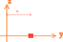

# Cell2D

2D Cell Section



## Background

`Cell2D` is the generic two-dimensional cell section, `Bar2D` is an alias of it and is normally used when the cell represents a reinforcing bar.
Each cell holds a given area, a one-dimensional material and a location along the transverse axis, with a single integration point at that location.
The strain in the cell is evaluated at its own eccentricity relative to the section reference axis and its contribution is assembled by a parent fibre section such as `Fibre2D`.
The linear density of the cell is its area times the material density.

## Syntax

```text title="Cell2D"
section Cell2D (1) (2) (3) [4]
# (1) int, unique section tag
# (2) double, area
# (3) int, material tag
# [4] double, eccentricity/location, default: 0.0
```

## Remarks

The fourth argument gives the location of the cell relative to the section reference axis, internally the sign is flipped and stored as eccentricity, see [Eccentricity](../Eccentricity.md) for the convention.
`Bar2D` is interchangeable with `Cell2D`, the names only indicate whether the cell is regarded as a reinforcing bar or a generic part of the section.

## Example

Two symmetric cells are combined with a concrete cell as follows, adapted from `Example/Section/Fibre2D.supan`.

```text
material ConcreteTsai 1 3E4 30. 2. 2. 2. .2 2E-3 1E-4
material MPF 2 2E5 400 .01
section Rectangle2D 2 300 500 1 9
section Cell2D 3 1200 2 230
section Cell2D 4 1200 2 -230
section Fibre2D 1 2 3 4
```
