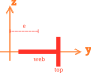

# TSection2D

2D T-Section



## Syntax

```text title="TSection2D"
section TSection2D (1) (2...5) (6) [7] [8]
# (1) int, unique tag
# (2...5) double, section dimensions
# (6) int, material tag
# [7] int, number of integration points, default: 6
# [8] double, eccentricity/location, default: 0.0
```

## Remarks

1. Section dimensions are:
   * `(2)` top flange height
   * `(3)` top flange thickness
   * `(4)` web width
   * `(5)` web thickness
2. The flange is at the top of the local coordinate system.

The eccentricity is measured from the centre of the web.
The default trivial eccentricity will lead to extra bending moments when the section is subjected to axial force since the section is not symmetric.
Eccentricity can be manually adjusted.

See [Eccentricity](../Eccentricity.md) for more details.

## Variants

The `TSection2DC` variant builds the same section but places its reference axis at the barycenter.

It is registered as `new_tsection2d<true>`, which computes the eccentricity from the section dimensions instead of reading it from the command.

This removes the default zero eccentricity that would otherwise introduce extra bending moments under axial force since the section is not symmetric.

The integration point argument is still accepted, but any user-supplied eccentricity is ignored.

See [Eccentricity](../Eccentricity.md) for more details.
