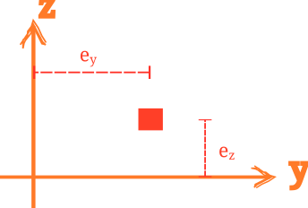

# Bar3D

3D Reinforcing Bar Section



## Background

`Bar3D` is an alias of `Cell3D`, both names are parsed into the same section class and behave identically.
Each instance represents one reinforcing bar (or any small cell) with a given area, a one-dimensional material and a location in the section plane defined by two eccentricities.
It stores one integration point, so the strain in the bar is evaluated at its own location relative to the section reference axis and its contribution is assembled by a parent fibre section such as `Fibre3D`.
The linear density of the bar is its area times the material density.

## Syntax

```text title="Bar3D"
section Bar3D (1) (2) (3) [4] [5]
# (1) int, unique section tag
# (2) double, area
# (3) int, material tag
# [4] double, eccentricity along y axis, default: 0.0
# [5] double, eccentricity along z axis, default: 0.0
```

## Remarks

The fourth and fifth arguments give the location of the bar along the local y and z axes relative to the section reference point, internally the signs are flipped and stored as eccentricity, see [Eccentricity](../Eccentricity.md) for the convention.
Both are optional and default to zero, which places the bar at the section origin.
`Cell3D` is interchangeable with `Bar3D`, the names only indicate whether the cell is regarded as a reinforcing bar or a generic part of the section.

## Example

A `Bar3D` reinforcement is combined with a `Rectangle3D` cell as follows, adapted from `Example/Element/F31.supan`.

```text
material MPF 1 1E2 2E-1 .05
section Rectangle3D 2 12 1 1
section Bar3D 3 100 1
section Fibre3D 1 2 3
element F31 1 1 2 1 1
```
