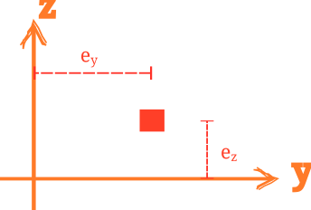

# Cell3D

3D Cell Section



## Background

`Cell3D` is the generic three-dimensional cell section, `Bar3D` is an alias of it and is normally used when the cell represents a reinforcing bar.
Each cell holds a given area, a one-dimensional material and a location in the section plane defined by two eccentricities, with a single integration point at that location.
The strain in the cell is evaluated at its own location relative to the section reference axis and its contribution is assembled by a parent fibre section such as `Fibre3D`.
The linear density of the cell is its area times the material density.

## Syntax

```text title="Cell3D"
section Cell3D (1) (2) (3) [4] [5]
# (1) int, unique section tag
# (2) double, area
# (3) int, material tag
# [4] double, eccentricity along y axis, default: 0.0
# [5] double, eccentricity along z axis, default: 0.0
```

## Remarks

The fourth and fifth arguments give the location of the cell along the local y and z axes relative to the section reference point, internally the signs are flipped and stored as eccentricity, see [Eccentricity](../Eccentricity.md) for the convention.
Both are optional and default to zero, which places the cell at the section origin.
`Bar3D` is interchangeable with `Cell3D`, the names only indicate whether the cell is regarded as a reinforcing bar or a generic part of the section.

## Example

A `Cell3D` is combined with a `Rectangle3D` cell as follows, adapted from `Example/Element/F31.supan`.

```text
material MPF 1 1E2 2E-1 .05
section Rectangle3D 2 12 1 1
section Cell3D 3 100 1
section Fibre3D 1 2 3
element F31 1 1 2 1 1
```
