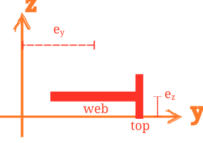

# TSection3D

3D T-Section



## Syntax

```text title="TSection3D"
section TSection3D (1) (2) (3) (4) (5) (6) [7] [8] [9]
# (1) int, unique section tag
# (2) double, top flange width
# (3) double, top flange thickness
# (4) double, web height
# (5) double, web thickness
# (6) int, material tag
# [7] int, number of integration points, default: 6
# [8] double, eccentricity along y axis, default: 0.0
# [9] double, eccentricity along z axis, default: 0.0
```

## Remarks

1. The flange/web is assumed to be slender.
   Thus, only one integration point is assigned across the thickness.
   The web, top flange and bottom flange share the same number of integration points over the height/width no matter how wide/tall the section is.

See [Eccentricity](../Eccentricity.md) for more details.

## Variants

The `TSection3DC` variant builds the same section but places its reference axis at the barycenter.

It is registered as `new_tsection3d<true>`, which computes the eccentricity along the y axis from the section dimensions instead of reading the eccentricity arguments from the command.

This removes the default zero eccentricity that would otherwise introduce extra bending moments under axial force since the section is not symmetric.

The integration point argument is still accepted, but any user-supplied eccentricity is ignored.

See [Eccentricity](../Eccentricity.md) for more details.
